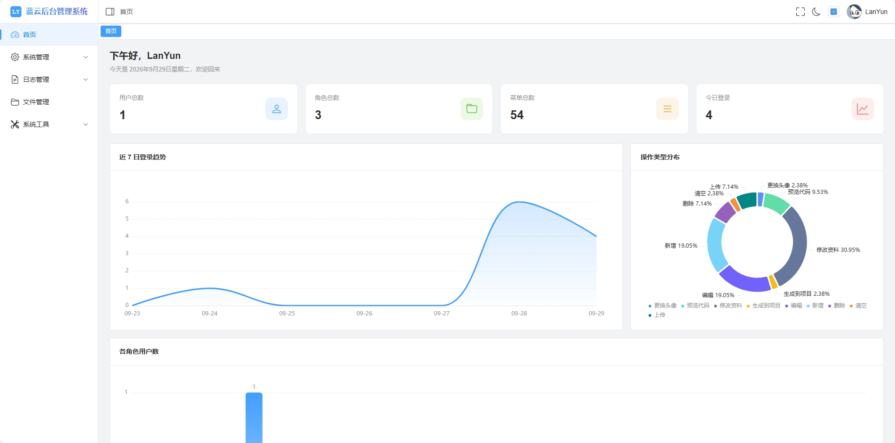
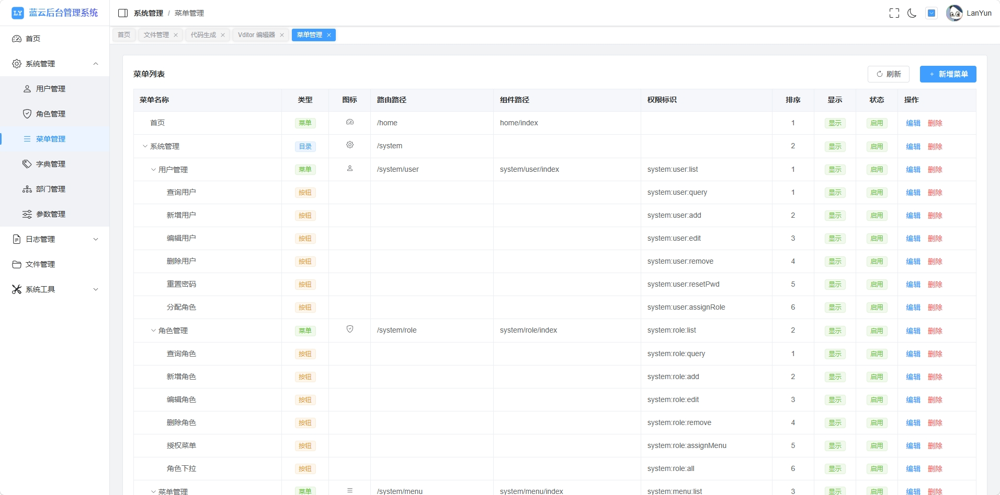
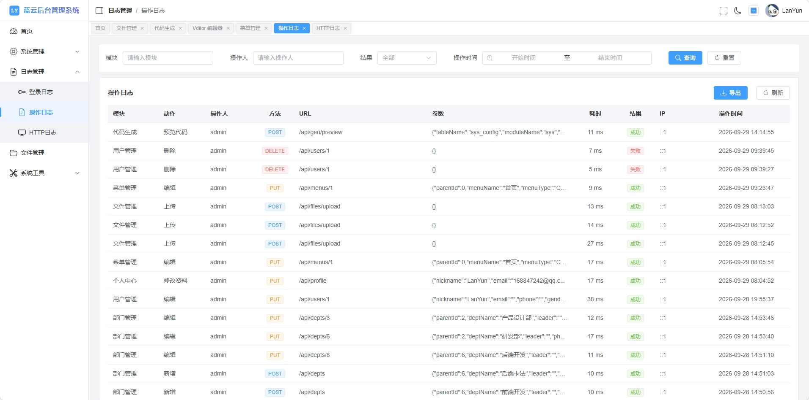
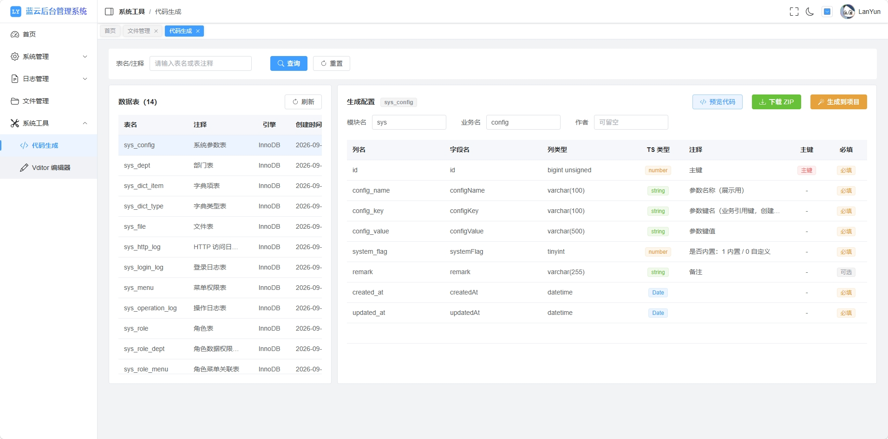
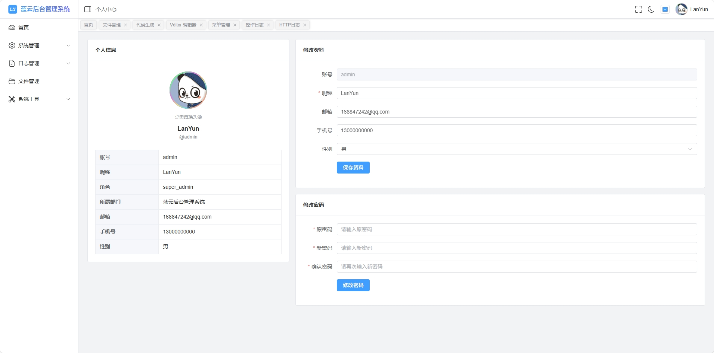

<p align="center">
  
</p>

<p align="center"><em>开箱即用的通用后台管理基座</em></p>

> 一套开箱即用的通用后台管理基座：JWT 双 Token 鉴权、RBAC + 数据权限、系统管理（用户 / 角色 / 菜单 / 部门 / 字典 / 参数）、三类日志、文件管理、通知中心、在线用户与系统监控（CPU / 内存 / 磁盘 / 网络吞吐）、代码生成器、ECharts 仪表盘与中英双语。前后端 TypeScript 全覆盖，遵循严格分层与统一工程规范。

<p align="center">
  
  
  
  
  
  
  
  
  
  
</p>

## 目录

- [项目简介](#项目简介)
- [关于本项目](#关于本项目)
- [界面预览](#界面预览)
- [功能特性](#功能特性)
- [技术栈](#技术栈)
- [目录结构](#目录结构)
- [快速开始](#快速开始)
- [默认账号](#默认账号)
- [可用脚本](#可用脚本)
- [环境变量](#环境变量)
- [部署](#部署)
- [接口约定](#接口约定)
- [贡献指南](#贡献指南)
- [常见问题](#常见问题)
- [许可](#许可)

---

## 项目简介

LYAdmin 面向企业内部运营 / 管理场景，提供一套可直接二次开发的中后台起点。它把「企业后台常见但每次都重复造」的能力沉淀为开箱可用的垂直切片：鉴权、权限、系统管理、日志、文件、代码生成、仪表盘。

设计取向：

- **前后端分离 + 严格分层**：后端 `module → controller → service`，数据访问统一走 `PrismaService`，业务层不直接拼 SQL；前端按 `views / api / store / components` 组织。
- **约定优先**：统一响应体、统一分页、统一错误码、菜单驱动动态路由、按钮级权限指令。
- **零魔法密钥**：JWT 密钥等敏感配置**无默认值**，缺失将拒绝启动，避免「默认口令」事故。
- **响应式优先**：窄屏（移动端）适配是默认要求，固定尺寸弹层一律走响应式封装。

## 关于本项目

本项目**完全由 AI 开发**：从需求梳理、系统设计、前后端编码到测试与文档，均在人工把关下由 AI 完成；仓库内的架构文档、代码规范与提交历史即这一过程的产物。

- 全程遵循统一的工程质量门禁（ESLint / Prettier / Stylelint / 类型检查 / 依赖基线守卫），提交前须全绿。
- 请以审阅 AI 生成代码的心态使用本仓库——欢迎通过 Issue / PR 指出问题与可改进之处。

## 界面预览



| 菜单管理                                      | 操作日志                                    |
| --------------------------------------------- | ------------------------------------------- |
|  |  |

| 代码生成                                     | 个人中心                              |
| -------------------------------------------- | ------------------------------------- |
|  |  |

## 功能特性

| 模块            | 能力                                                                                                                                                                                                                             |
| --------------- | -------------------------------------------------------------------------------------------------------------------------------------------------------------------------------------------------------------------------------- |
| 登录鉴权        | 账号密码登录、图形验证码、JWT 双 Token（access 2h / refresh 7d）、无感刷新、登出即时失效（Redis 黑名单）、登录频率限制、账号禁用强制下线                                                                                         |
| 权限管理        | RBAC 三段式（用户—角色—菜单）+ **数据权限**（数据范围：全部 / 自定义部门 / 本部门及以下 / 仅本人）；菜单树 → 动态路由；按钮级 `v-permission`                                                                                     |
| 用户管理        | 分页查询、增删改、启用 / 禁用、重置密码、分配角色、头像上传、部门归属                                                                                                                                                            |
| 角色管理        | 角色 CRUD、菜单授权（权限树勾选）、数据范围设置、编码唯一校验                                                                                                                                                                    |
| 菜单管理        | 树形表格 CRUD、目录 / 菜单 / 按钮三类、图标选择、排序、显隐、路由与组件路径、权限标识                                                                                                                                            |
| 部门管理        | 组织树 CRUD、上级部门选择、防成环校验、删除保护                                                                                                                                                                                  |
| 字典管理        | 字典类型 + 字典项两表；类型编码创建后不可改；内置字典保护；业务侧 `useDict` 缓存取数                                                                                                                                             |
| 参数管理        | 单值可调的系统参数；键名创建后不可改；内置参数禁删                                                                                                                                                                               |
| 日志管理        | 登录日志 / 操作日志 / HTTP 访问日志；条件筛选 + 导出 + 单条 / 多选删除；自动归档 + 按保留天数清理                                                                                                                                |
| 文件管理        | 多文件上传、哈希秒传预检、按扩展名分目录存储、类型 / 大小白名单、列表多条件筛选、下载、删除、静态访问（鉴权 + 防盗链 + 图片按需缩放）                                                                                            |
| 代码生成        | 读取数据表结构 → 预览 → 生成前后端 CRUD 骨架（下载 ZIP 或写入项目目录，含 Prisma model 与 NestJS 模块接线）                                                                                                                      |
| 接口文档        | `GET /api/docs` 扫描控制器自动生成接口清单（方法 / 路径 / 权限码 / 说明）；前端「接口文档」页按模块检索浏览                                                                                                                      |
| 通知中心        | 站内通知：导航栏未读数、列表查询、标记已读 / 全部已读；按接收人隔离                                                                                                                                                              |
| 在线用户        | 在线会话列表（按 sid 去重，刷新令牌不会翻倍）、强制下线（写入 Redis 黑名单，旧令牌立即失效）                                                                                                                                     |
| 系统监控        | CPU（整体 / 分核，cgroup 配额感知）、内存、磁盘、系统负载、进程；**网络活动**（上下行速率、累计流量、错误 / 丢包）。网络口径：Linux 读 `/proc/net/dev`（与采样同频 3s），Windows 走网卡统计（15s，因需起子进程），均排除环回网卡 |
| 仪表盘          | 统计卡片、近 7 日登录趋势、操作类型分布、各角色用户数（ECharts）                                                                                                                                                                 |
| 个人中心        | 修改资料、修改密码（旧密码校验）、更换头像                                                                                                                                                                                       |
| 多语言          | vue-i18n 中 / 英 双语，导航栏切换；语言包 key 由 `npm run guard:locale` 门禁对齐（缺 key / 占位符不一致直接拦截）                                                                                                                |
| Markdown 编辑器 | 内置 Vditor（懒加载、资源自托管、随主题切换亮 / 暗）                                                                                                                                                                             |
| 布局与体验      | 侧边栏折叠、面包屑、标签页（tagsView）、keep-alive、暗黑模式、移动端响应式、403 / 404 / 500 错误页                                                                                                                               |

## 技术栈

| 层             | 技术                                                                                                                                                                   |
| -------------- | ---------------------------------------------------------------------------------------------------------------------------------------------------------------------- |
| 前端框架       | Vue 3.5 + Vue Router 5 + Pinia 4（`pinia-plugin-persistedstate`）                                                                                                      |
| 前端 UI / 生态 | Element Plus 2.14 + Tailwind CSS 4.3 + `bootstrap-icons` + ECharts 6 + Vditor 4 + axios + dayjs + vue-i18n 11 + `@vueuse/core` + `lodash-es` + nprogress               |
| 前端工程       | Vite 8 + TypeScript 5.9 + vue-tsc；`unplugin-auto-import` + `unplugin-vue-components` 按需引入；`vite-plugin-compression2` 构建期 gzip / brotli 压缩                   |
| 后端框架       | NestJS 12 + TypeScript（纯 ESM，Express 5 适配层）                                                                                                                     |
| 后端数据层     | Prisma 7 + `@prisma/adapter-mariadb`（driver adapter 提供运行期连接；CLI 连接串见 `prisma.config.ts`）                                                                 |
| 后端能力       | jose（JWT）+ @node-rs/bcrypt（口令）+ class-validator / class-transformer（校验）+ multer（上传）+ sharp（图片处理）+ redis（官方 node-redis：验证码 / 黑名单 / 限流） |
| 数据库 / 缓存  | MySQL 8.x（库 `ly_admin`，utf8mb4）；Redis（可选，留空 `REDIS_HOST` 即降级：验证码跨实例共享、黑名单、限流失效）                                                       |
| 工程规范       | ESLint 10 + oxlint 1.88（后端）+ Prettier 3.9 + Stylelint 17 + husky 9 + lint-staged 17 + commitlint 21 + cz-git                                                       |

> 代码规范由 ESLint / oxlint / Prettier / Stylelint 统一约束，提交信息由 commitlint 校验，均由 husky 钩子在提交前自动拦截。

## 目录结构

```
ly-admin/
├─ ly-admin-web/              # 前端工程（Vue3 + Vite + Element Plus）
├─ ly-admin-api/              # 后端工程（NestJS 12 + Prisma 7）
│  ├─ web/                    # 前端构建产物映射目录（同源部署时由后端托管，产物不入库）
│  ├─ uploads/                # 上传文件目录（内容不入库）
│  ├─ cache/                  # 图片处理缓存（运行时产物，不入库）
│  └─ logs/                   # 日志文件目录
├─ .husky/                    # Git Hooks（pre-commit / commit-msg / pre-push）
├─ scripts/                   # 工程门禁脚本：deps-guard（依赖基线）/ check-tracked-imports（相对导入可解析）/ check-locale-keys（语言包 key 一致）
├─ package.json               # 根脚本：lint / format / commit / dev（并行启动）
├─ eslint.config.mjs          # ESLint flat config（覆盖 ly-admin-web + ly-admin-api）
├─ .prettierrc.json           # Prettier 规则
├─ .stylelintrc.json          # Stylelint 规则
├─ commitlint.config.cjs      # 约定式提交校验规则
├─ .czrc                      # cz-git 交互式提交配置
├─ lint-staged.config.cjs     # 暂存区分派 lint / format
├─ LICENSE                    # MIT
└─ README.md
```

**前端 `ly-admin-web/src`**

```
ly-admin-web/src/
├─ api/          # axios 实例(request.ts) + 各模块接口(auth/user/role/menu/dept/dict/config/log/file/gen/dashboard/profile/docs/notice/monitor)
├─ assets/       # 静态资源
├─ components/   # 通用组件：BasicDialog / ColumnSettings / ErrorPage / IconPicker / MenuTree / Pagination / SearchForm / VditorEditor
├─ directives/   # v-permission 按钮权限指令及注册
├─ composables/  # 组合式复用逻辑（useTable / useTheme / useResponsiveSize / useDict）
├─ layout/       # 主布局（AppMain / Navbar / Sidebar / TagsView）
├─ locales/      # 语言包（zh-CN / en-US，key 由 guard:locale 校验）
├─ router/       # 路由实例 / 静态路由表 / 全局守卫
├─ store/        # Pinia（user / permission / app / tagsView / notice）
├─ styles/       # index.css（Tailwind v4 入口 + @theme 令牌）/ element.scss（EP 覆盖）
├─ types/        # 全局类型 / 接口 DTO / 路由 meta
├─ utils/        # auth / format / permission / validate / echarts(按需注册) / chartTheme(图表配色与约定) / element(命令式 API 桶) 等
├─ views/        # 页面：home / login / system（user、role、menu、dept、dict、config、notice）/ monitor（online、server）/ log / files / profile / tool / docs / redirect
├─ App.vue       # 根组件
└─ main.ts       # 入口：样式引入顺序、注册 Pinia/Router/指令
```

**后端 `ly-admin-api/`**

```
ly-admin-api/
├─ prisma/
│  ├─ schema/                 # 数据模型（目录式 schema，按域拆分；/// 是库内 COMMENT 的唯一来源）
│  │  ├─ base.prisma          #   公共约定 + generator + datasource
│  │  ├─ dict-config.prisma   #   字典类型 / 字典项 / 系统参数
│  │  ├─ file.prisma          #   文件管理
│  │  ├─ generated.prisma     #   代码生成器注入区（[GEN-ANCHOR]，勿手工放业务模型）
│  │  ├─ log.prisma           #   登录 / 操作 / HTTP 访问日志
│  │  └─ system.prisma        #   用户 / 角色 / 菜单 / 部门 + 三张关联表
│  └─ seed.ts                 # CLI 种子（npm run seed）
├─ scripts/
│  ├─ prisma-comments.ts      # 把 schema 的 /// 同步为数据库表/字段 COMMENT
│  ├─ gen-api-docs.mjs        # 扫描控制器生成接口文档数据（docs:gen / build 的 prebuild）
│  └─ update-ip2region.ts     # 下载 / 校验 / 原子替换 IP 归属地数据文件
├─ src/
│  ├─ common/                 # 公共层（按职责分组）：config 配置常量 / utils 工具 / exception 异常 /
│  │                          #   http 适配与响应 / auth 鉴权体系 / log 日志 / file 文件 / ip 归属地 / redis
│  ├─ modules/                # 业务模块（各含 module / controller / service / dto）：
│  │                          #   auth / menu / users / roles / depts / dict / config /
│  │                          #   dashboard / gen / files / profile / logs / notice / monitor / docs / health
│  ├─ prisma/                 # PrismaModule / PrismaService（driver adapter）/ seed.service（启动即幂等种子）
│  ├─ generated/              # Prisma Client 生成产物（提交入库，勿手改）
│  ├─ app.module.ts           # 根模块（全局守卫 / 拦截器 / 过滤器装配）
│  └─ main.ts                 # 入口（响应适配器、全局管道、静态资源托管）
├─ test/                      # vitest 单测（13 个 spec）+ e2e（冒烟 / 契约快照，需本地 MySQL）
├─ prisma.config.ts           # Prisma CLI 的连接串与 schema 路径
└─ package.json
```

## 快速开始

### 环境要求

| 项      | 要求                                                     |
| ------- | -------------------------------------------------------- |
| Node.js | >= 24.0.0（验证于 v24.x）                                |
| npm     | >= 10                                                    |
| MySQL   | 8.x 运行中，需提前创建数据库 `ly_admin`（utf8mb4）       |
| Redis   | 可选。用于验证码共享、登出黑名单与登录限流；未配置时降级 |

### 1. 准备数据库

```sql
CREATE DATABASE IF NOT EXISTS `ly_admin`
  DEFAULT CHARACTER SET utf8mb4
  DEFAULT COLLATE utf8mb4_general_ci;
```

> 表结构由 Prisma 管理：Prisma 7 不提供运行时 DDL，首次需执行一次 `npm run prisma:push` 建表；
> 种子数据在每次服务启动时**幂等**执行，也可用 `npm run seed` 手动执行。

### 2. 安装依赖

根依赖（工程规范工具 + husky 钩子）**务必先装**：

```bash
npm install                        # 根目录
cd ly-admin-api && npm install     # 后端（NestJS 12 + Prisma 7）
cd ../ly-admin-web && npm install  # 前端（Vue 3 + Vite）
```

### 3. 配置环境变量

```bash
cd ly-admin-api
cp .env.example .env
```

至少需要改两处：

- `DB_*`：数据库连接信息。
- `JWT_ACCESS_SECRET` / `JWT_REFRESH_SECRET`：**必填且必须互不相同**，缺失或为空将拒绝启动。生成方式：

```bash
node -e "console.log(require('crypto').randomBytes(32).toString('hex'))"
```

完整变量清单见 [环境变量](#环境变量)。

### 4. 同步表结构并写入种子数据

```bash
cd ly-admin-api
npm run prisma:push       # 建表 / 同步表结构（首次必执行；Prisma 7 启动时不自动建表）
npm run prisma:comments   # 把 schema 里的 /// 文档注释同步为表/字段 COMMENT（幂等）
npm run seed              # 写入默认数据（可选：服务启动时也会自动幂等执行）
```

> Prisma 不会把 schema 的 `///` 注释写进数据库（`db push` 不写、`db pull` 也读不回），
> 表/字段 COMMENT 由 `npm run prisma:comments` 负责落库——它从 `prisma/schema/` 下各文件的 `///` 生成 DDL，
> 幂等可重复执行，改完注释或同步完表结构跑一次即可。用 `npm run prisma:comments:check` 可检查
> 库内注释是否漂移（有差异时退出码 1，可用于 CI）。这些注释是运维与代码生成器的数据源。

### 5. 启动

```bash
# 根目录：有序启动前后端（后端 :3000，前端 :5173）
npm run dev
```

`npm run dev` 由 `scripts/dev.mjs` 编排（零第三方依赖），**保证前端一定在后端就绪之后才启动**：

1. 先探 `GET /api/health/live`——已有后端在跑就直接复用，只起前端（顺带避开端口占用报错）；
2. 否则拉起 `nest start --watch`，轮询健康检查直到 200（进程已监听、路由已挂载）才继续；
3. 前端 vite 端口是 `strictPort`，被占用必失败，故动工前先查，报错直接带 PID；
4. 任一子进程退出即整棵进程树回收；Ctrl+C 干净退出，复用的后端不会被误杀。

```bash
npm run dev -- --fresh   # 忽略已在运行的后端，强制新起一个
```

或分别启动：

```bash
npm run dev:api    # 后端 http://localhost:3000（等价 cd ly-admin-api && npm run start:dev）
npm run dev:web   # 前端 http://localhost:5173（等价 cd ly-admin-web && npm run dev）
```

启动后可访问：

- 前端页面：<http://localhost:5173>
- 健康检查（探针）：`GET http://localhost:3000/api/health/live`（只证明进程可响应）、
  `GET http://localhost:3000/api/health/ready`（探测 MySQL / Redis，MySQL 不可用返回 503）
- 根探活：`GET http://localhost:3000/api`（返回服务名、状态、版本、uptime）

> 前端 dev server 通过 Vite 代理把 `/api`、`/static` 转发到 `http://localhost:3000`，开发期同源、无跨域。

## 默认账号

| 账号    | 密码     | 角色                        |
| ------- | -------- | --------------------------- |
| `admin` | `123456` | 超级管理员（`super_admin`） |

首次启动会自动写入上述超管账号、默认角色与完整菜单树。

> **安全提示**：默认凭据仅用于本地初始登录。部署后请立即修改密码，并避免在公网环境使用默认口令。

## 可用脚本

### 根目录

| 命令                        | 说明                                                       |
| --------------------------- | ---------------------------------------------------------- |
| `npm run dev`               | 有序启动前后端（后端就绪后才起前端，见 `scripts/dev.mjs`） |
| `npm run dev:api`           | 仅启动后端                                                 |
| `npm run dev:web`           | 仅启动前端                                                 |
| `npm run lint`              | 全仓 ESLint 检查（`--max-warnings 0`）                     |
| `npm run lint:fix`          | 全仓 ESLint 自动修复                                       |
| `npm run format`            | 全仓 Prettier 格式化                                       |
| `npm run format:check`      | 全仓 Prettier 格式校验（不写文件）                         |
| `npm run stylelint`         | 全仓 Stylelint 检查                                        |
| `npm run stylelint:fix`     | 全仓 Stylelint 自动修复                                    |
| `npm run guard:deps`        | 校验三处 `package.json` 的运行时依赖与基线一致             |
| `npm run guard:deps:update` | 依赖基线有变更时，先生成新基线再提交                       |
| `npm run guard:imports`     | 校验已入库文件的相对导入可解析（干净克隆可构建）           |
| `npm run guard:locale`      | 校验 zh-CN / en-US 语言包 key 与占位符一致                 |
| `npm run commit`            | cz-git 交互式生成规范提交                                  |
| `npm run prepare`           | 装配 husky 钩子（`npm install` 后自动执行）                |

### 前端 `ly-admin-web/`

| 命令                 | 说明                             |
| -------------------- | -------------------------------- |
| `npm run dev`        | Vite 开发服务（:5173）           |
| `npm run build`      | 类型检查 + 生产构建              |
| `npm run build:only` | 跳过类型检查，直接构建           |
| `npm run preview`    | 本地预览构建产物                 |
| `npm run type-check` | 仅类型检查（`vue-tsc --noEmit`） |

### 后端 `ly-admin-api/`

| 命令                            | 说明                                                       |
| ------------------------------- | ---------------------------------------------------------- |
| `npm run start:dev`             | Nest watch 模式热重载（:3000）                             |
| `npm run start:debug`           | 同样的 watch 模式，附带 Node 调试端口                      |
| `npm run build`                 | 编译到 `dist/`                                             |
| `npm run start:prod`            | 运行编译产物 `node dist/main`                              |
| `npm run migrate:dev`           | 生成并应用迁移（开发环境，产出的 SQL 需入库）              |
| `npm run migrate:deploy`        | 应用已有迁移（生产 / 容器）                                |
| `npm run migrate:status`        | 查看迁移状态                                               |
| `npm run prisma:push`           | 建表 / 同步表结构（首次必执行）                            |
| `npm run prisma:comments`       | 把 schema 的 `///` 同步为库内表 / 字段 COMMENT             |
| `npm run prisma:comments:check` | 检查库内注释是否漂移（有差异退出码 1）                     |
| `npm run prisma:generate`       | 重新生成 Prisma Client                                     |
| `npm run prisma:studio`         | 启动 Prisma Studio 可视化                                  |
| `npm run docs:gen`              | 扫描控制器重新生成接口文档（`build` 的 prebuild 自动执行） |
| `npm run ip2region:update`      | 下载 / 更新 IP 归属地数据文件（约 10MB，不入库）           |
| `npm run seed`                  | 单独执行种子数据（幂等）                                   |
| `npm run typecheck`             | 仅类型检查（`tsc --noEmit`）                               |
| `npm run lint`                  | oxlint（type-aware）                                       |
| `npm run test`                  | vitest 单元测试                                            |
| `npm run test:e2e`              | vitest e2e 契约测试（需本地 MySQL；CI 与提交前建议跑）     |

## 环境变量

> **单一事实源**：模板以 `ly-admin-api/.env.example` 为准，逐项说明见
> [后端开发规范/03-环境与配置](./knowledge/后端开发规范/03-环境与配置.md)。
> 下表是「必填 + 高频」清单，新增变量请同步这三处（本表曾因三份清单并存而漂移）。

### 后端 `ly-admin-api/.env`

| 变量                                | 示例值                  | 说明                                                                                                                                 |
| ----------------------------------- | ----------------------- | ------------------------------------------------------------------------------------------------------------------------------------ |
| `NODE_ENV`                          | `development`           | 运行环境                                                                                                                             |
| `PORT`                              | `3000`                  | 后端端口                                                                                                                             |
| `DB_HOST` / `DB_PORT`               | `localhost` / `3306`    | MySQL 主机 / 端口                                                                                                                    |
| `DB_NAME` / `DB_USER`               | `ly_admin` / `root`     | 数据库名 / 账号                                                                                                                      |
| `DB_PASSWORD`                       | `your_password`         | 数据库密码（改成实际值）                                                                                                             |
| `DATABASE_URL`                      | `mysql://…`             | 可选。Prisma CLI 用的完整连接串（优先于 `DB_*` 拼装）                                                                                |
| `DB_LOGGING`                        | `true`                  | 是否订阅 Prisma 查询事件（慢 SQL 日志 `db-*.log`）                                                                                   |
| `DB_CONNECTION_LIMIT`               | `10`                    | 数据库连接池上限（1~100）                                                                                                            |
| `JWT_ACCESS_SECRET`                 | `<32 字节随机 hex>`     | accessToken 密钥（**必填**，无默认值）                                                                                               |
| `JWT_REFRESH_SECRET`                | `<32 字节随机 hex>`     | refreshToken 密钥（**必填**，须与上方不同）                                                                                          |
| `JWT_ACCESS_EXPIRES_IN`             | `2h`                    | accessToken 有效期                                                                                                                   |
| `JWT_REFRESH_EXPIRES_IN`            | `7d`                    | refreshToken 有效期                                                                                                                  |
| `SEED_ADMIN_PASSWORD`               | 空                      | 超管初始口令；留空用开发默认弱口令（production 打 warn 提示）                                                                        |
| `CAPTCHA_ENABLED`                   | `true`                  | 是否启用登录图形验证码                                                                                                               |
| `CAPTCHA_TTL_MS` / `CAPTCHA_LENGTH` | `300000` / `4`          | 验证码有效期（ms）/ 字符数                                                                                                           |
| `TRUST_PROXY`                       | `1`                     | 反向代理信任跳数（仅部署在代理后设置）                                                                                               |
| `UPLOAD_DIR`                        | `uploads`               | 上传根目录（相对 `ly-admin-api/`）                                                                                                   |
| `UPLOAD_MAX_SIZE`                   | `10485760`              | 单文件上限（字节，10MB）                                                                                                             |
| `UPLOAD_MAX_COUNT`                  | `10`                    | 单次最多文件数                                                                                                                       |
| `UPLOAD_USER_QUOTA_MB`              | `512`                   | 单用户累计上传配额（MB），`0` = 不限                                                                                                 |
| `UPLOAD_CACHE_DIR`                  | `cache/images`          | 图片缩放缓存目录（须位于 `UPLOAD_DIR` 之外）                                                                                         |
| `UPLOAD_ALLOWED_REFERERS`           | `http://localhost:5173` | 防盗链 Referer 白名单（逗号分隔；同源部署无需配置）                                                                                  |
| `CORS_ORIGIN`                       | `http://localhost:5173` | 允许的跨域来源                                                                                                                       |
| `LOG_DIR`                           | `logs`                  | 日志目录                                                                                                                             |
| `LOG_ARCHIVE_DIR`                   | `logs/archive`          | 归档根目录（默认 `<LOG_DIR>/archive`）                                                                                               |
| `LOG_ARCHIVE_HOUR/MINUTE`           | `0` / `5`               | 日志归档时刻（本地时间）                                                                                                             |
| `LOG_ARCHIVE_KEEP_SOURCE`           | `false`                 | 归档后是否保留源 `.log`                                                                                                              |
| `LOG_SLOW_SQL_MS`                   | `200`                   | 慢 SQL 阈值（ms）                                                                                                                    |
| `LOG_HTTP_RETENTION_DAYS`           | `7`                     | HTTP 访问日志保留天数                                                                                                                |
| `LOG_OPERATION_RETENTION_DAYS`      | `180`                   | 操作日志保留天数                                                                                                                     |
| `LOG_LOGIN_RETENTION_DAYS`          | `180`                   | 登录日志保留天数                                                                                                                     |
| `LOG_RETENTION_HOUR/MINUTE`         | `0` / `10`              | 保留清理触发时刻                                                                                                                     |
| `LOG_RETENTION_ENABLED`             | `true`                  | 是否启用日志保留清理                                                                                                                 |
| `TAR_BIN`                           | `tar`                   | 自定义 tar 可执行文件（默认取 PATH）                                                                                                 |
| `IP2REGION_DB_PATH`                 | `data/ip2region_v4.xdb` | IP 归属地离线库路径（文件缺失时静默降级为空串）                                                                                      |
| `REDIS_HOST` / `REDIS_PORT`         | `127.0.0.1` / `6379`    | Redis 地址（留空 `REDIS_HOST` 即视为不启用）                                                                                         |
| `REDIS_PASSWORD` / `REDIS_DB`       | 空 / `0`                | Redis 密码 / 库号                                                                                                                    |
| `WEB_DIST_DIR`                      | `web`                   | 前端产物托管目录（相对 `ly-admin-api/`；不存在则跳过托管）                                                                           |
| `SECURITY_HSTS`                     | 跟随 production         | 是否下发 HSTS 头（默认 `NODE_ENV=production` 时开启）                                                                                |
| `CSP_POLICY`                        | 空                      | Content-Security-Policy 内容；留空不下发（SPA 需按实际配置）                                                                         |
| `APP_VERSION` / `GIT_COMMIT`        | `dev` / 空              | 版本与提交号，出现在 `/api` 与 `/api/health/live` 响应里                                                                             |
| `NET_DEV_PATH`                      | 空                      | 网卡计数文件路径覆盖（默认 Linux 读 `/proc/net/dev`）。用于非 Linux 集成测试，或容器使用 host 网络命名空间时指向挂载进来的宿主机文件 |

### 前端 `ly-admin-web/.env.development` / `.env.production`

| 变量                   | 示例值             | 说明                              |
| ---------------------- | ------------------ | --------------------------------- |
| `VITE_APP_TITLE`       | `蓝云后台管理系统` | 站点标题                          |
| `VITE_API_BASE_URL`    | `/api`             | axios baseURL（走代理 / 同源）    |
| `VITE_UPLOAD_BASE_URL` | `/static`          | 静态资源前缀                      |
| `VITE_PORT`            | `5173`             | dev server 端口（仅 development） |

## 部署

### 方式一：同源部署（推荐）

前端产物直接构建进后端目录，由后端一并托管：

```bash
cd ly-admin-web
# 产物必须落在 ly-admin-api/web/：后端按 path.resolve(ROOT_DIR, 'web') 读取（ROOT_DIR 即 ly-admin-api/），
# 写到仓库根 web/ 会导致后端找不到产物、跳过静态托管。
npm run build:only -- --outDir ../ly-admin-api/web --emptyOutDir

cd ../ly-admin-api
npm run build
NODE_ENV=production node dist/main.js
```

- 后端启动时若 `web/` 存在，会自动托管该目录，并对前端 history 路由做 `index.html` 回退。
- 产物目录可用 `WEB_DIST_DIR` 覆盖（相对 `ly-admin-api/`）。
- 同源部署下静态资源的防盗链「同源放行」天然成立，无需配置 `UPLOAD_ALLOWED_REFERERS`。
- 后端已内置响应压缩与静态缓存：构建产物优先返回 `.br` / `.gz`（1 年 immutable），上传文件缓存 30 天，`index.html` 每次校验；无需再为预压缩单独配置 Nginx。

### 方式二：前后端分离部署

- 前端产物部署到任意静态服务器 / Nginx。
- 后端配置：`CORS_ORIGIN` 填前端地址；`UPLOAD_ALLOWED_REFERERS` 填前端 origin（否则 `/static` 静态资源会被判为外链 403）。
- 前端 `VITE_API_BASE_URL` 指向后端地址（或由网关统一前缀）。

> 生产环境建议将 `NODE_ENV=production`，并通过进程管理器（systemd / pm2 / 容器）托管；`UPLOAD_DIR`、`LOG_DIR`、`cache` 目录需保证可写与持久化。
> 首次部署记得执行 `npm run prisma:push` 与 `npm run prisma:comments`（Prisma 7 不在启动时建表）。

## 接口约定

- **统一响应体**：成功 `{ "code": 200, "message": "success", "data": <T> }`；失败 `{ "code": <业务码>, "message": "<描述>", "data": null }`。
- **分页**：请求 `{ page, pageSize }`；响应 `data = { list, total, page, pageSize }`。
- **错误码**（节选）：`400` 参数校验失败 · `401` 未认证 / 账密错误 / 账号禁用 · `403` 无权限 · `404` 资源不存在 · `409` 数据冲突 · `500` 服务器错误。
- **鉴权**：除登录 / 刷新令牌 / 验证码等公开接口外，均需在请求头携带 `Authorization: Bearer <accessToken>`。
- **静态资源**：`GET /static/:filename`（启用防盗链与图片按需缩放）。

接口清单以代码为准：后端各模块的 `src/modules/*/*.controller.ts`，前端调用见 `ly-admin-web/src/api/*.ts`。

在线接口文档：`GET /api/docs` 返回结构化接口清单（公开接口），前端「接口文档」页可视化检索浏览。
清单由控制器源码自动生成（详见 [后端开发规范/14-接口文档](./knowledge/后端开发规范/14-接口文档.md)）。

## 贡献指南

欢迎提交 Issue 与 Pull Request。

1. **环境**：按[快速开始](#快速开始)拉起项目；根目录 `npm install` 以装配 husky 钩子。
2. **分支**：从 `main` 切出特性分支（命名 `feature/*` / `fix/*` / `hotfix/*`）。
3. **编码**：遵循 [前端开发规范](./knowledge/前端开发规范/00-导读.md)、[后端开发规范](./knowledge/后端开发规范/00-导读.md) 与 [Git 提交规范](./knowledge/Git提交规范/00-导读.md)；提交信息使用 Conventional Commits（`npm run commit` 可交互生成）。
4. **提交前自检**（务必全绿）：

   ```bash
   npm run format:check      # Prettier
   npm run lint              # ESLint（--max-warnings 0）
   npm run stylelint         # Stylelint
   npm run guard:deps        # 依赖基线
   npm run guard:locale      # 语言包 key / 占位符一致
   (cd ly-admin-api && npm run typecheck && npm run lint && npm run test && npm run test:e2e)
   (cd ly-admin-web && npm run type-check)
   ```

5. **PR**：说明背景与改动点，关联相关 Issue，并确保上述检查通过。
6. **推送**：本仓库是**双远端**（`origin` = Gitee，主远端；`github` = GitHub 镜像），
   用 `git pushall` 一次推两边；fetch / pull 只走 `origin`。细节见
   [Git 提交规范/02-分支与发布](./knowledge/Git提交规范/02-分支与发布.md)。

> 新增后端业务模块请遵循 NestJS 分层（module → controller → service → dto），数据访问统一走 `PrismaService`；
> 表结构变更改 `prisma/schema/` 下对应的模型文件（按域分文件，见 base.prisma 的「文件划分」）后，
> 依次执行 `npm run prisma:push` 与 `npm run prisma:comments`（后者把 `///` 同步为库内表/字段 COMMENT）。

## 常见问题

**Q1：端口被占用（3000 / 5173）？**
后端改 `ly-admin-api/.env` 的 `PORT`；前端改 `ly-admin-web/.env.development` 的 `VITE_PORT`（`vite.config.ts` 为 `strictPort: true`，端口占用会直接报错而非自动切换）；同时同步 `vite.config.ts` 中 proxy 的 `target` 端口。

**Q2：启动即报 JWT 相关错误？**
`JWT_ACCESS_SECRET` / `JWT_REFRESH_SECRET` 为**必填**且需互不相同。按[第 3 步](#3-配置环境变量)生成随机值填入 `ly-admin-api/.env`。

**Q3：数据库连不上（`ECONNREFUSED` / `Access denied` / `Unknown database`）？**
确认 MySQL 已启动、`ly_admin` 库已创建；核对 `ly-admin-api/.env` 的 `DB_*`（或 `DATABASE_URL`）。库不存在时执行[第 1 步](#1-准备数据库)的建库 SQL。

**Q4：报缺表 / `Table 'ly_admin.xxx' doesn't exist`？**
Prisma 7 不在启动时建表。执行 `cd ly-admin-api && npm run prisma:push`（表结构同步后如需恢复注释，再跑 `npm run prisma:comments`）。

**Q5：登录 / 鉴权正常，但登出黑名单、登录限流没生效？**
这两项依赖 Redis。未配置 `REDIS_HOST` 时视为不启用，主流程不受影响但增强失效。需要时启动 Redis 并配置 `REDIS_*`。

**Q6：Tailwind 样式不生效？**
本项目 Tailwind 采用 v4 的 CSS 优先配置，**刻意不引入 preflight**（避免破坏 Element Plus），**不做全局重置**属预期行为。若工具类整体失效，检查 `ly-admin-web/src/styles/index.css` 是否含 `@import url('tailwindcss/utilities.css')`、是否在 `main.ts` 末尾引入。改动 `@theme` 令牌后建议重启一次 dev server 确保产物刷新。

**Q7：提交时 husky 钩子不执行？**
在**根目录**执行 `npm install`（会触发 `prepare` → `husky`），确认 `.husky/` 下存在 `pre-commit` 与 `commit-msg`。只在 `ly-admin-web/` 或 `ly-admin-api/` 装依赖不会装配钩子。

**Q8：登录成功但菜单为空？**
菜单由后端按当前用户角色下发。`super_admin` 仍为空说明种子未写入，执行 `cd ly-admin-api && npm run seed`（幂等）；普通角色请在「角色管理 → 菜单授权」中勾选。

**Q9：上传文件后访问 404？**
确认 `ly-admin-api/uploads/` 存在且可写；确保后端已启动、前端代理已转发 `/static`。分离部署时还需把前端 origin 配进 `UPLOAD_ALLOWED_REFERERS`。

**Q10：接口 401 且反复跳登录？**
accessToken 过期会由前端自动刷新（`ly-admin-web/src/api/request.ts`）；refreshToken 也失效则登出。检查 `JWT_*` 配置一致性与服务器时间是否准确。

## 许可

本项目基于 [MIT 许可证](./LICENSE) 开源。
