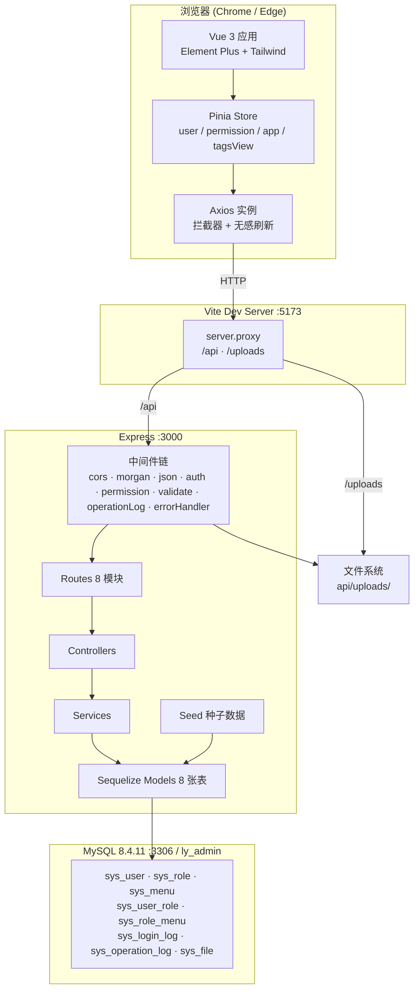
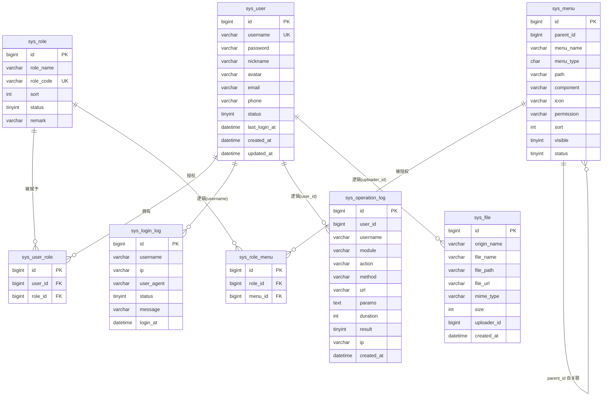
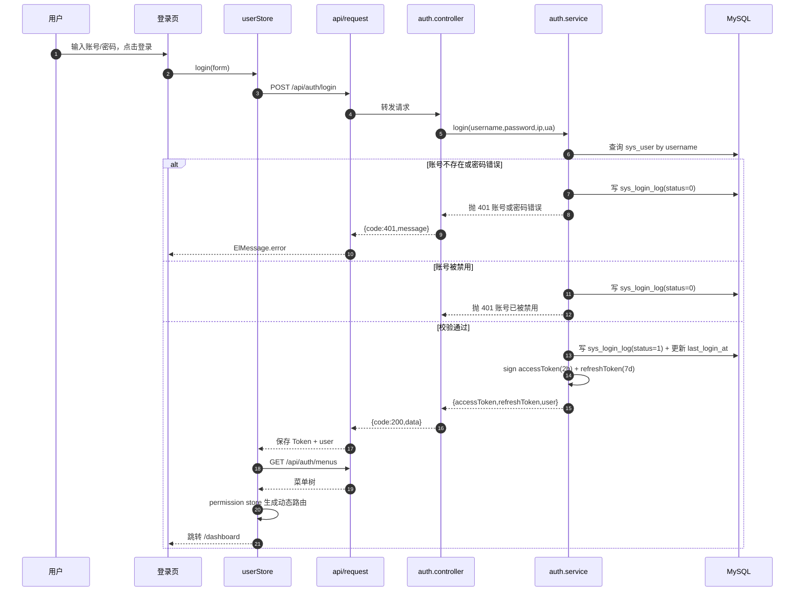
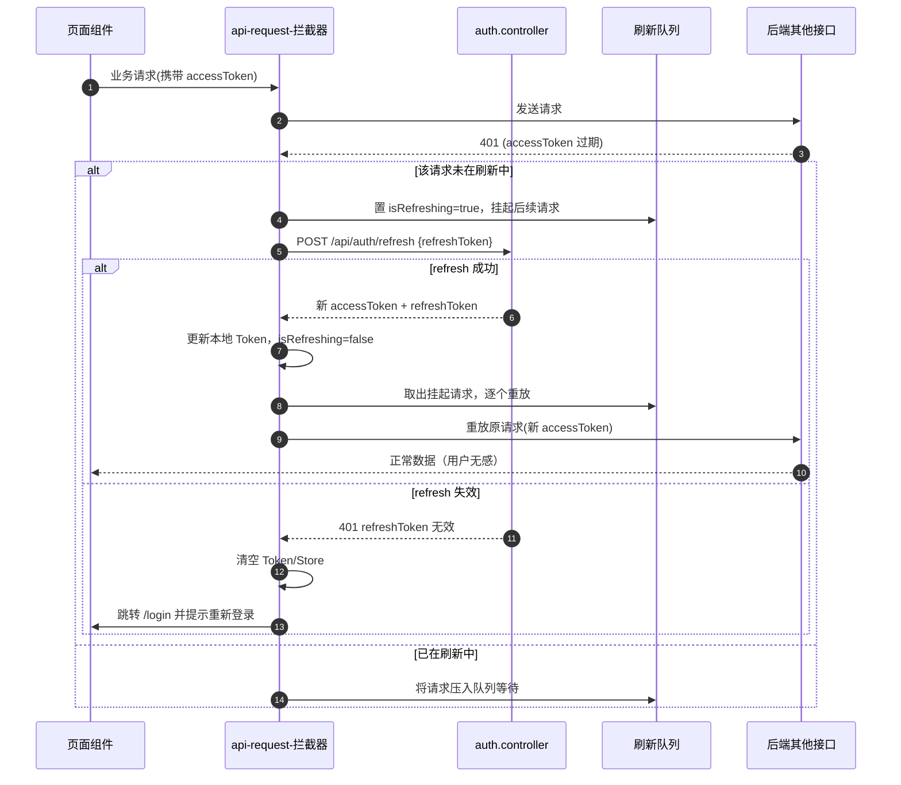
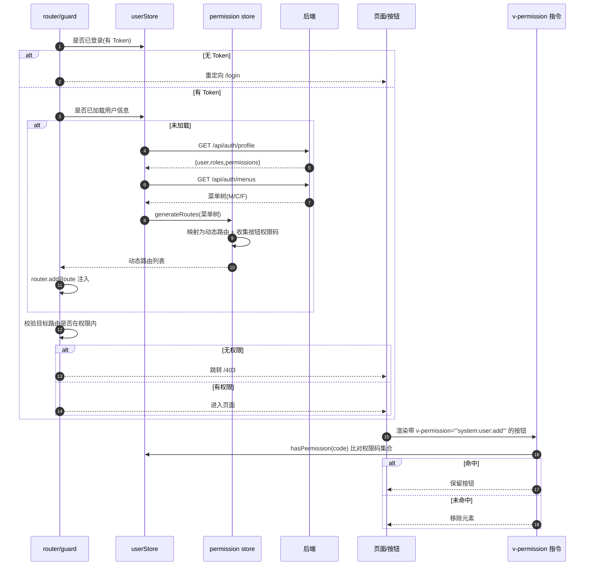

# 蓝云后台管理系统（LYAdmin）· 系统架构设计与任务分解

> 版本：v1.0 ｜ 阶段：第二阶段（架构设计 + 任务分解）｜ 架构师：高见远（Gao）
> 上游输入：`docs/PRD.md`（v1.0，39 条需求：P0×17 / P1×17 / P2×5）
> 本文档定位：**工程师寇豆码（dev-kou）的唯一实现依据**。覆盖 PRD 全部 P0 + P1 需求，P2 以「可选增强」标注。
> 环境基线：Windows / Node v22.22.2 / npm 10.9.7 / registry `https://registry.npmmirror.com` / MySQL 8.4.11（localhost:3306，`root`/`Abc123987`，库 `ly_admin` 已建好 utf8mb4）。
> 本文档不含实现代码，仅含契约性片段（接口签名 / 类型定义 / 模型关联写法）。

---

## 1. 实现方案总览

### 1.1 分层架构

采用「**前后端分离 + 后端三层 + 前端模块化**」架构，单仓（monorepo）三工程：

- **根目录**：统一工程规范（ESLint / Prettier / Stylelint / husky / lint-staged / commitlint / cz-git），不参与运行。
- **`api/`（后端）**：Express 5 + TypeScript + Sequelize，三层结构
  - `routes`（路由 + 中间件挂载，含鉴权/权限/校验）
  - `controllers`（参数解析、调用 service、组装统一响应）
  - `services`（业务逻辑 + 数据访问，唯一操作 Model 的层）
  - 横切层：`middlewares`（鉴权、权限、校验、操作日志、错误处理、上传）、`utils`、`config`、`models`、`seed`。
- **`admin/`（前端）**：Vite 8 + Vue 3.5 + TypeScript + Element Plus + Tailwind v3 + Pinia
  - `api`（axios 封装 + 各模块接口）→ `store`（Pinia）→ `router`（静态路由 + 动态路由）→ `layout`（主布局）→ `views`（页面）。
  - 权限链路：后端下发菜单树 → `permission` store 映射为动态路由 → 侧边栏渲染；按钮权限走 `v-permission` 指令。

### 1.2 架构图



### 1.3 关键技术决策（主理人已锁定，不可变更）

| 决策项   | 方案                                                                                                 |
| -------- | ---------------------------------------------------------------------------------------------------- |
| 鉴权     | JWT 双 Token：accessToken 2h + refreshToken 7d，`Authorization: Bearer <token>`，无感刷新 + 强制下线 |
| 权限     | RBAC 菜单 + 按钮级；用户—角色—菜单三段式；后端下发菜单树 → 前端动态路由；按钮用 `v-permission`       |
| 建表     | Sequelize `sync({ alter: false })` 自动建表 + 启动时执行种子数据                                     |
| 强制下线 | 用户状态校验（每次鉴权查库校验 `status`），不引入 Redis / Token 黑名单                               |
| 前端 UI  | tagsView + 面包屑 + 可折叠侧边栏 + 暗黑模式 + keep-alive；**不做 i18n**                              |
| 部署     | 仅本地启动，不生成 Docker / Nginx                                                                    |

### 1.4 技术风险点结论（主理人指定必须给出）

**风险 A —— TailwindCSS 与 Element Plus 样式冲突（结论：可规避）**

1. **锁定 Tailwind CSS v3.4.19**，**不使用 v4**（v4 的 CSS-first `@theme` 配置与 Element Plus 兼容成本高）。
2. **禁用 preflight**：`tailwind.config.js` 中设置 `corePlugins: { preflight: false }`，避免 Tailwind 的全局重置覆盖 Element Plus 组件样式与按钮/表单默认外观。
3. **自行补充必要 base 重置**：在 `src/styles/index.css` 的 `@layer base` 中仅补最小重置（`html/body` 高度、`box-sizing`、`body` 字号字体、`img` 块级），不引入全局 `margin:0` 之外的破坏性规则。
4. **样式引入顺序**（`src/main.ts` 内）：先 `import 'element-plus/dist/index.css'` → 再 `import 'element-plus/theme-chalk/dark/css-vars.css'` → 最后 `import '@/styles/index.css'`（含 `@tailwind base/components/utilities` 与 EP 覆盖）。保证 Tailwind 工具类位于 EP 之后。
5. **职责边界**：Tailwind 只用于**布局/间距/flex/栅格/文本**等工具类；EP 组件的**内部外观**不用 Tailwind 强行覆盖。确需覆盖时，在 `element.scss` 中写带命名空间的样式，而不是靠 `!important`。
6. **暗黑模式**：Tailwind 设 `darkMode: 'class'`，与 Element Plus 的 `html.dark` 方案对齐，由 VueUse `useDark` 统一切换 `html.dark`。

**风险 B —— 前后端联调（结论：Vite 代理为主，cors 兜底）**

1. 前端 dev server 端口 **5173**（`strictPort: true`），后端 **3000**。
2. `vite.config.ts` 中 `server.proxy`：`'/api'` → `http://localhost:3000`，`'/uploads'` → `http://localhost:3000`，均 `changeOrigin: true`。前端 axios `baseURL = '/api'`，静态资源用 `/uploads/xxx`，**同源无跨域**。
3. 后端**仍挂 `cors` 中间件**兜底（允许 `http://localhost:5173`、`credentials: true`），便于直接用 Postman / curl 联调。
4. 后端注意：Express 5 使用 `path-to-regexp` v8，**通配路由写法为 `'/uploads/*splat'` 或 `'/{*splat}'`**，不能用旧版 `'/uploads/*'`。

---

## 2. 技术选型与版本

> 以下版本号均已于 2026-09 通过 `npm view <pkg> version` 在 npmmirror 镜像核实，真实存在且与 Node 22.22.2 兼容。ESLint 生态约束 `typescript >=4.8.4 <6.1.0`，故前后端统一锁定 **TypeScript ^5.9.3**（不使用 6.x/7.x）。

### 2.1 根目录 `package.json`（工程规范，无运行时依赖）

| 包                               | 版本     | 用途                                   |
| -------------------------------- | -------- | -------------------------------------- |
| eslint                           | ^10.11.0 | Lint 引擎（flat config）               |
| @eslint/js                       | ^10.0.1  | ESLint 官方 JS 推荐规则（flat config） |
| eslint-plugin-vue                | ^10.11.0 | Vue 单文件组件规则                     |
| vue-eslint-parser                | ^10.4.1  | 解析 `.vue`                            |
| typescript-eslint                | ^8.70.1  | TS ESLint 规则集（统一入口）           |
| @typescript-eslint/parser        | ^8.70.1  | TS 解析器                              |
| @typescript-eslint/eslint-plugin | ^8.70.1  | TS 规则                                |
| @vue/eslint-config-typescript    | ^14.9.0  | Vue+TS 预设（支持 ESLint 10）          |
| eslint-config-prettier           | ^10.1.8  | 关闭与 Prettier 冲突规则               |
| eslint-plugin-prettier           | ^5.5.6   | 以 Prettier 作为规则                   |
| prettier                         | ^3.9.8   | 格式化                                 |
| stylelint                        | ^17.15.0 | 样式 Lint                              |
| stylelint-config-standard        | ^40.0.0  | 标准规则（peer: stylelint ^17）        |
| stylelint-config-recess-order    | ^7.8.0   | 属性排序                               |
| stylelint-prettier               | ^5.0.3   | 样式格式化联动                         |
| husky                            | ^9.1.7   | Git Hooks                              |
| lint-staged                      | ^17.5.1  | 暂存区校验                             |
| @commitlint/cli                  | ^21.2.3  | 提交信息校验                           |
| @commitlint/config-conventional  | ^21.2.3  | 约定式提交规范                         |
| commitizen                       | ^4.3.2   | 交互式提交                             |
| cz-git                           | ^1.14.0  | cz 适配器                              |
| concurrently                     | ^10.0.5  | 根目录并行启动前后端（可选）           |

### 2.2 `admin/package.json`（前端）

**dependencies**

| 包                          | 版本     | 用途                                                 |
| --------------------------- | -------- | ---------------------------------------------------- |
| vue                         | ^3.5.43  | 框架                                                 |
| vue-router                  | ^5.3.1   | 路由（peer 需 vue ^3.5.34、vite ^7/^8、pinia ^3/^4） |
| pinia                       | ^4.0.3   | 状态管理（peer 需 vue ^3.5.11、ts >=5.6）            |
| pinia-plugin-persistedstate | ^4.7.1   | Store 持久化（暗黑模式/侧边栏折叠记忆）              |
| element-plus                | ^2.14.6  | UI 组件库                                            |
| @element-plus/icons-vue     | ^2.3.2   | 图标                                                 |
| axios                       | ^1.20.0  | HTTP                                                 |
| echarts                     | ^6.1.0   | 图表                                                 |
| nprogress                   | ^0.2.0   | 顶部进度条                                           |
| @vueuse/core                | ^15.0.0  | 组合式工具（useDark/useFullscreen 等）               |
| lodash-es                   | ^4.18.1  | 工具函数（ESM）                                      |
| dayjs                       | ^1.11.23 | 日期                                                 |
| sortablejs                  | ^1.15.7  | tagsView 标签拖拽（P2）                              |

**devDependencies**

| 包                      | 版本     | 用途                                          |
| ----------------------- | -------- | --------------------------------------------- |
| vite                    | ^8.3.0   | 构建（engines: node ^20.19 或 >=22.12，满足） |
| @vitejs/plugin-vue      | ^6.0.9   | Vue 插件                                      |
| typescript              | ^5.9.3   | 类型                                          |
| vue-tsc                 | ^3.3.11  | 类型检查                                      |
| @vue/tsconfig           | ^0.9.1   | TS 基础配置                                   |
| @types/node             | ^22.20.4 | Node 类型（对齐 Node 22）                     |
| @types/lodash-es        | ^4.17.12 | lodash-es 类型                                |
| @types/nprogress        | ^0.2.3   | nprogress 类型                                |
| @types/sortablejs       | ^1.15.9  | sortablejs 类型                               |
| unplugin-auto-import    | ^21.1.0  | 自动导入 API                                  |
| unplugin-vue-components | ^32.1.0  | 自动导入组件（EP 按需）                       |
| tailwindcss             | ^3.4.19  | 原子 CSS（**锁 v3**）                         |
| postcss                 | ^8.5.28  | Tailwind 依赖                                 |
| autoprefixer            | ^10.6.1  | 前缀                                          |
| sass                    | ^1.104.1 | Element Plus 主题变量（如需）                 |

### 2.3 `api/package.json`（后端）

**dependencies**

| 包                   | 版本     | 用途                                      |
| -------------------- | -------- | ----------------------------------------- |
| express              | ^5.2.1   | Web 框架                                  |
| sequelize            | ^6.37.8  | ORM                                       |
| sequelize-typescript | ^2.1.6   | 装饰器式模型（peer: sequelize >=6.20.1）  |
| mysql2               | ^3.24.4  | MySQL 驱动                                |
| jsonwebtoken         | ^9.0.3   | JWT 签发/校验                             |
| bcryptjs             | ^3.0.3   | 密码哈希（自带类型，无需 @types）         |
| multer               | ^2.4.0   | 文件上传                                  |
| morgan               | ^1.12.1  | HTTP 访问日志                             |
| cors                 | ^2.8.6   | 跨域兜底                                  |
| dotenv               | ^18.0.2  | 环境变量                                  |
| dayjs                | ^1.11.23 | 日期处理                                  |
| reflect-metadata     | ^0.2.2   | 装饰器元数据（sequelize-typescript 必需） |
| zod                  | ^4.6.5   | 请求参数校验                              |

**devDependencies**

| 包                  | 版本      | 用途                                  |
| ------------------- | --------- | ------------------------------------- |
| typescript          | ^5.9.3    | 类型                                  |
| ts-node             | ^10.9.2   | 开发期直跑 TS（**保留装饰器元数据**） |
| nodemon             | ^3.1.14   | 热重载                                |
| @types/node         | ^22.20.4  | Node 类型                             |
| @types/express      | ^5.0.6    | Express 类型                          |
| @types/jsonwebtoken | ^9.0.10   | JWT 类型                              |
| @types/multer       | ^2.2.0    | multer 类型                           |
| @types/morgan       | ^1.9.10   | morgan 类型                           |
| @types/cors         | ^2.8.19   | cors 类型                             |
| @types/validator    | ^13.15.10 | sequelize-typescript 传递依赖类型     |

> **为什么用 ts-node 而非 tsx**：sequelize-typescript 依赖 `emitDecoratorMetadata` 的 `design:type` 元数据；esbuild（tsx）**不支持** `emitDecoratorMetadata`，会导致模型关联推断失败。ts-node 使用官方 tsc 编译链，可正确产出装饰器元数据。

---

## 3. 完整文件清单

> 共 **167** 个文件：根目录 **15** / 后端 `api/` **70** / 前端 `admin/` **82**。工程师请逐个创建，不得省略。

### 3.1 根目录（15）

| #   | 相对路径                 | 职责                                                                                                               |
| --- | ------------------------ | ------------------------------------------------------------------------------------------------------------------ |
| 1   | `package.json`           | 根工程：脚本（lint/format/prepare/commit/dev）、devDeps、`config.commitizen`                                       |
| 2   | `.npmrc`                 | 固定 registry 为 npmmirror                                                                                         |
| 3   | `.gitignore`             | 忽略 node_modules / dist / .env / uploads 内容                                                                     |
| 4   | `.editorconfig`          | 统一缩进、换行、字符集                                                                                             |
| 5   | `.prettierrc.json`       | Prettier 规则（printWidth 120、tabWidth 2、单引号、保留分号、trailingComma all、arrowParens always、endOfLine lf） |
| 6   | `.prettierignore`        | 忽略 dist / node_modules / 静态资源                                                                                |
| 7   | `eslint.config.mjs`      | ESLint 10 flat config，覆盖 admin(.vue/.ts) 与 api(.ts)                                                            |
| 8   | `.stylelintrc.json`      | Stylelint 规则（standard + recess-order + prettier）                                                               |
| 9   | `.stylelintignore`       | 忽略 dist / 第三方样式                                                                                             |
| 10  | `commitlint.config.cjs`  | 约定式提交规则                                                                                                     |
| 11  | `.czrc`                  | cz-git 交互式提交配置                                                                                              |
| 12  | `lint-staged.config.cjs` | 暂存区文件分派 lint/format                                                                                         |
| 13  | `.husky/pre-commit`      | 提交前执行 `lint-staged`                                                                                           |
| 14  | `.husky/commit-msg`      | 提交信息校验 `commitlint`                                                                                          |
| 15  | `README.md`              | 项目说明、启动步骤、默认账号、目录结构（已存在，需补全）                                                           |

### 3.2 后端 `api/`（70）

**配置与基建（10）**

| #   | 相对路径                     | 职责                                                                                   |
| --- | ---------------------------- | -------------------------------------------------------------------------------------- |
| 16  | `api/package.json`           | 后端依赖与脚本（dev/build/start/seed）                                                 |
| 17  | `api/tsconfig.json`          | TS 配置：`commonjs`、`experimentalDecorators`、`emitDecoratorMetadata`、路径别名 `@/*` |
| 18  | `api/nodemon.json`           | 监听 `src`，执行 `ts-node src/server.ts`                                               |
| 19  | `api/.env`                   | 实际环境变量（不入库）                                                                 |
| 20  | `api/.env.example`           | 环境变量样例                                                                           |
| 21  | `api/.gitignore`             | 忽略 node_modules / dist / uploads/* / .env                                            |
| 22  | `api/uploads/.gitkeep`       | 上传目录占位                                                                           |
| 23  | `api/src/config/index.ts`    | 读取并导出 `.env` 配置（端口、DB、JWT、上传）                                          |
| 24  | `api/src/config/database.ts` | 创建 Sequelize 实例、注册模型、`sync` 建表                                             |
| 25  | `api/src/constants/index.ts` | 业务错误码、枚举（状态/菜单类型/日志结果）、正则、白名单                               |

**工具与类型（9）**

| #   | 相对路径                        | 职责                                                      |
| --- | ------------------------------- | --------------------------------------------------------- |
| 26  | `api/src/utils/response.ts`     | 统一响应体 `ok()/fail()`、`AppError` 类                   |
| 27  | `api/src/utils/jwt.ts`          | 签发/校验 accessToken、refreshToken                       |
| 28  | `api/src/utils/password.ts`     | bcrypt 加密与比对                                         |
| 29  | `api/src/utils/pagination.ts`   | 解析 `page/pageSize`，构造分页响应                        |
| 30  | `api/src/utils/tree.ts`         | 平铺列表 → 树（菜单树/权限树）                            |
| 31  | `api/src/utils/logger.ts`       | morgan 输出流（控制台 + 文件 `logs/`）、HTTP 日志入库辅助 |
| 32  | `api/src/utils/asyncHandler.ts` | 包裹 async 控制器，统一异常传递                           |
| 33  | `api/src/types/index.ts`        | `JwtPayload`、`PageQuery`、`ServiceResult` 等共享类型     |
| 34  | `api/src/types/express.d.ts`    | 扩展 `Express.Request`（`user`、`auth`）                  |

**数据模型（9）**

| #   | 相对路径                         | 职责                                                            |
| --- | -------------------------------- | --------------------------------------------------------------- |
| 35  | `api/src/models/index.ts`        | 汇总导出全部模型 + 关联注册                                     |
| 36  | `api/src/models/User.ts`         | `sys_user` 模型（`@HasMany UserRole`）                          |
| 37  | `api/src/models/Role.ts`         | `sys_role` 模型（`@BelongsToMany User`、`@BelongsToMany Menu`） |
| 38  | `api/src/models/Menu.ts`         | `sys_menu` 模型（自关联 `parent_id`、`@BelongsToMany Role`）    |
| 39  | `api/src/models/UserRole.ts`     | `sys_user_role` 关联表                                          |
| 40  | `api/src/models/RoleMenu.ts`     | `sys_role_menu` 关联表                                          |
| 41  | `api/src/models/LoginLog.ts`     | `sys_login_log`                                                 |
| 42  | `api/src/models/OperationLog.ts` | `sys_operation_log`                                             |
| 43  | `api/src/models/File.ts`         | `sys_file`                                                      |

**中间件（6）**

| #   | 相对路径                              | 职责                                                        |
| --- | ------------------------------------- | ----------------------------------------------------------- |
| 44  | `api/src/middlewares/auth.ts`         | 解析 Bearer、校验 accessToken、查库校验用户状态（强制下线） |
| 45  | `api/src/middlewares/permission.ts`   | 校验当前用户是否具备所需权限码（按钮/接口级）               |
| 46  | `api/src/middlewares/validate.ts`     | 基于 zod 的 `body/query/params` 校验                        |
| 47  | `api/src/middlewares/errorHandler.ts` | 兜底错误处理 + 404，输出统一响应                            |
| 48  | `api/src/middlewares/operationLog.ts` | 拦截写操作，记录模块/动作/参数（密码脱敏）/耗时/结果        |
| 49  | `api/src/middlewares/upload.ts`       | multer 磁盘存储 + 类型/大小/数量白名单                      |

**种子数据（4）**

| #   | 相对路径                    | 职责                                           |
| --- | --------------------------- | ---------------------------------------------- |
| 50  | `api/src/seed/index.ts`     | 种子入口，按序执行 menu→role→user              |
| 51  | `api/src/seed/menu.seed.ts` | 写入完整菜单树（目录/菜单/按钮）               |
| 52  | `api/src/seed/role.seed.ts` | 写入默认角色（super_admin/admin/viewer）并授权 |
| 53  | `api/src/seed/user.seed.ts` | 写入超管 `admin`/`123456` 并绑定角色           |

**应用装配与路由（11）**

| #   | 相对路径                             | 职责                                                        |
| --- | ------------------------------------ | ----------------------------------------------------------- |
| 54  | `api/src/app.ts`                     | 创建 Express 实例、挂载全局中间件、静态目录、路由、错误处理 |
| 55  | `api/src/server.ts`                  | 入口：`reflect-metadata` → DB 连接 → sync → seed → listen   |
| 56  | `api/src/routes/index.ts`            | 聚合挂载 8 个业务路由到 `/api`                              |
| 57  | `api/src/routes/auth.routes.ts`      | 认证路由                                                    |
| 58  | `api/src/routes/user.routes.ts`      | 用户路由                                                    |
| 59  | `api/src/routes/role.routes.ts`      | 角色路由                                                    |
| 60  | `api/src/routes/menu.routes.ts`      | 菜单路由                                                    |
| 61  | `api/src/routes/log.routes.ts`       | 日志路由                                                    |
| 62  | `api/src/routes/file.routes.ts`      | 文件路由                                                    |
| 63  | `api/src/routes/dashboard.routes.ts` | 仪表盘路由                                                  |
| 64  | `api/src/routes/profile.routes.ts`   | 个人中心路由                                                |

**控制器（8）**

| #   | 相对路径                                      | 职责                             |
| --- | --------------------------------------------- | -------------------------------- |
| 65  | `api/src/controllers/auth.controller.ts`      | 登录/刷新/登出/用户信息/菜单树   |
| 66  | `api/src/controllers/user.controller.ts`      | 用户 CRUD/状态/重置密码/分配角色 |
| 67  | `api/src/controllers/role.controller.ts`      | 角色 CRUD/菜单授权               |
| 68  | `api/src/controllers/menu.controller.ts`      | 菜单 CRUD/树查询                 |
| 69  | `api/src/controllers/log.controller.ts`       | 三类日志列表/导出                |
| 70  | `api/src/controllers/file.controller.ts`      | 上传/列表/删除                   |
| 71  | `api/src/controllers/dashboard.controller.ts` | 统计卡片/趋势/分布/柱状          |
| 72  | `api/src/controllers/profile.controller.ts`   | 改资料/改密码/换头像             |

**服务（8）**

| #   | 相对路径                                | 职责                            |
| --- | --------------------------------------- | ------------------------------- |
| 73  | `api/src/services/auth.service.ts`      | 登录校验、双 Token、菜单树组装  |
| 74  | `api/src/services/user.service.ts`      | 用户分页/CRUD/角色绑定/密码重置 |
| 75  | `api/src/services/role.service.ts`      | 角色 CRUD/菜单授权              |
| 76  | `api/src/services/menu.service.ts`      | 菜单 CRUD/树                    |
| 77  | `api/src/services/log.service.ts`       | 三类日志查询/写入/导出          |
| 78  | `api/src/services/file.service.ts`      | 文件落库/查询/删除              |
| 79  | `api/src/services/dashboard.service.ts` | 聚合统计 SQL                    |
| 80  | `api/src/services/profile.service.ts`   | 个人资料/密码/头像              |

**校验器（5）**

| #   | 相对路径                                  | 职责                          |
| --- | ----------------------------------------- | ----------------------------- |
| 81  | `api/src/validators/auth.validator.ts`    | 登录/刷新/改密 zod schema     |
| 82  | `api/src/validators/user.validator.ts`    | 用户增改/状态/分配角色 schema |
| 83  | `api/src/validators/role.validator.ts`    | 角色增改/授权 schema          |
| 84  | `api/src/validators/menu.validator.ts`    | 菜单增改 schema               |
| 85  | `api/src/validators/profile.validator.ts` | 个人资料/改密 schema          |

### 3.3 前端 `admin/`（82）

**配置（10）**

| #   | 相对路径                   | 职责                                                                    |
| --- | -------------------------- | ----------------------------------------------------------------------- |
| 86  | `admin/package.json`       | 前端依赖与脚本（dev/build/preview/type-check）                          |
| 87  | `admin/tsconfig.json`      | TS 配置 + 路径别名 `@/*`                                                |
| 88  | `admin/tsconfig.node.json` | 供 vite.config 使用的 Node 侧 TS 配置                                   |
| 89  | `admin/vite.config.ts`     | Vite 配置：插件、别名、端口 5173、proxy、自动导入                       |
| 90  | `admin/index.html`         | HTML 模板（挂载点 `#app`）                                              |
| 91  | `admin/.env.development`   | 开发环境变量                                                            |
| 92  | `admin/.env.production`    | 生产环境变量                                                            |
| 93  | `admin/tailwind.config.js` | Tailwind v3 配置（`preflight:false`、`darkMode:'class'`、content 路径） |
| 94  | `admin/postcss.config.js`  | postcss 插件（tailwindcss + autoprefixer）                              |
| 95  | `admin/src/vite-env.d.ts`  | Vite 环境与 `.vue` 模块类型声明                                         |

**入口与样式（5）**

| #   | 相对路径                        | 职责                                                              |
| --- | ------------------------------- | ----------------------------------------------------------------- |
| 96  | `admin/src/main.ts`             | 创建应用、按序引入 EP 样式与全局样式、注册 Pinia/Router/指令/图标 |
| 97  | `admin/src/App.vue`             | 根组件（`el-config-provider` + `router-view`）                    |
| 98  | `admin/src/assets/logo.svg`     | Logo                                                              |
| 99  | `admin/src/styles/index.css`    | Tailwind 指令 + `@layer base` 最小重置 + 全局工具类               |
| 100 | `admin/src/styles/element.scss` | Element Plus 主题/尺寸微调（命名空间覆盖）                        |

**路由（3）**

| #   | 相对路径                     | 职责                                              |
| --- | ---------------------------- | ------------------------------------------------- |
| 101 | `admin/src/router/index.ts`  | 创建 router 实例、注册静态路由                    |
| 102 | `admin/src/router/routes.ts` | 静态路由表（login/redirect/error/主布局壳）       |
| 103 | `admin/src/router/guard.ts`  | 全局前置守卫：鉴权、动态路由注入、NProgress、标题 |

**状态管理（5）**

| #   | 相对路径                                | 职责                                     |
| --- | --------------------------------------- | ---------------------------------------- |
| 104 | `admin/src/store/index.ts`              | 创建 Pinia 实例并挂载持久化插件          |
| 105 | `admin/src/store/modules/user.ts`       | 用户信息、Token、角色、权限码、登录/登出 |
| 106 | `admin/src/store/modules/permission.ts` | 菜单树 → 动态路由生成、路由重置          |
| 107 | `admin/src/store/modules/app.ts`        | 侧边栏折叠、暗黑模式、主题色、全屏（P2） |
| 108 | `admin/src/store/modules/tagsView.ts`   | 标签页增删/切换/缓存名单                 |

**类型（3）**

| #   | 相对路径                    | 职责                         |
| --- | --------------------------- | ---------------------------- |
| 109 | `admin/src/types/index.ts`  | 全局类型统一导出             |
| 110 | `admin/src/types/api.ts`    | 统一响应体、分页、各实体 DTO |
| 111 | `admin/src/types/router.ts` | 路由 meta / 菜单节点类型     |

**工具（4）**

| #   | 相对路径                        | 职责                             |
| --- | ------------------------------- | -------------------------------- |
| 112 | `admin/src/utils/auth.ts`       | Token 读写（localStorage）       |
| 113 | `admin/src/utils/permission.ts` | `hasPermission(code)` 判定       |
| 114 | `admin/src/utils/format.ts`     | 日期/文件大小/耗时格式化         |
| 115 | `admin/src/utils/validate.ts`   | 表单校验规则（手机号/邮箱/密码） |

**API 层（9）**

| #   | 相对路径                     | 职责                                          |
| --- | ---------------------------- | --------------------------------------------- |
| 116 | `admin/src/api/request.ts`   | axios 实例、请求/响应拦截、401 无感刷新与重放 |
| 117 | `admin/src/api/auth.ts`      | 登录/刷新/登出/用户信息/菜单树                |
| 118 | `admin/src/api/user.ts`      | 用户模块接口                                  |
| 119 | `admin/src/api/role.ts`      | 角色模块接口                                  |
| 120 | `admin/src/api/menu.ts`      | 菜单模块接口                                  |
| 121 | `admin/src/api/log.ts`       | 日志模块接口                                  |
| 122 | `admin/src/api/file.ts`      | 文件模块接口                                  |
| 123 | `admin/src/api/dashboard.ts` | 仪表盘接口                                    |
| 124 | `admin/src/api/profile.ts`   | 个人中心接口                                  |

**指令与 Hook（4）**

| #   | 相对路径                             | 职责                             |
| --- | ------------------------------------ | -------------------------------- |
| 125 | `admin/src/directives/permission.ts` | `v-permission` 按钮级权限指令    |
| 126 | `admin/src/directives/index.ts`      | 指令统一注册                     |
| 127 | `admin/src/hooks/useTable.ts`        | 列表分页/查询通用逻辑（P2 复用） |
| 128 | `admin/src/hooks/useTheme.ts`        | 暗黑模式切换封装                 |

**布局（9）**

| #   | 相对路径                                              | 职责                                        |
| --- | ----------------------------------------------------- | ------------------------------------------- |
| 129 | `admin/src/layout/index.vue`                          | 主布局壳（侧栏 + 顶栏 + 标签页 + 内容区）   |
| 130 | `admin/src/layout/components/AppMain.vue`             | 内容区：`router-view` + `keep-alive` + 过渡 |
| 131 | `admin/src/layout/components/Navbar/index.vue`        | 顶栏：折叠按钮 + 面包屑 + 右侧操作          |
| 132 | `admin/src/layout/components/Navbar/Breadcrumb.vue`   | 动态面包屑                                  |
| 133 | `admin/src/layout/components/Navbar/Avatar.vue`       | 头像下拉（个人中心/退出/暗黑/全屏）         |
| 134 | `admin/src/layout/components/Sidebar/index.vue`       | 侧边栏（`el-menu` 递归）                    |
| 135 | `admin/src/layout/components/Sidebar/SidebarItem.vue` | 菜单项递归渲染                              |
| 136 | `admin/src/layout/components/Sidebar/Logo.vue`        | 侧边栏 Logo 区                              |
| 137 | `admin/src/layout/components/TagsView/index.vue`      | 标签页（切换/关闭/关闭其他/右键）           |

**通用组件（4）**

| #   | 相对路径                                    | 职责                                |
| --- | ------------------------------------------- | ----------------------------------- |
| 138 | `admin/src/components/Pagination/index.vue` | 分页组件封装                        |
| 139 | `admin/src/components/SearchForm/index.vue` | 查询表单容器（折叠/重置/查询）      |
| 140 | `admin/src/components/IconPicker/index.vue` | 图标选择器（菜单用）                |
| 141 | `admin/src/components/MenuTree/index.vue`   | 菜单权限树（角色授权/上级菜单选择） |

**页面（26）**

| #   | 相对路径                                                      | 职责                               |
| --- | ------------------------------------------------------------- | ---------------------------------- |
| 142 | `admin/src/views/login/index.vue`                             | 登录页                             |
| 143 | `admin/src/views/dashboard/index.vue`                         | 仪表盘页（卡片 + 图表组合）        |
| 144 | `admin/src/views/dashboard/components/StatCard.vue`           | 统计卡片                           |
| 145 | `admin/src/views/dashboard/components/TrendChart.vue`         | 近 7 日登录趋势折线图              |
| 146 | `admin/src/views/dashboard/components/PieChart.vue`           | 操作类型分布饼图                   |
| 147 | `admin/src/views/dashboard/components/BarChart.vue`           | 各角色用户数柱状图                 |
| 148 | `admin/src/views/upload/index.vue`                            | 文件上传与管理页                   |
| 149 | `admin/src/views/system/user/index.vue`                       | 用户管理列表页                     |
| 150 | `admin/src/views/system/user/components/UserForm.vue`         | 用户新增/编辑弹窗                  |
| 151 | `admin/src/views/system/user/components/AssignRoleDialog.vue` | 分配角色弹窗                       |
| 152 | `admin/src/views/system/role/index.vue`                       | 角色管理列表页                     |
| 153 | `admin/src/views/system/role/components/RoleForm.vue`         | 角色新增/编辑弹窗                  |
| 154 | `admin/src/views/system/role/components/PermissionDrawer.vue` | 角色菜单授权抽屉                   |
| 155 | `admin/src/views/system/menu/index.vue`                       | 菜单管理（树形表格）页             |
| 156 | `admin/src/views/system/menu/components/MenuForm.vue`         | 菜单新增/编辑弹窗                  |
| 157 | `admin/src/views/system/menu/components/IconSelect.vue`       | 菜单图标选择弹层                   |
| 158 | `admin/src/views/log/login/index.vue`                         | 登录日志页                         |
| 159 | `admin/src/views/log/operation/index.vue`                     | 操作日志页                         |
| 160 | `admin/src/views/log/http/index.vue`                          | HTTP 访问日志页                    |
| 161 | `admin/src/views/profile/index.vue`                           | 个人中心页                         |
| 162 | `admin/src/views/profile/components/ProfileForm.vue`          | 资料表单                           |
| 163 | `admin/src/views/profile/components/PasswordForm.vue`         | 改密表单                           |
| 164 | `admin/src/views/error/403.vue`                               | 无权限页                           |
| 165 | `admin/src/views/error/404.vue`                               | 页面不存在                         |
| 166 | `admin/src/views/error/500.vue`                               | 服务器错误                         |
| 167 | `admin/src/views/redirect/index.vue`                          | 重定向中转页（供 keep-alive 刷新） |

---

## 4. 数据模型设计

### 4.1 全局约定

- Sequelize 实例开启 `underscored: true` → 模型属性 **camelCase** 自动映射 DB 列 **snake_case**（`createdAt` ↔ `created_at`）。模型类中**不写** `field` 也能映射；仅特殊列显式声明 `field`。
- 全局 `timestamps: true`、`freezeTableName: true`、`charset: 'utf8mb4'`、`dialectOptions.dateStrings: true`。
- 状态类字段统一 `TINYINT`：`1 = 启用/成功`，`0 = 禁用/失败`。

### 4.2 字段定义

**`sys_user` 用户表**

| 字段          | 类型                  | 可空 | 默认 | 注释            |
| ------------- | --------------------- | ---- | ---- | --------------- |
| id            | BIGINT UNSIGNED PK AI | N    | -    | 主键            |
| username      | VARCHAR(50) UNIQUE    | N    | -    | 登录账号        |
| password      | VARCHAR(100)          | N    | -    | bcrypt 哈希     |
| nickname      | VARCHAR(50)           | N    | ''   | 昵称            |
| avatar        | VARCHAR(255)          | Y    | NULL | 头像 URL        |
| email         | VARCHAR(100)          | Y    | NULL | 邮箱            |
| phone         | VARCHAR(20)           | Y    | NULL | 手机号          |
| status        | TINYINT               | N    | 1    | 1 启用 / 0 禁用 |
| last_login_at | DATETIME              | Y    | NULL | 最后登录时间    |
| remark        | VARCHAR(255)          | Y    | NULL | 备注            |
| created_at    | DATETIME              | N    | now  | 创建时间        |
| updated_at    | DATETIME              | N    | now  | 更新时间        |

**`sys_role` 角色表**

| 字段       | 类型                  | 可空 | 默认 | 注释            |
| ---------- | --------------------- | ---- | ---- | --------------- |
| id         | BIGINT UNSIGNED PK AI | N    | -    | 主键            |
| role_name  | VARCHAR(50)           | N    | -    | 角色名称        |
| role_code  | VARCHAR(50) UNIQUE    | N    | -    | 角色编码        |
| sort       | INT                   | N    | 0    | 排序            |
| status     | TINYINT               | N    | 1    | 1 启用 / 0 禁用 |
| remark     | VARCHAR(255)          | Y    | NULL | 备注            |
| created_at | DATETIME              | N    | now  | 创建时间        |
| updated_at | DATETIME              | N    | now  | 更新时间        |

**`sys_menu` 菜单权限表**

| 字段       | 类型                  | 可空 | 默认 | 注释                             |
| ---------- | --------------------- | ---- | ---- | -------------------------------- |
| id         | BIGINT UNSIGNED PK AI | N    | -    | 主键                             |
| parent_id  | BIGINT UNSIGNED       | N    | 0    | 父级 id（0 为根）                |
| menu_name  | VARCHAR(50)           | N    | -    | 菜单名称                         |
| menu_type  | CHAR(1)               | N    | -    | M 目录 / C 菜单 / F 按钮         |
| path       | VARCHAR(200)          | Y    | NULL | 路由路径                         |
| component  | VARCHAR(255)          | Y    | NULL | 组件路径                         |
| icon       | VARCHAR(100)          | Y    | NULL | 图标                             |
| permission | VARCHAR(100)          | Y    | NULL | 权限标识（如 `system:user:add`） |
| sort       | INT                   | N    | 0    | 排序                             |
| visible    | TINYINT               | N    | 1    | 1 显示 / 0 隐藏                  |
| status     | TINYINT               | N    | 1    | 1 启用 / 0 禁用                  |
| redirect   | VARCHAR(255)          | Y    | NULL | 重定向                           |
| keep_alive | TINYINT               | N    | 0    | 1 缓存 / 0 不缓存                |
| created_at | DATETIME              | N    | now  | 创建时间                         |
| updated_at | DATETIME              | N    | now  | 更新时间                         |

**`sys_user_role` 用户角色关联表**

| 字段    | 类型                     | 可空 | 默认 | 注释    |
| ------- | ------------------------ | ---- | ---- | ------- |
| id      | BIGINT UNSIGNED PK AI    | N    | -    | 主键    |
| user_id | BIGINT UNSIGNED          | N    | -    | 用户 id |
| role_id | BIGINT UNSIGNED          | N    | -    | 角色 id |
| 约束    | UNIQUE(user_id, role_id) |      |      | 防重复  |

**`sys_role_menu` 角色菜单关联表**

| 字段    | 类型                     | 可空 | 默认 | 注释    |
| ------- | ------------------------ | ---- | ---- | ------- |
| id      | BIGINT UNSIGNED PK AI    | N    | -    | 主键    |
| role_id | BIGINT UNSIGNED          | N    | -    | 角色 id |
| menu_id | BIGINT UNSIGNED          | N    | -    | 菜单 id |
| 约束    | UNIQUE(role_id, menu_id) |      |      | 防重复  |

**`sys_login_log` 登录日志表**

| 字段       | 类型                  | 可空 | 默认 | 注释                 |
| ---------- | --------------------- | ---- | ---- | -------------------- |
| id         | BIGINT UNSIGNED PK AI | N    | -    | 主键                 |
| username   | VARCHAR(50)           | N    | -    | 登录账号（失败也记） |
| ip         | VARCHAR(50)           | Y    | NULL | 客户端 IP            |
| user_agent | VARCHAR(500)          | Y    | NULL | UA                   |
| status     | TINYINT               | N    | -    | 1 成功 / 0 失败      |
| message    | VARCHAR(255)          | Y    | NULL | 结果描述             |
| login_at   | DATETIME              | N    | now  | 登录时间             |

**`sys_operation_log` 操作日志表**

| 字段          | 类型                  | 可空 | 默认 | 注释                         |
| ------------- | --------------------- | ---- | ---- | ---------------------------- |
| id            | BIGINT UNSIGNED PK AI | N    | -    | 主键                         |
| user_id       | BIGINT UNSIGNED       | Y    | NULL | 操作人 id                    |
| username      | VARCHAR(50)           | Y    | NULL | 操作人账号                   |
| module        | VARCHAR(50)           | N    | -    | 模块（如 用户管理）          |
| action        | VARCHAR(50)           | N    | -    | 动作（新增/编辑/删除/授权…） |
| method        | VARCHAR(10)           | N    | -    | HTTP 方法                    |
| url           | VARCHAR(255)          | N    | -    | 请求 URL                     |
| params        | TEXT                  | Y    | NULL | 请求参数（密码脱敏）         |
| duration      | INT                   | N    | 0    | 耗时 ms                      |
| result        | TINYINT               | N    | -    | 1 成功 / 0 失败              |
| error_message | VARCHAR(500)          | Y    | NULL | 失败信息                     |
| ip            | VARCHAR(50)           | Y    | NULL | 客户端 IP                    |
| created_at    | DATETIME              | N    | now  | 操作时间                     |

**`sys_file` 文件表**

| 字段        | 类型                  | 可空 | 默认 | 注释                        |
| ----------- | --------------------- | ---- | ---- | --------------------------- |
| id          | BIGINT UNSIGNED PK AI | N    | -    | 主键                        |
| origin_name | VARCHAR(255)          | N    | -    | 原始文件名                  |
| file_name   | VARCHAR(255)          | N    | -    | 存储文件名（含时间戳/随机） |
| file_path   | VARCHAR(500)          | N    | -    | 磁盘相对路径                |
| file_url    | VARCHAR(500)          | N    | -    | 访问 URL（`/uploads/xxx`）  |
| mime_type   | VARCHAR(100)          | N    | -    | MIME                        |
| size        | INT UNSIGNED          | N    | 0    | 字节                        |
| uploader_id | BIGINT UNSIGNED       | Y    | NULL | 上传人 id                   |
| created_at  | DATETIME              | N    | now  | 上传时间                    |

### 4.3 ER 图



### 4.4 sequelize-typescript 模型与关联写法要点

```ts
// api/src/models/User.ts（契约示例，非完整实现）
import { Table, Column, Model, DataType, BelongsToMany, HasMany } from 'sequelize-typescript';
import { Role } from './Role';
import { UserRole } from './UserRole';

@Table({ tableName: 'sys_user', underscored: true })
export class User extends Model {
  @Column({ type: DataType.STRING(50), allowNull: false, unique: true })
  declare username: string;

  @Column({ type: DataType.TINYINT, allowNull: false, defaultValue: 1 })
  declare status: number;

  @BelongsToMany(() => Role, () => UserRole)
  declare roles: Role[];

  @HasMany(() => UserRole)
  declare userRoles: UserRole[];
}
```

- **多对多**：`@BelongsToMany(() => Role, () => UserRole)`；`UserRole` 中 `@ForeignKey(() => User)` / `@ForeignKey(() => Role)` 定义外键列。
- **一对多 / 自关联**：`Menu` 自关联用 `@HasMany(() => Menu, 'parentId')` 与 `@BelongsTo(() => Menu, 'parentId')`。
- **外键列**：`@ForeignKey(() => User) @Column(DataType.BIGINT.UNSIGNED) declare userId: number;`
- **关联注册**：`models: [User, Role, Menu, UserRole, RoleMenu, LoginLog, OperationLog, File]` 传给 Sequelize 构造函数（`api/src/models/index.ts` 统一导出）。
- **装饰器依赖**：`server.ts` 首行必须 `import 'reflect-metadata';`；`tsconfig` 必须开 `experimentalDecorators` + `emitDecoratorMetadata`；启动用 `ts-node`（非 tsx）。
- **`sync`**：`sequelize.sync()` 按模型建表；关联表由 `@BelongsToMany` 的中间模型显式建表，保证 `sys_user_role` / `sys_role_menu` 存在。

---

## 5. 接口清单

> 统一前缀 `/api`。鉴权列：`公开` = 无需 Token；`登录` = 需 accessToken；`权限码` = 额外需该权限。响应体统一见第 6 节。

### 5.1 认证 `/api/auth`

| 方法 | 路径                | 说明           | 鉴权 | 权限码 | 请求参数              | 响应 data                         |
| ---- | ------------------- | -------------- | ---- | ------ | --------------------- | --------------------------------- |
| POST | `/auth/login`       | 登录           | 公开 | -      | `{username,password}` | `{accessToken,refreshToken,user}` |
| POST | `/auth/refresh`     | 刷新 Token     | 公开 | -      | `{refreshToken}`      | `{accessToken,refreshToken}`      |
| POST | `/auth/logout`      | 登出           | 登录 | -      | -                     | `null`                            |
| GET  | `/auth/profile`     | 当前用户信息   | 登录 | -      | -                     | `{user,roles,permissions}`        |
| GET  | `/auth/menus`       | 当前用户菜单树 | 登录 | -      | -                     | `MenuNode[]`                      |
| GET  | `/auth/permissions` | 按钮权限码列表 | 登录 | -      | -                     | `string[]`                        |

### 5.2 用户 `/api/users`

| 方法   | 路径                  | 说明      | 权限码                   | 请求参数                                                              | 响应 data                    |
| ------ | --------------------- | --------- | ------------------------ | --------------------------------------------------------------------- | ---------------------------- |
| GET    | `/users`              | 分页列表  | `system:user:list`       | `{page,pageSize,username?,status?}`                                   | `{list,total,page,pageSize}` |
| GET    | `/users/:id`          | 详情      | `system:user:query`      | -                                                                     | `UserDetail`                 |
| POST   | `/users`              | 新增      | `system:user:add`        | `{username,password,nickname,email?,phone?,status,roleIds[],remark?}` | `UserDetail`                 |
| PUT    | `/users/:id`          | 编辑      | `system:user:edit`       | `{nickname,email?,phone?,status,roleIds[],remark?}`                   | `UserDetail`                 |
| DELETE | `/users/:id`          | 删除      | `system:user:remove`     | -                                                                     | `null`                       |
| PUT    | `/users/:id/status`   | 启用/禁用 | `system:user:edit`       | `{status}`                                                            | `null`                       |
| PUT    | `/users/:id/password` | 重置密码  | `system:user:resetPwd`   | `{password}`                                                          | `null`                       |
| PUT    | `/users/:id/roles`    | 分配角色  | `system:user:assignRole` | `{roleIds:number[]}`                                                  | `null`                       |

### 5.3 角色 `/api/roles`

| 方法   | 路径               | 说明              | 权限码                   | 请求参数                                  | 响应 data                    |
| ------ | ------------------ | ----------------- | ------------------------ | ----------------------------------------- | ---------------------------- |
| GET    | `/roles`           | 分页列表          | `system:role:list`       | `{page,pageSize,roleName?,status?}`       | `{list,total,page,pageSize}` |
| GET    | `/roles/all`       | 全部角色（下拉）  | 登录                     | -                                         | `RoleBrief[]`                |
| POST   | `/roles`           | 新增              | `system:role:add`        | `{roleName,roleCode,sort,status,remark?}` | `Role`                       |
| PUT    | `/roles/:id`       | 编辑              | `system:role:edit`       | `{roleName,sort,status,remark?}`          | `Role`                       |
| DELETE | `/roles/:id`       | 删除              | `system:role:remove`     | -                                         | `null`                       |
| GET    | `/roles/:id/menus` | 角色已授权菜单 id | `system:role:query`      | -                                         | `number[]`                   |
| PUT    | `/roles/:id/menus` | 授权菜单          | `system:role:assignMenu` | `{menuIds:number[]}`                      | `null`                       |

### 5.4 菜单 `/api/menus`

| 方法   | 路径          | 说明                               | 权限码               | 请求参数                    | 响应 data    |
| ------ | ------------- | ---------------------------------- | -------------------- | --------------------------- | ------------ |
| GET    | `/menus`      | 列表（平铺/树，`tree=1` 时返回树） | `system:menu:list`   | `{menuName?,status?,tree?}` | `MenuNode[]` |
| GET    | `/menus/tree` | 菜单树（授权/上级选择）            | `system:menu:list`   | -                           | `MenuNode[]` |
| GET    | `/menus/:id`  | 详情                               | `system:menu:query`  | -                           | `Menu`       |
| POST   | `/menus`      | 新增                               | `system:menu:add`    | `MenuUpsert`                | `Menu`       |
| PUT    | `/menus/:id`  | 编辑                               | `system:menu:edit`   | `MenuUpsert`                | `Menu`       |
| DELETE | `/menus/:id`  | 删除（含子级校验）                 | `system:menu:remove` | -                           | `null`       |

`MenuUpsert = {parentId,menuName,menuType,path?,component?,icon?,permission?,sort,visible,status,redirect?,keepAlive}`

### 5.5 日志 `/api/logs`

| 方法 | 路径                     | 说明               | 权限码                 | 请求参数                                                        | 响应 data                    |
| ---- | ------------------------ | ------------------ | ---------------------- | --------------------------------------------------------------- | ---------------------------- |
| GET  | `/logs/login`            | 登录日志列表       | `log:login:list`       | `{page,pageSize,username?,status?,startTime?,endTime?}`         | `{list,total,page,pageSize}` |
| GET  | `/logs/operation`        | 操作日志列表       | `log:operation:list`   | `{page,pageSize,module?,username?,result?,startTime?,endTime?}` | 同上                         |
| GET  | `/logs/http`             | HTTP 日志列表      | `log:http:list`        | `{page,pageSize,method?,statusCode?,startTime?,endTime?}`       | 同上                         |
| GET  | `/logs/login/export`     | 导出登录日志（P2） | `log:login:export`     | 同筛选                                                          | `text/csv` 流                |
| GET  | `/logs/operation/export` | 导出操作日志（P2） | `log:operation:export` | 同筛选                                                          | `text/csv` 流                |

### 5.6 文件 `/api/files`

| 方法   | 路径            | 说明            | 鉴权 | 权限码        | 请求参数                        | 响应 data                    |
| ------ | --------------- | --------------- | ---- | ------------- | ------------------------------- | ---------------------------- |
| POST   | `/files/upload` | 上传（1~10 个） | 登录 | `file:upload` | `multipart/form-data` `files[]` | `FileItem[]`                 |
| GET    | `/files`        | 文件列表（P2）  | 登录 | `file:list`   | `{page,pageSize,originName?}`   | `{list,total,page,pageSize}` |
| DELETE | `/files/:id`    | 删除文件（P2）  | 登录 | `file:remove` | -                               | `null`                       |

### 5.7 仪表盘 `/api/dashboard`

| 方法 | 路径                                | 说明            | 鉴权 | 请求参数    | 响应 data                                         |
| ---- | ----------------------------------- | --------------- | ---- | ----------- | ------------------------------------------------- |
| GET  | `/dashboard/stats`                  | 统计卡片        | 登录 | -           | `{userTotal,roleTotal,menuTotal,todayLoginCount}` |
| GET  | `/dashboard/login-trend`            | 近 7 日登录趋势 | 登录 | `{days?=7}` | `{dates:string[],counts:number[]}`                |
| GET  | `/dashboard/operation-distribution` | 操作类型分布    | 登录 | -           | `{name,value}[]`                                  |
| GET  | `/dashboard/role-user-count`        | 各角色用户数    | 登录 | -           | `{names:string[],counts:number[]}`                |

### 5.8 个人中心 `/api/profile`

| 方法 | 路径                | 说明     | 鉴权 | 请求参数                                    | 响应 data   |
| ---- | ------------------- | -------- | ---- | ------------------------------------------- | ----------- |
| PUT  | `/profile`          | 修改资料 | 登录 | `{nickname,email?,phone?,avatar?}`          | `UserBrief` |
| PUT  | `/profile/password` | 修改密码 | 登录 | `{oldPassword,newPassword,confirmPassword}` | `null`      |
| POST | `/profile/avatar`   | 更换头像 | 登录 | `multipart/form-data` `file`                | `{avatar}`  |

### 5.9 静态资源

| 方法 | 路径                 | 说明           |
| ---- | -------------------- | -------------- |
| GET  | `/uploads/:filename` | 访问已上传文件 |

> 实现方式：`api/src/app.ts` 使用 `app.use('/uploads', express.static(config.upload.dir))` **直接挂载静态目录**，无需通配路由。
> 注意事项：若改用通配路由显式处理，Express 5 基于 `path-to-regexp` v8，通配写法为 `'/uploads/*splat'` 或 `'/{*splat}'`，**不能**沿用旧版 `'/uploads/*'`。

---

## 6. 统一约定（跨文件共享知识 · CRITICAL）

### 6.1 统一响应体

```ts
// 成功
{ "code": 200, "message": "success", "data": <T> }
// 失败
{ "code": <业务码>, "message": "<错误描述>", "data": null }
```

### 6.2 业务错误码表

| code | HTTP | 含义                   | 触发场景                               |
| ---- | ---- | ---------------------- | -------------------------------------- |
| 200  | 200  | 成功                   | 一切正常返回                           |
| 400  | 400  | 参数校验失败           | zod 校验不通过                         |
| 401  | 401  | 未认证 / Token 失效    | 缺 Token、过期、签名错误               |
| 401  | 401  | 账号或密码错误         | 登录校验失败                           |
| 401  | 401  | 账号已被禁用           | 登录/鉴权时 `status=0`（触发强制下线） |
| 401  | 401  | 密码已变更，请重新登录 | 改密后旧 Token 失效                    |
| 403  | 403  | 无访问权限             | 权限码不匹配                           |
| 404  | 404  | 资源不存在             | 记录/路由不存在                        |
| 409  | 409  | 数据冲突               | 用户名/角色编码重复                    |
| 500  | 500  | 服务器内部错误         | 未捕获异常                             |

> 前端拦截规则：`code===401` → 尝试刷新或登出；`403` → 跳 403 页；其余非 200 → `ElMessage.error(message)`。

### 6.3 分页约定

- **请求**：`page`（从 1 开始）、`pageSize`（默认 10，上限 100）。
- **响应**：`data = { list: T[], total: number, page: number, pageSize: number }`。
- 后端统一用 `utils/pagination.ts` 解析与组装。

### 6.4 HTTP 状态码使用约定

| 场景                         | HTTP 状态               |
| ---------------------------- | ----------------------- |
| 正常/业务参数错误            | 200（业务码区分）或 400 |
| 未认证 / Token 失效 / 被禁用 | **401**                 |
| 已认证但无权限               | **403**                 |
| 资源不存在                   | 404                     |
| 唯一键冲突                   | 409                     |
| 未捕获异常                   | 500                     |

> 鉴权失败一律 **401**（触发前端刷新/登出）；权限不足一律 **403**（跳 403 页）。

### 6.5 TypeScript 路径别名

| 工程  | 别名  | 指向          | 配置位置                                          |
| ----- | ----- | ------------- | ------------------------------------------------- |
| admin | `@/*` | `admin/src/*` | `tsconfig.json` + `vite.config.ts`                |
| api   | `@/*` | `api/src/*`   | `tsconfig.json` + 运行时 `tsconfig-paths`/ts-node |

### 6.6 命名规范

| 对象        | 规范                              | 示例                                       |
| ----------- | --------------------------------- | ------------------------------------------ |
| 目录/文件   | 组件 PascalCase，其余 kebab/camel | `UserForm.vue`、`request.ts`               |
| Vue 组件    | PascalCase                        | `TagsView`                                 |
| 变量/函数   | camelCase                         | `getUserList`                              |
| 常量        | UPPER_SNAKE                       | `ERROR_CODE`                               |
| 数据库表/列 | snake_case                        | `sys_user`、`created_at`                   |
| 模型属性    | camelCase                         | `createdAt`（`underscored:true` 自动映射） |
| 权限码      | `模块:子模块:动作`                | `system:user:add`                          |
| 菜单类型    | `M` 目录 / `C` 菜单 / `F` 按钮    | -                                          |

> **Sequelize 注意事项（CRITICAL）**：`underscored: true` 下模型属性 camelCase 会自动映射列 snake_case，但 **`col()` 在 `raw: true` 下不做属性名 → 列名映射**，必须写**真实数据库列名（snake_case）**。
> 反例：`fn('COUNT', col('userId'))` 在 `raw: true` 查询中报 `Unknown column 'userId'`；正例：`api/src/services/dashboard.service.ts` 写 `fn('COUNT', col('user_id'))`。

### 6.7 环境变量清单

**`api/.env`**

| 变量                     | 示例值                    | 说明                                                                               |
| ------------------------ | ------------------------- | ---------------------------------------------------------------------------------- |
| `NODE_ENV`               | `development`             | 运行环境                                                                           |
| `PORT`                   | `3000`                    | 后端端口                                                                           |
| `DB_HOST`                | `localhost`               | MySQL 主机                                                                         |
| `DB_PORT`                | `3306`                    | MySQL 端口                                                                         |
| `DB_NAME`                | `ly_admin`                | 库名                                                                               |
| `DB_USER`                | `root`                    | 账号                                                                               |
| `DB_PASSWORD`            | `your_password`           | 数据库密码（占位符，与 `api/.env.example` 一致；本地开发环境实际值为 `Abc123987`） |
| `DB_LOGGING`             | `false`                   | 是否打印 SQL                                                                       |
| `JWT_ACCESS_SECRET`      | `ly_admin_access_secret`  | accessToken 密钥                                                                   |
| `JWT_REFRESH_SECRET`     | `ly_admin_refresh_secret` | refreshToken 密钥                                                                  |
| `JWT_ACCESS_EXPIRES_IN`  | `2h`                      | accessToken 有效期                                                                 |
| `JWT_REFRESH_EXPIRES_IN` | `7d`                      | refreshToken 有效期                                                                |
| `UPLOAD_DIR`             | `uploads`                 | 上传根目录（相对 `api/`）                                                          |
| `UPLOAD_MAX_SIZE`        | `10485760`                | 单文件上限 10MB                                                                    |
| `UPLOAD_MAX_COUNT`       | `10`                      | 单次最多文件数                                                                     |
| `CORS_ORIGIN`            | `http://localhost:5173`   | 允许来源                                                                           |
| `LOG_DIR`                | `logs`                    | 日志文件目录                                                                       |

**`admin/.env.development`**

| 变量                   | 示例值             | 说明                          |
| ---------------------- | ------------------ | ----------------------------- |
| `VITE_APP_TITLE`       | `蓝云后台管理系统` | 站点标题                      |
| `VITE_API_BASE_URL`    | `/api`             | axios baseURL（走 Vite 代理） |
| `VITE_UPLOAD_BASE_URL` | `/uploads`         | 静态资源前缀                  |
| `VITE_PORT`            | `5173`             | dev server 端口               |

**`admin/.env.production`**

| 变量                   | 示例值             | 说明         |
| ---------------------- | ------------------ | ------------ |
| `VITE_APP_TITLE`       | `蓝云后台管理系统` | 站点标题     |
| `VITE_API_BASE_URL`    | `/api`             | 生产同源前缀 |
| `VITE_UPLOAD_BASE_URL` | `/uploads`         | 静态资源前缀 |

### 6.8 时区与时间处理（CRITICAL）

- `api/src/config/database.ts` 的 Sequelize 实例设置了 `timezone: '+08:00'`，并配合 `dialectOptions.dateStrings: true`，因此 **DATETIME 字段以本地时间字符串（`YYYY-MM-DD HH:mm:ss`）返回**。
- **禁止**对数据库时间字段直接 `new Date(str)` 做跨时区比较 —— 这会导致 **8 小时偏差**。本项目真实踩过该坑：曾导致 REQ-026（改密后旧 Token 失效）校验静默失效。
- 需要比较时统一走 **`payload.iat`（秒级时间戳）× 1000** 与数据库时间字段的一致 epoch 口径；前后端日期计算统一用 `dayjs`，展示统一用 `admin/src/utils/format.ts` 的 `formatDateTime`。

---

## 7. 关键流程时序图

### 7.1 登录 + 双 Token 签发



### 7.2 无感刷新（401 → refresh → 重放原请求）



### 7.3 动态路由加载 + 按钮权限判定



---

## 8. 任务列表（工程师实现顺序）

> 共 **33** 个任务，按「先基建、后功能」排序。`依赖` 列为前置任务编号。验收标准为可自测的客观条件。
> 说明：本任务粒度为主理人指定的工程级粒度（25~40），与本角色默认的「≤5 任务」模板不同——本项目为 167 文件全栈单仓，粗粒度无法交付。

### 阶段 0 · 根目录工程规范

| ID  | 任务名               | 涉及文件                                                                                                                                                                       | 依赖 | 优先级 | 验收标准                                                                                                 |
| --- | -------------------- | ------------------------------------------------------------------------------------------------------------------------------------------------------------------------------ | ---- | ------ | -------------------------------------------------------------------------------------------------------- |
| T01 | 根目录工程规范初始化 | 根目录 1~15（package.json / .npmrc / .gitignore / .editorconfig / prettier / eslint.config.mjs / stylelint / commitlint / .czrc / lint-staged / .husky 两个 hook / README.md） | -    | P0     | 根 `npm install` 成功；`npm run lint`、`npm run format` 可执行；husky hook 已安装；`git commit` 触发校验 |

### 阶段 1 · 后端基建

| ID  | 任务名                    | 涉及文件                                                                                                                                    | 依赖    | 优先级 | 验收标准                                                                 |
| --- | ------------------------- | ------------------------------------------------------------------------------------------------------------------------------------------- | ------- | ------ | ------------------------------------------------------------------------ |
| T02 | 后端工程与配置            | api 16~24（package.json / tsconfig / nodemon / .env / .env.example / .gitignore / uploads/.gitkeep / config/index.ts / config/database.ts） | T01     | P0     | `npm install` 成功；`tsc --noEmit` 通过；Sequelize 实例可连上 `ly_admin` |
| T03 | 后端常量/工具/类型        | api 25~34（constants / response / jwt / password / pagination / tree / logger / asyncHandler / types/index / types/express.d.ts）           | T02     | P0     | 单元自测：jwt 签发校验往返、bcrypt 往返、tree 平铺转树正确               |
| T04 | 数据模型层（8 表 + 关联） | api 35~43（models/index + User/Role/Menu/UserRole/RoleMenu/LoginLog/OperationLog/File）                                                     | T02     | P0     | `sequelize.sync()` 在 `ly_admin` 中建出 8 张表；关联可 eager load        |
| T05 | 核心中间件                | api 44~49（auth / permission / validate / errorHandler / operationLog / upload）                                                            | T03,T04 | P0     | 无 Token 返回 401；无权限返回 403；zod 失败返回 400；上传超限被拒        |
| T06 | 种子数据初始化            | api 50~53（seed/index + menu.seed + role.seed + user.seed）                                                                                 | T04     | P0     | 首启后写入超管 `admin`、3 个默认角色、完整菜单树；重复执行幂等           |
| T07 | 应用装配与入口            | api 54~56（app.ts / server.ts / routes/index.ts）                                                                                           | T05,T06 | P0     | `npm run dev` 启动，`GET /api` 健康响应；`/uploads` 静态可访问           |

### 阶段 2 · 后端业务模块

| ID  | 任务名                 | 涉及文件                                                    | 依赖    | 优先级 | 验收标准                                                                    |
| --- | ---------------------- | ----------------------------------------------------------- | ------- | ------ | --------------------------------------------------------------------------- |
| T08 | 认证模块               | api 57,65,73,81（auth.routes/controller/service/validator） | T07     | P0     | 正确账密返回双 Token；错误账密 401；`/auth/profile`、`/auth/menus` 返回正确 |
| T09 | 用户模块               | api 58,66,74,82                                             | T08     | P0     | 分页/搜索生效；CRUD 落库；分配角色后重登权限变化                            |
| T10 | 角色模块               | api 59,67,75,83                                             | T08     | P0     | 角色 CRUD；编码唯一冲突返回 409；授权菜单后生效                             |
| T11 | 菜单模块               | api 60,68,76,84                                             | T08     | P0     | 树形 CRUD；父级/排序正确；删除含子级校验                                    |
| T12 | 日志模块               | api 61,69,77                                                | T08     | P0     | 三类日志可查询、可按条件筛选；登录/操作日志已自动落库                       |
| T13 | 文件上传模块           | api 62,70,78                                                | T08     | P1     | 单/多文件上传成功落库；非法类型/超限被拒；静态 URL 可访问                   |
| T14 | 仪表盘模块             | api 63,71,79                                                | T08     | P1     | 4 个统计接口返回正确结构与真实数据                                          |
| T15 | 个人中心模块           | api 64,72,80,85                                             | T08,T13 | P1     | 改资料/改密（旧密码校验）/换头像均生效；改密后旧 Token 失效                 |
| T16 | 后端路由挂载补全与自测 | api 56（更新）                                              | T09~T15 | P0     | 全部接口挂载到 `/api`；Postman/curl 全量冒烟通过；401/403 行为正确          |

### 阶段 3 · 前端基建

| ID  | 任务名              | 涉及文件                                                                                                                        | 依赖    | 优先级 | 验收标准                                                                    |
| --- | ------------------- | ------------------------------------------------------------------------------------------------------------------------------- | ------- | ------ | --------------------------------------------------------------------------- |
| T17 | 前端工程初始化      | admin 86~95（package.json / tsconfig×2 / vite.config / index.html / .env×2 / tailwind.config / postcss.config / vite-env.d.ts） | T01     | P0     | `npm install` 成功；`npm run dev` 起在 5173；Tailwind 工具类生效且不破坏 EP |
| T18 | 前端类型与工具      | admin 109~115（types×3 / utils×4）                                                                                              | T17     | P0     | 类型可被引用；`hasPermission`、`format`、`validate` 自测通过                |
| T19 | 请求封装与 API 模块 | admin 116~124（request + 8 个 api）                                                                                             | T18     | P0     | 请求携带 Token；401 触发刷新逻辑；各模块接口签名与第 5 节一致               |
| T20 | Pinia Store         | admin 104~108（store/index + user/permission/app/tagsView）                                                                     | T19     | P0     | 登录写入 Store；刷新页面状态保持（持久化）；菜单树→动态路由生成正确         |
| T21 | 路由与守卫          | admin 101~103（router/index + routes + guard）                                                                                  | T20     | P0     | 未登录拦截到 /login；登录后注入动态路由；无权限跳 403；标题/NProgress 生效  |
| T22 | 指令与全局样式      | admin 99,100,125~128（styles×2 / directives×2 / hooks×2）                                                                       | T17,T18 | P0     | `v-permission` 生效；暗黑模式切换即时且持久；样式加载顺序正确               |
| T23 | 应用入口与根组件    | admin 96,97,98（main.ts / App.vue / logo.svg）                                                                                  | T21,T22 | P0     | 应用可启动渲染；EP 中文语言包与暗黑变量生效                                 |

### 阶段 4 · 前端布局与通用组件

| ID  | 任务名     | 涉及文件                                                                  | 依赖 | 优先级 | 验收标准                                                             |
| --- | ---------- | ------------------------------------------------------------------------- | ---- | ------ | -------------------------------------------------------------------- |
| T24 | 主布局框架 | admin 129~137（layout/index + AppMain + Navbar×3 + Sidebar×3 + TagsView） | T23  | P0     | 侧栏/顶栏/标签页/内容区渲染；折叠、面包屑、标签开关、keep-alive 生效 |
| T25 | 通用组件   | admin 138~141（Pagination / SearchForm / IconPicker / MenuTree）          | T23  | P0     | 组件可复用；分页联动、查询表单、图标选择、权限树勾选正常             |

### 阶段 5 · 前端页面

| ID  | 任务名                     | 涉及文件                                                     | 依赖 | 优先级 | 验收标准                                                 |
| --- | -------------------------- | ------------------------------------------------------------ | ---- | ------ | -------------------------------------------------------- |
| T26 | 登录页 + 错误页 + 重定向页 | admin 142,164~167（login/index + error×3 + redirect）        | T25  | P0     | 登录成功跳首页；403/404/500 展示且可回首页；重定向页可用 |
| T27 | 仪表盘 + 文件上传页        | admin 143~148（dashboard/index + 4 图表组件 + upload/index） | T25  | P1     | 卡片与 3 类 ECharts 正常渲染；上传/列表/删除交互完整     |
| T28 | 用户管理页                 | admin 149~151（user/index + UserForm + AssignRoleDialog）    | T25  | P0     | 搜索/分页/增删改/分配角色/重置密码/启禁用/头像全流程可用 |
| T29 | 角色管理页                 | admin 152~154（role/index + RoleForm + PermissionDrawer）    | T25  | P0     | 角色 CRUD；权限树勾选保存后按角色生效                    |
| T30 | 菜单管理页                 | admin 155~157（menu/index + MenuForm + IconSelect）          | T25  | P0     | 树形表格增删改、类型/路径/图标/排序/显隐正确             |
| T31 | 日志三页                   | admin 158~160（log/login + log/operation + log/http）        | T25  | P0     | 三类日志列表、筛选、分页正确                             |
| T32 | 个人中心页                 | admin 161~163（profile/index + ProfileForm + PasswordForm）  | T25  | P1     | 改资料/改密/换头像生效；改密后需重新登录                 |

### 阶段 6 · 联调

| ID  | 任务名               | 涉及文件                   | 依赖        | 优先级 | 验收标准                                                                    |
| --- | -------------------- | -------------------------- | ----------- | ------ | --------------------------------------------------------------------------- |
| T33 | 前后端联调与整体自测 | 无新增（按需微调既有文件） | T16,T24~T32 | P0     | 超管登录→动态路由→各模块 CRUD→日志落库→上传→仪表盘 全链路跑通；无控制台报错 |

---

## 9. 待明确事项

> 主理人已裁定的 Q1~Q5 不再列出。以下为仍存的小范围不确定项，均给出**默认处理方案**，工程师按默认执行即可，无需阻塞。

| #   | 事项                     | 默认处理方案                                                                                                                                                                                                                                                                                                                                                                                         |
| --- | ------------------------ | ---------------------------------------------------------------------------------------------------------------------------------------------------------------------------------------------------------------------------------------------------------------------------------------------------------------------------------------------------------------------------------------------------- |
| U1  | 菜单图标来源             | 统一使用 `@element-plus/icons-vue` 组件名作为 `icon` 字段值；`IconPicker` 从该图标库选择                                                                                                                                                                                                                                                                                                             |
| U2  | 组件按需引入方式         | 采用 `unplugin-vue-components` + `ElementPlusResolver` 自动按需引入（含图标），`main.ts` 只引入必要样式                                                                                                                                                                                                                                                                                              |
| U3  | 强制下线的“改密失效”判定 | **已实现（对应 PRD REQ-026）**：`sys_user` 已有 `password_changed_at` 字段；`resetPassword`（用户模块重置密码）与 `changePassword`（个人中心改密）均写入该字段；鉴权中间件 `api/src/middlewares/auth.ts` 在校验 Token 后比较 `payload.iat * 1000 < passwordChangedAt`，命中则返回 401「密码已变更，请重新登录」；刷新流程 `api/src/services/auth.service.ts` 有同样校验。无需 Redis / Token 黑名单。 |
| U4  | HTTP 访问日志存储        | morgan 输出到控制台 + `logs/access.log` 文件；`/api/logs/http` 列表从文件解析最近 N 行（不落库，避免高频写库）。若工程师实现成本高，可退化为仅文件输出 + 页面读取                                                                                                                                                                                                                                    |
| U5  | 日志导出格式（P2）       | 统一导出 CSV（UTF-8 BOM），字段与列表一致                                                                                                                                                                                                                                                                                                                                                            |
| U6  | 头像裁剪                 | 不做裁剪，仅上传后即时替换（`vue-cropperjs` 等裁剪库不引入）                                                                                                                                                                                                                                                                                                                                         |
| U7  | 主题色切换（P2）         | 通过 CSS 变量覆盖 EP `--el-color-primary`，值持久化到 localStorage                                                                                                                                                                                                                                                                                                                                   |

---

## 修订记录

> 本次修订以**实际实现**为准，同步 `docs/ARCHITECTURE.md` 与代码、其余规范文档（`docs/CODE-STYLE.md` / `docs/GIT-CONVENTION.md` / `README.md`）。

| 日期       | 修订内容                                                                             | 原因                                                     |
| ---------- | ------------------------------------------------------------------------------------ | -------------------------------------------------------- |
| 2026-09-22 | 2.1 依赖表：删除 `stylelint-config-prettier`，补入 `@eslint/js`、`typescript-eslint` | 与根 `package.json` 实际安装的包对齐                     |
| 2026-09-22 | 3.1 `.prettierrc.json` 描述改为真实配置值                                            | 与 `.prettierrc.json` 实际内容一致                       |
| 2026-09-22 | 6.7 `DB_PASSWORD` 示例改为占位符 `your_password` 并注明本地实际值                    | 与 `api/.env.example` 一致                               |
| 2026-09-22 | 9-U3 改为「已实现」（`password_changed_at` + 鉴权/刷新校验）                         | 实际已实现 PRD REQ-026                                   |
| 2026-09-22 | 5.9 静态资源改为 `express.static` 直挂，通配写法降级为注意事项                       | 与 `api/src/app.ts` 实现一致                             |
| 2026-09-22 | 6.8 新增「时区与时间处理」小节                                                       | 记录 `timezone:'+08:00'` + `dateStrings` 及 8 小时偏差坑 |
| 2026-09-22 | 6.6 补充 `col()` 在 `raw:true` 下须写真实列名的注意事项                              | 记录 `Unknown column` 坑                                 |

---

## 附：交付物索引

- 本文档：`docs/ARCHITECTURE.md`
- 类/ER 图：`docs/class-diagram.mermaid`
- 时序图：`docs/sequence-diagram.mermaid`
