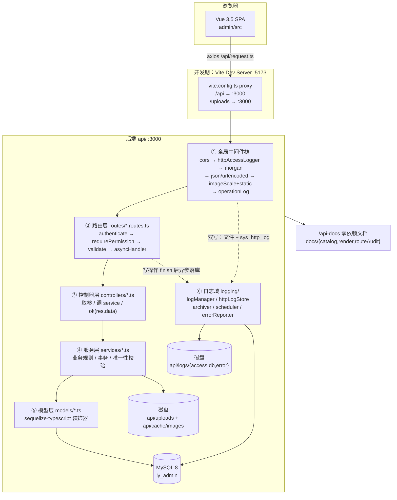
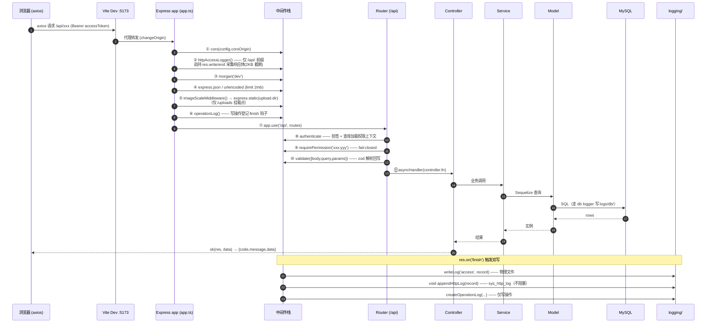
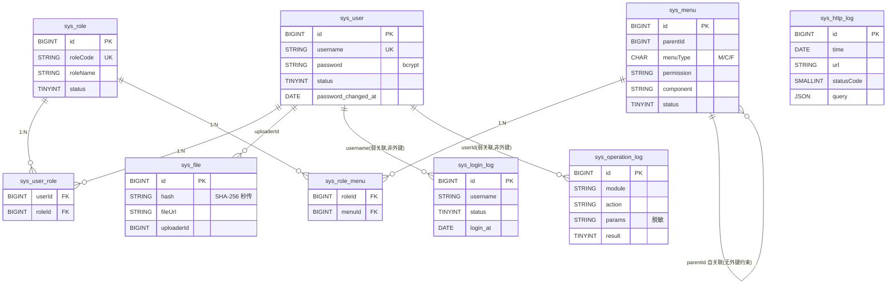
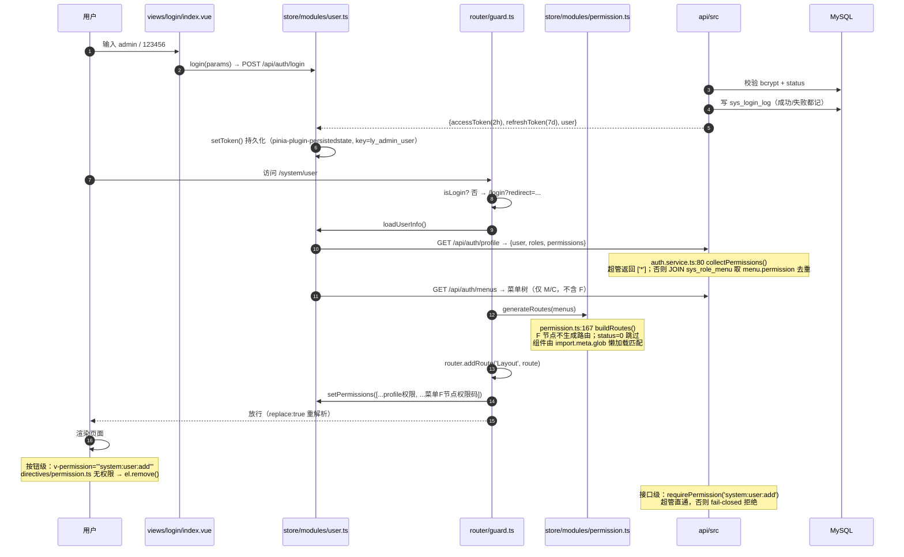

# LYAdmin 架构接手手册（ARCHITECTURE-HANDOVER）

> 适用范围：`C:/Users/LY-VM/Desktop/ly-admin`（蓝云后台管理系统 LYAdmin）
> 编写方式：**只读通读源码**，所有结论均给出 `文件路径:行号` 依据，未做臆测。
> 本次梳理**未修改任何源码**（唯一新增文件是本手册）。
> 代码基线：`master @ eb5671a`（`style(log): 操作日志方法列按请求方法显示彩色标签`），另有 `dev` 分支。

---

## 0. 三十秒速览

| 维度         | 结论                                                                                                                                                                                                                                                  |
| ------------ | ----------------------------------------------------------------------------------------------------------------------------------------------------------------------------------------------------------------------------------------------------- |
| 形态         | 单仓双工程：`admin/`（Vue 3.5 + Vite 8 + TS + Element Plus + Tailwind + Pinia）、`api/`（Express 5 + TS + Sequelize 6 + MySQL 8）。仓库根只放工程规范（ESLint / Prettier / Stylelint / husky / commitlint）。                                         |
| 后端规模     | `api/src` **85 个 `.ts`**：`app.ts`+`server.ts`(2) / config(2) / constants(1) / controllers(9) / middlewares(7) / models(9+index) / routes(9+index) / seed(3+index) / services(12) / logging(7+index) / docs(4) / validators(5) / utils(9) / types(2) |
| 核心领域     | 三段式 RBAC（用户-角色-菜单/权限码）、三套日志（登录/操作/HTTP）、文件管理（秒传+图片按需缩放）、代码生成器（gen）、零依赖自建接口文档                                                                                                                |
| 一句话架构   | **前端动态路由完全由后端菜单树驱动**；后端是"中间件栈 → router → controller → service → model"的经典四层，权限在 middleware 层强制拦截，业务在 service 层，落库在 model 层。                                                                          |
| 权限红线现状 | **基本达标**。后端 `requirePermission()` **35 处调用全部带参**且已 fail-closed；写操作与只读权限码已分离（gen 四码、log clear 独立码）。**但发现 3 个前端越权缺口 + 1 个后端无码接口**，详见 §3.6。                                                   |

---

## 1. 系统全景

### 1.1 分层架构图



### 1.2 前后端请求链路（中间件顺序以 `api/src/app.ts` 为准）



### 1.3 中间件顺序（**必须准确**，摘抄自 `api/src/app.ts:21-71`）

| #   | 行号  | 中间件                                                      | 说明                                      |
| --- | ----- | ----------------------------------------------------------- | ----------------------------------------- |
| 0   | 24-25 | `trust proxy` / `disable('x-powered-by')`                   | 取真实 IP、隐藏技术栈                     |
| 1   | 28-33 | `cors({origin: config.corsOrigin, credentials:true})`       | 默认 `http://localhost:5173`              |
| 2   | 36    | `httpAccessLogger()`                                        | **访问日志双写**（文件 + `sys_http_log`） |
| 3   | 37    | `morgan('dev')`                                             | 控制台                                    |
| 4   | 40-41 | `express.json` / `express.urlencoded`（2mb）                | 请求体解析                                |
| 5   | 46    | **`imageScaleMiddleware()` → `express.static(upload.dir)`** | 挂载 `/uploads`                           |
| 6   | 49    | `operationLog()`                                            | 写操作登记（挂 finally 钩子，不阻塞）     |
| 7   | 52-58 | `GET /api` 健康检查                                         | 在业务路由之前                            |
| 8   | 61    | `app.use('/api', routes)`                                   | 9 个业务子路由                            |
| 9   | 64    | `registerDocsRoutes(app)`                                   | `/api-docs`（在 `/api` **之外**，不冲突） |
| 10  | 67-68 | `notFoundHandler` → `errorHandler`                          | 统一兜底                                  |

> **⚠️ 关键约束：`imageScale` 必须在 `static` 之前**（`app.ts:44-46` 注释已写明）。
> 原因：`imageScaleMiddleware` 是「条件处理 + 放行」型中间件——命中 `?scale=` 且为合法图片时 `res.sendFile()` 返回缩放结果，否则 `next()` 交给 `express.static` 出原图。
> 若顺序颠倒，`express.static` 会先把原图响应掉，`imageScale` 永远得不到执行，缩放功能静默失效。
> 详见 `api/src/middlewares/imageScale.ts:52-118`（非 GET/HEAD、无 scale、非图片、越界、异常 五种情况一律 `next()` 回退）。

### 1.4 路由挂载表（`api/src/routes/index.ts:18-26`）

| 挂载点                             | 文件                  | 鉴权方式                                                |
| ---------------------------------- | --------------------- | ------------------------------------------------------- |
| `/api`（健康检查）                 | `app.ts:52`           | 公开                                                    |
| `/api/auth`                        | `auth.routes.ts`      | login/refresh 公开；其余 `authenticate`                 |
| `/api/users`                       | `user.routes.ts`      | `router.use(authenticate)` + 逐接口 `requirePermission` |
| `/api/roles`                       | `role.routes.ts`      | 同上（**`/all` 例外，无权限码**）                       |
| `/api/menus`                       | `menu.routes.ts`      | 同上                                                    |
| `/api/logs`                        | `log.routes.ts`       | 同上                                                    |
| `/api/files`                       | `file.routes.ts`      | 同上                                                    |
| `/api/dashboard`                   | `dashboard.routes.ts` | 仅 `authenticate`（登录即可）                           |
| `/api/profile`                     | `profile.routes.ts`   | 仅 `authenticate`（登录即可）                           |
| `/api/gen`                         | `gen.routes.ts`       | 同上 + 四码分离                                         |
| `/api-docs`、`/api-docs/data.json` | `docs/index.ts:66-78` | 公开                                                    |

---

## 2. 数据模型（`api/src/models/*.ts`）

### 2.1 九张表总览

| 表                  | 模型文件          | 主键        | 时间戳                  | 性质                     |
| ------------------- | ----------------- | ----------- | ----------------------- | ------------------------ |
| `sys_user`          | `User.ts`         | BIGINT 自增 | ✅ created/updated      | 业务主数据               |
| `sys_role`          | `Role.ts`         | BIGINT 自增 | ✅                      | 业务主数据               |
| `sys_menu`          | `Menu.ts`         | BIGINT 自增 | ✅                      | 业务主数据（权限载体）   |
| `sys_user_role`     | `UserRole.ts`     | BIGINT 自增 | ❌ (`timestamps:false`) | 多对多中间表             |
| `sys_role_menu`     | `RoleMenu.ts`     | BIGINT 自增 | ❌                      | 多对多中间表             |
| `sys_login_log`     | `LoginLog.ts`     | BIGINT 自增 | ❌（自带 `login_at`）   | **日志表**               |
| `sys_operation_log` | `OperationLog.ts` | BIGINT 自增 | ✅ 仅 created           | **日志表**               |
| `sys_file`          | `File.ts`         | BIGINT 自增 | ✅ 仅 created           | 业务主数据（文件元信息） |
| `sys_http_log`      | `HttpLog.ts`      | BIGINT 自增 | ❌（自带 `time`）       | **日志表**               |

> 全部统一 `underscored: true`（`config/database.ts:53`）+ `freezeTableName: true` + `utf8mb4`，时区 `+08:00`（`database.ts:64`）。

### 2.2 字段级说明

#### `sys_user`（`User.ts:24-83`）

| 字段                         | 类型               | 约束                | 说明                                                             |
| ---------------------------- | ------------------ | ------------------- | ---------------------------------------------------------------- |
| `id`                         | BIGINT UNSIGNED PK | 自增                |                                                                  |
| `username`                   | STRING(50)         | NOT NULL, UNIQUE    | 登录账号，正则 `^[a-zA-Z0-9_]{3,20}$`（`constants/index.ts:58`） |
| `password`                   | STRING(100)        | NOT NULL            | bcrypt 哈希                                                      |
| `nickname`                   | STRING(50)         | NOT NULL, 默认 `''` |                                                                  |
| `avatar` / `email` / `phone` | STRING(255/100/20) | NULL                |                                                                  |
| `status`                     | TINYINT            | NOT NULL, 默认 1    | 1 启用 / 0 禁用                                                  |
| `last_login_at`              | DATE               | NULL                | 登录成功时更新（`auth.service.ts:152`）                          |
| `password_changed_at`        | DATE               | NULL                | **改密后旧 Token 全部失效的判据**（`auth.ts:53-58`）             |
| `remark`                     | STRING(255)        | NULL                |                                                                  |

→ **安全设计**：`User.toJSON()` 重写（`User.ts:77-82`）剔除 `password` 与 `passwordChangedAt`，杜绝序列化泄漏。

#### `sys_role`（`Role.ts:26-58`）

`id` / `roleName` STRING(50) / `roleCode` STRING(50) **UNIQUE** / `sort` INT / `status` TINYINT / `remark` STRING(255)

#### `sys_menu`（`Menu.ts:25-84`）

`id` / `parentId` BIGINT（0=根，自关联）/ `menuName` STRING(50) / `menuType` CHAR(1) **`M`目录 `C`菜单 `F`按钮** / `path` STRING(200) / `component` STRING(255) / `icon` STRING(100) / **`permission` STRING(100)** / `sort` INT / `visible` TINYINT / `status` TINYINT / `redirect` STRING(255) / `keep_alive` TINYINT

> `permission` 是整个权限体系的枢纽：菜单（C）的 `permission` 决定"能否进入页面"，按钮（F）的 `permission` 决定"能否看到/调用某个操作"。
> 注意 `Menu.ts:73-77` 的自关联显式写了 `constraints: false`，**数据库层面没有 `parent_id` 外键**，父子完整性靠 service 层保证（`menu.service.ts:updateMenu`）。

#### `sys_user_role` / `sys_role_menu`（`UserRole.ts`、`RoleMenu.ts`）

均为 `id + 外键 + 唯一联合索引`（`role_id,menu_id` / `user_id,role_id`），`timestamps: false`。

#### `sys_login_log`（`LoginLog.ts:13-42`）

`id` / `username` STRING(50) / `ip` / `userAgent` STRING(500) / `status` TINYINT（1 成功 0 失败）/ `message` STRING(255) / `login_at` DATE(默认 NOW)
**无索引**（对比 `HttpLog` 有 4 个索引）→ 数据量上来后按时间筛选会全表扫。

#### `sys_operation_log`（`OperationLog.ts:14-55`）

`id` / `userId` / `username` / `module` / `action` / `method` / `url` / `params`(TEXT, 脱敏 JSON) / `duration`(ms) / `result`(1 成功 0 失败) / `errorMessage` / `ip` / `created_at`
**无索引**。

#### `sys_http_log`（`HttpLog.ts:20-55`）

`id` / `time` DATE(3) / `method` STRING(10) / `url` STRING(1024) / `statusCode` SMALLINT / `duration` INT / `ip` / `userAgent` / `query` JSON / `reqBody` TEXT / `resBody` TEXT
**唯一带索引的日志表**：`idx_time`、`idx_method`、`idx_status_code`、`idx_method_time`（`HttpLog.ts:13-18`）

#### `sys_file`（`File.ts:14-46`）

`id` / `originName` / `fileName` / `filePath` / `fileUrl` / `mimeType` / `size` / **`hash` STRING(64)（SHA-256，秒传去重依据）** / `uploaderId` / `created_at`（`updatedAt: false`）

### 2.3 表间关系（ER）



**Sequelize 关联声明**（`models/index.ts:26` 注册 9 个模型）：

| 关联                                         | 声明位置                                    |
| -------------------------------------------- | ------------------------------------------- |
| `User` ⇄ `Role`（多对多，经 `UserRole`）     | `User.ts:70` / `Role.ts:47`                 |
| `Role` ⇄ `Menu`（多对多，经 `RoleMenu`）     | `Role.ts:50` / `Menu.ts:79`                 |
| `Menu` → `Menu.children`（HasMany parentId） | `Menu.ts:73`                                |
| `Menu` → `Menu.parent`（BelongsTo）          | `Menu.ts:76`                                |
| `User`/`Role`/`Menu` → 中间表（HasMany）     | `User.ts:73`、`Role.ts:53,56`、`Menu.ts:82` |

### 2.4 日志表与清理/归档机制（**重点**）

三张日志表 + 一套物理文件日志，清理能力**严重不均衡**：

| 数据                       | 落库/落盘方式                                                                         | 清理 / 归档机制                                                                                  | 现状评价                        |
| -------------------------- | ------------------------------------------------------------------------------------- | ------------------------------------------------------------------------------------------------ | ------------------------------- |
| `sys_login_log`            | `auth.service.ts:63` `LoginLog.create()`（成功与失败都记）                            | **无任何清理/导出/归档接口**                                                                     | ❌ 只增不减                     |
| `sys_operation_log`        | `middlewares/operationLog.ts:120` `createOperationLog()`（`res.on('finish')` 后异步） | 只有查询与 CSV 导出，**无清理接口**                                                              | ❌ 只增不减                     |
| `sys_http_log`             | `logging/httpLogStore.ts:45` `HttpLog.create()`（fire-and-forget，失败吞异常）        | ✅ `DELETE /api/logs/http` → `HttpLog.truncate()`（`log.controller.ts:41`，需 `log:http:clear`） | ⚠️ 只能"全清"，无按时间范围清理 |
| `logs/access/YYYY-M-D.log` | `utils/logger.ts:180` `writeLog('access', record)`                                    | ✅ 每日 00:05 由 `scheduler.ts` 用系统 `tar` 归档为 `.tar.gz`，默认删源文件                      | ✅ 有归档                       |
| `logs/db/YYYY-M-D.log`     | `config/database.ts:31`（Sequelize `logging` 钩子 + `benchmark:true`，含慢 SQL 标记） | ✅ 同上                                                                                          | ✅ 有归档                       |
| `logs/error/YYYY-M-D.log`  | `logging/errorReporter.ts:109`（**仅 5xx 写，4xx 不写**，见 `errorHandler.ts:32`）    | ✅ 同上                                                                                          | ✅ 有归档                       |
| `api/cache/images/*`       | `image.service.ts:143` sharp 缩放缓存                                                 | **无任何淘汰机制**                                                                               | ❌ 只增不减                     |

**归档调度链路**（`server.ts:20` → `logging/scheduler.ts:56`）：

1. 启动立即 `runArchive('启动补跑')`（不阻塞，覆盖停机跨天）
2. `setTimeout` 自调度到次日 `archiveHour:archiveMinute`（默认 `00:05`），每次执行后重算延迟防漂移（**零 cron 依赖**）
3. `archivePastLogs()` 只处理「日期键 < 今天」的文件，幂等（目标 `.tar.gz` 已存在即跳过）
4. Windows 兼容：以源目录为 `cwd`、目标用「相对路径 + 正斜杠」传入 tar（规避盘符冒号被 GNU tar 误判为远端主机，见 `archiver.ts:8-11`）

---

## 3. 权限模型（RBAC）

### 3.1 完整链路：登录 → 双 Token → 菜单树 → 动态路由 → 按钮指令



### 3.2 双 Token 与无感刷新

**后端签发**（`utils/jwt.ts`）：

- `accessToken`：`config.jwt.accessSecret`，默认 `2h`，载荷 `{userId, username}`（**不含角色/权限**，权限每次现查库）
- `refreshToken`：`config.jwt.refreshSecret`（**不同密钥**），默认 `7d`
- 三处强制失效判据（`middlewares/auth.ts` + `services/auth.service.ts:168`）：
  1. `user.status !== ENABLED` → 401 账号禁用
  2. `payload.iat*1000 < passwordChangedAt` → 401 密码已变更
  3. Token 过期 / 签名无效 → 401

**前端无感刷新状态机**（`admin/src/api/request.ts:33-201`）：

```
isRefreshing（单飞标志） + pendingQueue（挂起队列）
  ① 首个 401：isRefreshing=true → requestNewToken()
     注意：requestNewToken 用「裸 axios.post」而非 service，避免递归进拦截器（request.ts:68）
  ② 并发 401：压入 pendingQueue，等待新 Token 后重放（_retry=true 防无限循环）
  ③ 刷新成功：广播新 Token 给队列 → 重放原请求
  ④ 刷新失败/refresh 接口自身 401：handleAuthFailure() → 清 Token + localStorage → window.location.href='/login?redirect=...'
```

- 请求拦截额外注入 `X-Timezone-Offset`（`request.ts:93`），供后端 CSV 导出按用户本地时区格式化时间。
- **登出是无状态的**：`auth.service.ts:238` `logout()` 是空实现，服务端不维护黑名单；前端只清本地 Token。

### 3.3 权限码命名规范

`模块:资源:动作`，示例与清单（**以 `api/src/seed/menu.seed.ts` 为准**）：

| 分组            | 权限码                                                                                         | 类型         | 种子行号                   |
| --------------- | ---------------------------------------------------------------------------------------------- | ------------ | -------------------------- |
| 用户管理        | `system:user:list`                                                                             | 菜单（页面） | `menu.seed.ts:55`          |
|                 | `system:user:query` / `:add` / `:edit` / `:remove` / `:resetPwd` / `:assignRole`               | 按钮         | `:64,71,78,85,92,99`       |
| 角色管理        | `system:role:list`（页面）、`system:role:query` / `:add` / `:edit` / `:remove` / `:assignMenu` | 按钮         | `:111,120,127,134,141,148` |
| 菜单管理        | `system:menu:list`（页面）、`system:menu:query` / `:add` / `:edit` / `:remove`                 | 按钮         | `:160,169,176,183,190`     |
| 登录日志        | `log:login:list`（页面）、`log:login:export`                                                   | 按钮         | `:214,223`                 |
| 操作日志        | `log:operation:list`（页面）、`log:operation:export`                                           | 按钮         | `:235,244`                 |
| HTTP 日志       | `log:http:list`（页面）、**`log:http:clear`（高危）**                                          | 按钮         | `:256,265`                 |
| 文件管理        | `file:list`（页面）、`file:upload` / `file:remove`                                             | 按钮         | `:279,284,285`             |
| 代码生成        | `tool:gen:list`（页面）、**`tool:gen:preview` / `:download` / `:create`（三码分离）**          | 按钮         | `:305,314,321,328`         |
| 首页 / 个人中心 | 无权限码（登录即可）                                                                           | 菜单         | `:28-37`、`336-345`        |

**规范要点**：

- 页面级统一用 `:list`，进入页面后按钮级才细分；
- **写操作 / 破坏性操作必须有独立码**，禁止复用 `:list` / `:query`（`gen.routes.ts:22`、`log.routes.ts:27-28` 有显式注释约束）；
- 超管 `super_admin` 后端直通（`permission.ts:22`），前端权限数组下发 `['*']`（`auth.service.ts:82`）。

### 3.4 后端拦截：`requirePermission`

```ts
// api/src/middlewares/permission.ts:14-41
export function requirePermission(...codes: string[]): RequestHandler;
```

- 无 `req.user` → 401
- `roles.includes('super_admin')` → **直通**
- `codes.length === 0` → **403（fail-closed）**（`:29-31`，注释明确说明这是为修复"空参放行"的历史越权风险）
- `codes.some(c => user.permissions.includes(c))` → 通过，否则 403

### 3.5 前端拦截：`v-permission`

```ts
// admin/src/directives/permission.ts:8-18
mounted(el, binding) { if (!hasPermission(binding.value)) el.parentNode?.removeChild(el) }
// admin/src/utils/permission.ts:9-21
hasPermission(code) { /* 超管 '*' / '*:*:*' 通配；否则 some(includes) */ }
```

权限码来源两路合并（`guard.ts:55`）：`/api/auth/profile` 下发的 `permissions` ∪ 菜单树中 F 节点的 `permission`。

### 3.6 🔴 权限红线审查结论（**本次重点产出**）

#### ✅ 达标项

| 检查项                                   | 结论                                                                                                                                                                                                    | 依据                                                                                                     |
| ---------------------------------------- | ------------------------------------------------------------------------------------------------------------------------------------------------------------------------------------------------------- | -------------------------------------------------------------------------------------------------------- |
| `requirePermission()` 是否存在不传参调用 | **无**。35 处调用（`routes/*.routes.ts` 中 `requirePermission(...)` 实际调用点）全部带参，0 处空参                                                                                                      | 脚本核对：35 处调用 + 6 行 `import`；全仓 `requirePermission()` 空参仅命中 `permission.ts:27` 的注释文字 |
| 中间件是否 fail-closed                   | **是**。`codes.length===0` → 403                                                                                                                                                                        | `permission.ts:26-31`                                                                                    |
| 写操作是否复用只读权限码                 | **否**。gen 用 4 个独立码；log clear 独立码（提交 `c41b459 fix(security): 修复只读角色可清空日志的越权漏洞`）；user 的 edit/resetPwd/assignRole 各自独立                                                | `gen.routes.ts:18-23`、`log.routes.ts:29`、`user.routes.ts:60-79`                                        |
| 只读角色 `viewer` 是否只持查看类权限     | **是**。仅 `dashboard`/`system`(目录)/`system:user`(`system:user:list`)/`system:user:query`/`log`(目录)/`log:login`/`log:operation`/`log:http`/`profile`，**不含任何写操作码，也不含 `log:http:clear`** | `role.seed.ts:63-82`（`:68-69` 有显式约束注释）                                                          |
| 上传接口是否先鉴权再解析 multipart       | **是**。`requirePermission('file:upload')` 在 `upload.any()` 之前                                                                                                                                       | `file.routes.ts:17`                                                                                      |
| 代码生成落盘是否有路径穿越防护           | **是**。三重防御：`NAME_PATTERN`（`gen.service.ts:74`）+ 服务端派生路径 + `resolve` 后前缀校验                                                                                                          | `gen.writer.ts:57-78`                                                                                    |

#### 🔴 发现的问题（按严重度）

**P1-1｜`GET /api/roles/all` 完全没有权限码**

- 位置：`api/src/routes/role.routes.ts:30` → `router.get('/all', asyncHandler(roleController.all));`
- 问题：同文件其余 6 个接口都挂了 `requirePermission`，唯独 `/all` 只有 `authenticate`。任意已登录用户（**含只读 viewer**）可枚举全部角色的 `id / roleName / roleCode / sort / status`，属内部权限模型信息泄漏，也破坏了"权限码全覆盖"约定。
- 建议：补 `requirePermission('system:role:list')`；若确需给"用户分配角色"下拉用（无 `system:role:list` 的角色也要能选角色），则新建独立码 `system:role:option` 并只授予具备用户管理写权限的角色。

**P1-2｜文件管理整页无任何 `v-permission`**

- 位置：`admin/src/views/upload/index.vue` —— `el-upload` 拖拽上传区（`:119-132`）、删除按钮（`:177`）
- 问题：后端 `file:upload` / `file:remove` 两个写操作权限码已定义且强制，但**前端两个入口都没加 `v-permission`**。全站 18 处 `v-permission` 分布在 7 个页面（log×3、system×3、tool/gen×1），**唯独 `views/upload/index.vue` 一处都没有**。任何能进入 `/upload` 页面的角色都能看到并尝试上传/删除（后端仍会 403，但会触发见 P2-3 的整页跳转）。
- 建议：上传区包一层 `<div v-permission="'file:upload'">`，删除按钮加 `v-permission="'file:remove'"`。

**P1-3｜用户状态开关（写操作）未加 `v-permission`**

- 位置：`admin/src/views/system/user/index.vue:184` → `<el-switch :model-value="row.status === 1" @change="handleStatusChange(row)" />`
- 问题：该开关调 `PUT /api/users/:id/status`，后端要求 `system:user:edit`（`user.routes.ts:62`），是**写操作**。但前端未加 `v-permission="'system:user:edit'"`。只读 `viewer` 能看到并点击 → 后端返回 403 → 前端整页跳 `/403`（见 P2-3），用户体验与权限一致性双输。
- 建议：补 `v-permission="'system:user:edit'"`。

**P2-1｜前端权限判定是 fail-OPEN，与后端 fail-closed 相反**

- 位置：`admin/src/utils/permission.ts:10-12`（`if (!code || length===0) return true`）+ `admin/src/directives/permission.ts:11-13`（`if (!value) return;` 直接保留元素）
- 问题：后端 `requirePermission()` 空码 → 拒绝；前端空码 → **放行**。一旦权限码写错成 `undefined`/空串/拼错变量，按钮就会对所有角色可见，形成"看得见点不了"的越权暴露面。
- 建议：`hasPermission` 空值时 `return false`（或无权限时 `el.style.display='none'` 而非不处理）；并在 dev 环境 `console.warn` 提示无效权限码。

**P2-2｜`collectPermissions` 不校验父菜单状态**

- 位置：`api/src/services/auth.service.ts:88-100`
- 问题：查询条件只有 `Menu.status = ENABLED`，**不校验父级菜单是否启用**。管理员把某个父菜单禁用后，其子按钮权限码仍会被下发，用户虽看不到入口，但直接调接口仍能通过。
- 建议：改为先取启用菜单全集，在内存中剔除"父链上存在禁用节点"的分支后再收集权限码。

**P2-3｜403 一律整页跳转，按钮级越权会打断用户**

- 位置：`admin/src/api/request.ts:120-126`、`143-150` → `window.location.href = '/403'`
- 问题：403 既可能来自"路由级无权限"，也可能来自"某个按钮点击"。后者表现为：点一下按钮 → 整页重载到 403 页，正在填的表单全丢。
- 建议：403 默认只 `ElMessage.error`；仅在路由守卫/页面初始化请求失败时才跳 403 页。

**P2-4｜`/api/gen/*` 写操作不进操作日志**

- 位置：`api/src/middlewares/operationLog.ts:18-38`（`OPERATION_RULES` 只有 users/roles/menus/files/profile，**无 `/api/gen`**）
- 问题：`POST /api/gen/create` 是**全系统最危险的写操作**（把生成代码直接写入 `api/src` 与 `admin/src`，还会改写 `models/index.ts`、`routes/index.ts`），却不产生任何 `sys_operation_log` 留痕。出问题无法追溯"谁在什么时候生成了什么"。
- 建议：补规则 `{ pattern: /^\/api\/gen\/create$/, module: '代码生成', action: '生成到项目' }`（预览/下载可按需加）。

**P3-1｜JWT 默认密钥硬编码**

- 位置：`api/src/config/index.ts:51-52`（`'ly_admin_access_secret'` / `'ly_admin_refresh_secret'`）、`api/.env.example:12-13`
- 问题：未提供环境变量时静默回退到公开可猜的默认密钥，可直接伪造任意用户 Token。当前本地 `api/.env` 使用的也正是这一对默认值。
- 建议：生产环境缺 `JWT_*_SECRET` 时**启动即报错退出**，不要静默回退。

**P3-2｜`/api-docs` 完全公开**

- 位置：`api/src/app.ts:63-64`、`docs/index.ts:66-78`
- 说明：`app.ts:63` 注释称"不含敏感信息"，但文档实际上完整暴露了全部接口路径与**全部权限码清单**（`docs/catalog.ts` 中每个 endpoint 的 `permission` 字段），等于把权限模型地图公开。
- 建议：生产环境用 `NODE_ENV` 或独立开关关闭 `/api-docs`，或加 Basic Auth / IP 白名单。

---

## 4. 模块清单

### 4.1 后端模块 → routes / controller / service / validator 对应表

| 模块             | routes                | controller                                                                                       | service                                                                                     | validator                                                        | 权限码                                          |
| ---------------- | --------------------- | ------------------------------------------------------------------------------------------------ | ------------------------------------------------------------------------------------------- | ---------------------------------------------------------------- | ----------------------------------------------- |
| 认证 auth        | `auth.routes.ts`      | `auth.controller.ts`<br/>login/refresh/logout/profile/menus/permissions                          | `auth.service.ts`                                                                           | `auth.validator.ts`<br/>loginSchema, refreshSchema               | 无（profile/menus/permissions 仅 authenticate） |
| 用户 users       | `user.routes.ts`      | `user.controller.ts`<br/>list/detail/create/update/remove/changeStatus/resetPassword/assignRoles | `user.service.ts`                                                                           | `user.validator.ts`<br/>6 schema                                 | `system:user:*`                                 |
| 角色 roles       | `role.routes.ts`      | `role.controller.ts`<br/>list/all/create/update/remove/menus/assignMenus                         | `role.service.ts`                                                                           | `role.validator.ts`<br/>5 schema                                 | `system:role:*`（**`/all` 无码**）              |
| 菜单 menus       | `menu.routes.ts`      | `menu.controller.ts`<br/>list/tree/detail/create/update/remove                                   | `menu.service.ts`                                                                           | `menu.validator.ts`<br/>3 schema                                 | `system:menu:*`                                 |
| 日志 logs        | `log.routes.ts`       | `log.controller.ts`<br/>loginLogs/operationLogs/httpLogs/clearHttpLogs/export×2                  | `log.service.ts`<br/>+ `logging/httpLogStore.ts`                                            | ❌ **无 validator**（query 直接取 `req.query`）                  | `log:*:*`                                       |
| 文件 files       | `file.routes.ts`      | `file.controller.ts`<br/>upload/list/check/remove                                                | `file.service.ts`<br/>+ `image.service.ts`                                                  | ❌ **无 validator**（multer fileFilter 代劳）                    | `file:*`                                        |
| 仪表盘 dashboard | `dashboard.routes.ts` | `dashboard.controller.ts`<br/>stats/loginTrend/operationDistribution/roleUserCount               | `dashboard.service.ts`                                                                      | ❌                                                               | 无（登录即可）                                  |
| 个人中心 profile | `profile.routes.ts`   | `profile.controller.ts`<br/>updateProfile/changePassword/uploadAvatar                            | `profile.service.ts`                                                                        | `profile.validator.ts`<br/>（复用 auth 的 changePasswordSchema） | 无（登录即可）                                  |
| 代码生成 gen     | `gen.routes.ts`       | `gen.controller.ts`<br/>listTables/tableDetail/preview/download/create                           | `gen.service.ts`<br/>`gen.templates.ts`<br/>`gen.writer.ts`<br/>+ `utils/zip.ts`            | ❌ **无 validator**（`resolveGenContext` 内手写校验）            | `tool:gen:*`                                    |
| 接口文档 docs    | `docs/index.ts`       | —                                                                                                | `docs/catalog.ts`（数据）<br/>`docs/render.ts`（HTML）<br/>`docs/routeAudit.ts`（覆盖校验） | —                                                                | 公开                                            |

### 4.2 后端模块 → 前端 views / api 映射表

| 后端模块         | 前端 API 模块                                                                                        | 前端页面                                                                                                                        | 备注                                                                         |
| ---------------- | ---------------------------------------------------------------------------------------------------- | ------------------------------------------------------------------------------------------------------------------------------- | ---------------------------------------------------------------------------- |
| `/api/auth`      | `admin/src/api/auth.ts`（loginApi/refreshApi/logoutApi/getProfileApi/getMenusApi/getPermissionsApi） | `views/login/index.vue`                                                                                                         | `getPermissionsApi` 已定义但**前端未使用**（权限来自 profile + 菜单 F 节点） |
| `/api/users`     | `api/user.ts`（7 个）                                                                                | `views/system/user/index.vue`<br/>`components/UserForm.vue`<br/>`components/AssignRoleDialog.vue`                               |                                                                              |
| `/api/roles`     | `api/role.ts`（7 个，含 `getAllRolesApi`）                                                           | `views/system/role/index.vue`<br/>`components/RoleForm.vue`<br/>`components/PermissionDrawer.vue`                               | `getAllRolesApi` ← `/api/roles/all`（P1-1 问题接口）                         |
| `/api/menus`     | `api/menu.ts`（6 个）                                                                                | `views/system/menu/index.vue`<br/>`components/MenuForm.vue`<br/>`components/IconSelect.vue`<br/>`components/MenuTree/index.vue` |                                                                              |
| `/api/logs`      | `api/log.ts`（6 个）                                                                                 | `views/log/login/index.vue`<br/>`views/log/operation/index.vue`<br/>`views/log/http/index.vue`                                  |                                                                              |
| `/api/files`     | `api/file.ts`（4 个）                                                                                | `views/upload/index.vue`                                                                                                        | ⚠️ 该页 0 处 `v-permission`（P1-2）                                          |
| `/api/dashboard` | `api/dashboard.ts`（4 个）                                                                           | `views/home/index.vue`<br/>`components/{StatCard,TrendChart,BarChart,PieChart}.vue`                                             | ECharts                                                                      |
| `/api/profile`   | `api/profile.ts`（3 个）                                                                             | `views/profile/index.vue`<br/>`components/ProfileForm.vue`<br/>`components/PasswordForm.vue`                                    |                                                                              |
| `/api/gen`       | `api/gen.ts`（5 个）                                                                                 | `views/tool/gen/index.vue`                                                                                                      |                                                                              |
| `/api-docs`      | —                                                                                                    | —                                                                                                                               | 后端自渲染单文件 HTML                                                        |

### 4.3 前端基础设施

| 目录                                   | 内容                                                          | 关键点                                                                                                                   |
| -------------------------------------- | ------------------------------------------------------------- | ------------------------------------------------------------------------------------------------------------------------ |
| `api/request.ts`                       | axios 实例 + 拦截器                                           | 无感刷新（§3.2）、统一解包 `code===200 → return data`、403 跳转                                                          |
| `router/routes.ts`                     | 静态路由（login/redirect/403/404/500/Layout/catch-all）       | `name:'Layout'` 是动态路由注入锚点（`:51`）                                                                              |
| `router/guard.ts`                      | `beforeEach`                                                  | 白名单 `['/login','/403','/404','/500']`；`permissionStore.added` 防重复注入                                             |
| `store/modules/permission.ts`          | 菜单树 → 动态路由                                             | `buildRoutes()`（`:167`）、`collectButtonPermissions()`（`:74`）、`ROUTE_NAME_OVERRIDES`（`:36`，keep-alive 组件名补丁） |
| `store/modules/user.ts`                | 用户/角色/权限/菜单                                           | 持久化只 pick `accessToken, refreshToken`（`:122-126`）                                                                  |
| `store/modules/app.ts` / `tagsView.ts` | 布局状态 / 标签页                                             |                                                                                                                          |
| `hooks/useTable.ts` / `useTheme.ts`    | 列表分页封装 / 主题                                           |                                                                                                                          |
| `directives/permission.ts`             | `v-permission`                                                | §3.5                                                                                                                     |
| `components/`                          | BasicDialog / IconPicker / MenuTree / Pagination / SearchForm |                                                                                                                          |

---

## 5. 关键机制

### 5.1 文件上传与图片按需缩放

**上传链路**（`file.routes.ts:17` → `middlewares/upload.ts` → `services/file.service.ts`）：

1. `requirePermission('file:upload')` → `upload.any()`（兼容 `files` / `files[]` / `file` 任意字段名）
2. multer `diskStorage`：`destination = config.upload.dir`（默认 `api/uploads`），文件名 `${Date.now()}_${random8}${ext}`（`upload.ts:18-22`）
3. 双重白名单：`UPLOAD_ALLOWED_MIME` + `UPLOAD_ALLOWED_EXT` 必须**同时命中**（`upload.ts:35-44`，`constants/index.ts:71-101`）
4. limits：`fileSize` 10MB、`files` 10
5. **秒传**：计算 SHA-256（`File.hash`），命中已存在记录则删除本次物理文件、返回既有记录 + `deduplicated: true`，不新增记录
6. **删除**：引用计数语义——同一 `filePath` 仍有其它记录时只删记录，本条为最后引用时才删磁盘文件

**图片按需缩放链路**（`GET /uploads/xxx.png?scale=0.1`）：

```
imageScaleMiddleware()                      // 必须在 static 之前
  ├─ 非 GET/HEAD → next()
  ├─ parseScale(query.scale) == null → next()   // 缺省/非法/重复参数/越界(0.1~1)
  ├─ resolveSafePath(req.path) → 防目录穿越（decodeURIComponent + resolve + 前缀校验）
  ├─ isImageFile() ? : next()                // 扩展名白名单 .png/.jpg/.jpeg/.webp/.gif/.avif
  ├─ statSync 必须是普通文件，否则 next()
  └─ getScaledImage()                        // services/image.service.ts:102
       ├─ scale >= 1 → 原图
       ├─ 缓存命中 → 直接返回 cachePath
       ├─ inflight Map 并发去重（同 key 共享同一个 Promise）
       └─ sharp 仅按 width 等比缩放（保持原格式、只缩不放）
            → 临时文件 + 原子 rename（防半截文件被误判为缓存命中）
            → 任何异常 catch 后回退原图路径
  → res.sendFile(resultPath) + Cache-Control: public, max-age=604800（7 天）
```

**安全设计**：缓存目录 `api/cache/images` 刻意放在静态根 `api/uploads` **之外**（`config/index.ts:63-67` 有注释说明），避免缓存文件被公开访问。

### 5.2 代码生成（gen）工作原理

```
GET  /api/gen/tables            → 读 information_schema.TABLES（仅 BASE TABLE）
GET  /api/gen/tables/:tableName → 读 information_schema.COLUMNS（用 ? 占位参数化，防注入）
POST /api/gen/preview           → 返回源码文件列表（不落盘）
POST /api/gen/download          → 打包 ZIP 返回
POST /api/gen/create            → 直接写进真实项目目录 + 自动接线
```

**模板产物**（`services/gen.templates.ts:700-707`，一次生成 7 个文件）：

```
backend/models/<Cls>.ts
backend/validators/<name>.validator.ts
backend/services/<name>.service.ts
backend/controllers/<name>.controller.ts
backend/routes/<name>.routes.ts
frontend/api/<name>.ts
frontend/views/<moduleName>/<name>/index.vue
```

外加 `README.md`（不落盘，`gen.writer.ts:68-71` 返回 null 过滤掉）。

**ZIP 打包零依赖**：`utils/zip.ts` 手工拼装 PKZIP 三段结构（本地文件头 / 中央目录 / EOCD），store 模式不压缩，自实现 CRC32，设置 UTF-8 标志位（0x0800）避免中文路径乱码。

**落盘安全三重防御**（`gen.writer.ts`）：

1. `NAME_PATTERN = /^[a-zA-Z][a-zA-Z0-9]*$/`（`gen.service.ts:74`）——模块名/业务名只许字母数字且字母开头
2. 目标路径**服务端派生**，不接受客户端路径（`gen.writer.ts:8` 注释）
3. `resolve()` 后校验 `absolute.startsWith(targetDir + sep)`（`:74`），非法即 400

**自动接线**（`gen.writer.ts:108-167`）：用"行模式锚点 + 倒序找最后一个匹配"的方式往 `api/src/models/index.ts`（import / export / models 数组）和 `api/src/routes/index.ts`（import / `router.use`）插入代码；锚点缺失时**不做半截修改**，返回 `injected: []` 交由人工处理（`:131-134`）。
冲突检测：同名文件已存在且未传 `overwrite=true` → 409，message 列出冲突文件（`:182-185`）。

### 5.3 三类日志的落库方式（`api/src/logging/`）

| 类            | 触发点                                                                              | 落库/落盘                                                                                                                                             |
| ------------- | ----------------------------------------------------------------------------------- | ----------------------------------------------------------------------------------------------------------------------------------------------------- |
| HTTP 访问日志 | `utils/logger.ts:135` `httpAccessLogger()`，挂 `res.on('finish')`                   | **双写** ① `writeLog('access',...)` → `logs/access/YYYY-M-D.log`（JSON Lines）② `void appendHttpLog(...)` → `sys_http_log`（fire-and-forget，吞异常） |
| 操作日志      | `middlewares/operationLog.ts:88`，仅 POST/PUT/PATCH/DELETE 且命中 `OPERATION_RULES` | `services/log.service.ts:createOperationLog` → `sys_operation_log`                                                                                    |
| 登录日志      | `services/auth.service.ts:55-74` `writeLoginLog()`                                  | `LoginLog.create()` → `sys_login_log`（成功与失败都记，失败也吞异常）                                                                                 |
| 错误日志      | `middlewares/errorHandler.ts:29`（**仅 5xx**）、`logging/processHandlers.ts`        | `logs/error/YYYY-M-D.log`，**绝不写数据库**（避免递归）                                                                                               |
| SQL 日志      | `config/database.ts:21-36` Sequelize `logging` 钩子 + `benchmark:true`              | `logs/db/YYYY-M-D.log`，`slow = durationMs >= 200`                                                                                                    |

**关键约定**：

- 只记 `/api/` 前缀（`/uploads` 静态资源不记，`logger.ts:141`）
- 用 `req.originalUrl` 而非 `req.path`（后者在 finish 时已被剥离挂载前缀，`logger.ts:139`）
- `/api/logs/*` 的响应体不记录，避免"日志的日志"递归噪音（`logger.ts:156`）
- 响应体捕获上限 2048 字节，超出只计数不入内存（`logger.ts:101-104`）
- 脱敏：正则 `/password|pwd|pass|token|secret|authorization|credential/i`（`logger.ts:32`）

### 5.4 自建零依赖接口文档与 routeAudit

- **架构**：`docs/catalog.ts`（纯数据，1790 行手工维护的强类型常量）→ `docs/render.ts`（渲染内联 CSS/JS 的单文件 HTML）→ `docs/index.ts`（注册 `/api-docs`、`/api-docs/data.json`）
- **零依赖达成**：`api/src/docs/` 目录下 4 个文件**只 import 类型与 `@/docs/catalog`**，无任何 npm 包；ZIP 打包同理自实现（`utils/zip.ts`）
- **routeAudit 覆盖率校验**（`docs/routeAudit.ts:153`）：
  1. `collectRuntimeRoutes(app)`：递归遍历 Express router stack，绕开"Express 5 的 Layer 不再暴露挂载路径"的问题——优先读 `layer.path`，否则用 `layer.matchers` 逐个探测 `buildProbeMounts()` 生成的候选前缀（`resolveMount()` `:46-76`）
  2. 与 `ALL_ENDPOINTS` 做双向 diff：输出"代码有文档缺"与"文档有代码无"两类告警
  3. **容错铁律**：任何异常/结构不符都只 `console.log` 一行提示，**绝不抛出、绝不阻断启动**（`:6-9`、`:192-194`）
  4. 调用时机：`server.ts:34`，在 `app.listen` **之后**

**当前覆盖率实测（本次核对）：100%，0 处不一致。**

| 来源                                                        | 数量   |
| ----------------------------------------------------------- | ------ |
| `routes/*.routes.ts` 中 `router.get/post/put/delete` 注册数 | 49     |
| `app.ts:52` 健康检查 `GET /api`                             | 1      |
| `docs/index.ts:66,74` 文档页 + data.json                    | 2      |
| **运行时合计**                                              | **52** |
| `docs/catalog.ts` 中 `ALL_ENDPOINTS` 条目数                 | **52** |

> 例外提醒：`catalog.ts:1771` 的**示例 JSON** 里写的是 `"total": 47`（历史遗留静态文案），与真实 `ENDPOINT_TOTAL=52` 不符，属示例文案陈旧而非覆盖缺失。

---

## 6. 技术债与风险清单

> 格式：`文件:行号` — 问题 — 建议

### 🔴 高优先级

| #   | 位置                                           | 问题                                                                                                                        | 建议                                                                                |
| --- | ---------------------------------------------- | --------------------------------------------------------------------------------------------------------------------------- | ----------------------------------------------------------------------------------- |
| D1  | `api/src/routes/role.routes.ts:30`             | `GET /api/roles/all` 无权限码，任意登录用户可枚举全部角色                                                                   | 补权限码（详见 §3.6 P1-1）                                                          |
| D2  | `admin/src/views/upload/index.vue:119-132,177` | 文件管理整页 0 处 `v-permission`，上传/删除两个写入口裸奔                                                                   | 补两个 `v-permission`（P1-2）                                                       |
| D3  | `admin/src/views/system/user/index.vue:184`    | 状态开关（写操作）无 `v-permission`                                                                                         | 补 `v-permission="'system:user:edit'"`（P1-3）                                      |
| D4  | `api/src/middlewares/operationLog.ts:18-38`    | `/api/gen/create`（写源码到项目目录）不在 `OPERATION_RULES`，**最危险的写操作零留痕**                                       | 补齐规则（P2-4）                                                                    |
| D5  | `api/src/services/user.service.ts` 相关        | `sys_login_log` / `sys_operation_log` **无任何清理/归档接口**，只增不减；`sys_http_log` 只能全表 TRUNCATE，无按时间范围清理 | 增加按时间范围删除接口 + 定时归档任务（复用 `logging/archiver.ts` 的思路迁移到 DB） |
| D6  | `api/src/services/image.service.ts:87-92`      | 缩放缓存 `api/cache/images/` **无淘汰机制**，源文件删除后缓存仍残留，长期磁盘泄漏                                           | 加 LRU/TTL 清理，或删文件时联动清理同名 `_s*.xx` 缓存                               |
| D7  | `api/src/config/index.ts:51-52`                | JWT 密钥有硬编码默认值，缺环境变量时静默使用可猜密钥（`api/.env` 当前即为默认值）                                           | 生产环境缺失即启动失败                                                              |

### 🟡 中优先级

| #   | 位置                                                                               | 问题                                                                                                                                                                                      | 建议                                                                                           |
| --- | ---------------------------------------------------------------------------------- | ----------------------------------------------------------------------------------------------------------------------------------------------------------------------------------------- | ---------------------------------------------------------------------------------------------- |
| D8  | `api/src/services/auth.service.ts:115-124` → `:88-100`                             | `loadAuthUser` 在**每一个**鉴权请求上执行 `User.findByPk(include Role)` + `Menu.findAll(JOIN Role)`，无任何缓存。每个 API 请求固定 2~3 次 SQL，且权限变更要等下次请求才生效（这点是对的） | 加短期内存缓存（如 30s，key=userId），权限变更时主动失效；或把权限塞进 JWT（需接受时效性下降） |
| D9  | `api/src/middlewares/operationLog.ts:70-82` vs `api/src/utils/logger.ts:35-47`     | **两套脱敏实现**：前者用 `SENSITIVE_KEYS` 精确匹配（4 个字段名），后者用正则 `SENSITIVE_KEY_RE`。规则不一致，新增敏感字段极易漏改其中一处                                                 | 抽到 `utils/` 统一，两份都引用                                                                 |
| D10 | `api/src/validators/{user,menu,role}.validator.ts`                                 | `idParamSchema` 在三个文件里各写一遍（内容相同）                                                                                                                                          | 抽到公共 validator 或 `validators/common.ts`                                                   |
| D11 | `api/src/server.ts:23`                                                             | 每次启动都 `sequelize.sync({alter:false})` 自动建表。开发环境便利，生产环境等于允许应用自动 DDL                                                                                           | 生产改为迁移脚本（umzug / sequelize-cli），或由 `NODE_ENV` 开关控制                            |
| D12 | `api/src/app.ts:63-64` + `docs/catalog.ts`                                         | `/api-docs` 完全公开，暴露全量接口路径与**全部权限码清单**                                                                                                                                | 生产环境关闭或加访问控制（P3-2）                                                               |
| D13 | `admin/src/api/request.ts:120-126,143-150`                                         | 任何 403 都 `window.location.href='/403'` 整页跳转，按钮级越权会打断用户操作、丢失表单                                                                                                    | 403 默认只提示，路由级才跳页（P2-3）                                                           |
| D14 | `admin/src/utils/permission.ts:10-12`                                              | 前端权限判定 fail-OPEN，与后端 fail-closed 相反                                                                                                                                           | 空码返回 false（P2-1）                                                                         |
| D15 | `api/src/services/auth.service.ts:88-100`                                          | `collectPermissions` 不校验父菜单启用状态，父菜单禁用后子按钮权限仍生效                                                                                                                   | 剔除父链含禁用节点的分支（P2-2）                                                               |
| D16 | `api/src/models/LoginLog.ts` / `OperationLog.ts`                                   | 两张日志表**零索引**，而页面支持按 `username` / `module` / 时间范围筛选                                                                                                                   | 补 `idx_login_at`、`idx_created_at`、`idx_module`、`idx_username`                              |
| D17 | `api/src/controllers/log.controller.ts`、`file.controller.ts`、`gen.controller.ts` | 无 zod validator，`req.query` / `req.body` 直接透传给 service（靠 service 内部 `Record<string, unknown>` 手动解析）                                                                       | 补 validator 层，与 users/roles/menus 对齐                                                     |
| D18 | `api/src/docs/catalog.ts`（1790 行）                                               | 文档目录与路由**无强绑定**，`routeAudit` 只打印告警不阻断 CI                                                                                                                              | 把 `auditDocsCoverage` 接入 CI，diff>0 即 fail                                                 |

### 🟢 低优先级 / 代码整洁

| #   | 位置                                             | 问题                                                                                                                                                            | 建议                                                                      |
| --- | ------------------------------------------------ | --------------------------------------------------------------------------------------------------------------------------------------------------------------- | ------------------------------------------------------------------------- |
| D19 | `admin/src/store/modules/permission.ts:36-38`    | `ROUTE_NAME_OVERRIDES` 手工维护表（`/home` → `HomePage`），因为 keep-alive `include` 按**组件名**匹配而路由名由 path 推导。新增页面若组件名不符规则会静默不缓存 | 统一约定"组件 `defineOptions({name})` = PascalCase(path)"，逐步去掉覆盖表 |
| D20 | `api/src/seed/index.ts:21`                       | 用 `require.main === module`（CommonJS 语法）判断直接执行，而项目是 ESM 风格的 `import` 语法混用                                                                | 改用 `import.meta` 或统一为 CJS（当前能跑是因为 ts-node 编译为 CJS）      |
| D21 | `api/src/logging/archiver.ts:79`                 | 依赖系统 `tar` 二进制（Git Bash GNU tar / Windows bsdtar 行为有差异），容器内可能不存在                                                                         | 提供纯 Node zlib 回退，或明确写入部署文档                                 |
| D22 | `api/src/services/auth.service.ts:238`           | `logout()` 是空实现（`return Promise.resolve()`），服务端不维护黑名单，Token 在 2h 内仍然有效                                                                   | 若需强制下线，引入 refreshToken 白名单表或 Redis 黑名单                   |
| D23 | `admin/src/api/auth.ts:30`                       | `getPermissionsApi` 已定义但前端未使用（权限来自 profile + 菜单 F 节点合并）                                                                                    | 删除或补注释说明保留原因                                                  |
| D24 | `api/src/controllers/dashboard.controller.ts` 等 | `_req` 未使用参数命名不统一（`_req` / `req`）                                                                                                                   | 跟随 `CODE-STYLE.md` 统一                                                 |
| D25 | 仓库根 `docs/` 与 `api/src/docs/` 同名概念       | 根目录 `docs/ARCHITECTURE.md`（90KB）、`docs/system_design.md`（27KB）与本次新增的 `docs/handover/` 存在内容重叠风险                                            | 明确 `ARCHITECTURE.md` 为设计期、`handover/` 为接手期，互相链接           |

### 6.1 文档与代码不一致之处

| 位置                                                    | 不一致                                                                                                                                                                      |
| ------------------------------------------------------- | --------------------------------------------------------------------------------------------------------------------------------------------------------------------------- |
| `api/src/routes/index.ts:3`                             | 注释写"将 **8 个**业务路由模块挂载"，实际 `router.use` 有 **9 处**（auth/users/roles/menus/logs/files/dashboard/profile/gen）                                               |
| `api/src/docs/catalog.ts:1771`                          | 文档示例里写 `"total": 47`，而实际 `ENDPOINT_TOTAL = 52`（49 个业务路由 + `GET /api` 健康检查 + 2 个 `/api-docs`）。示例值为历史遗留，易误导                                |
| `api/src/logging/archiver.ts:5,7` / `database.ts:14` 等 | 多处注释引用 `docs/system_design.md §3.5 / §4 / §8` 等章节号，需确认该文档章节编号未漂移                                                                                    |
| `api/src/models/Menu.ts:37`                             | `menuType` 声明为 `CHAR(1)`，但 `constants/index.ts:40-44` 的 `MenuType` 枚举值为 `'M'/'C'/'F'`；而 `docs/catalog.ts` 的示例响应写的是 `"menuType": "M"`，与种子数据一致 ✅ |
| `api/src/seed/menu.seed.ts:32`                          | 首页 `component: 'home/index'`，但 `menuType` 是 `MenuType.MENU`（`C`），而名字叫"首页"且是根级——与目录/菜单的类型语义略有出入（不影响功能）                                |

---

## 7. 新人上手路径

### 7.1 环境启动（3 步）

```bash
# 1. 根依赖（工程规范 / husky / commitlint）
npm install

# 2. 后端：配置 api/.env（可直接 cp .env.example .env），准备 MySQL 库 ly_admin
npm --prefix api install
npm run dev:api        # nodemon，:3000，启动即建表 + 写种子（admin/123456）

# 3. 前端
npm --prefix admin install
npm run dev:admin      # vite，:5173，已配 /api 与 /uploads 代理

# 或一键双开
npm run dev
```

启动后三个关键入口：

- 接口健康检查：http://localhost:3000/api
- **接口文档（重点，先看这个）**：http://localhost:3000/api-docs
- 管理后台：http://localhost:5173 （`admin` / `123456`）

### 7.2 改一个典型功能："新增一个业务模块"（以 `report`（报表）为例）

> **最快路径：用代码生成器起骨架，再手工补齐权限。** 下面分 A（推荐）/ B（纯手工）两条路。

#### A 路线：用 gen 生成骨架（约 5 分钟）

1. 在 MySQL 建业务表，例如 `biz_report`
2. 后台 → 系统工具 → 代码生成 → 选 `biz_report`，填模块名 `report`、业务名 `report`
3. 点「预览代码」确认 → 点「生成到项目」（需 `tool:gen:create` 权限）
   - 自动生成 7 个文件（§5.2），并**自动接线** `api/src/models/index.ts` 与 `api/src/routes/index.ts`
4. **重启后端**（`models/index.ts`、`routes/index.ts` 已改，必须重启）
5. 后台 → 系统管理 → 菜单管理，新增菜单：
   - 目录 `报表`（M，path `/report`，icon 自选）
   - 菜单 `报表管理`（C，path `/report/list`，component `report/list/index`，permission `report:list`）
   - 按钮若干（F）：`report:query` / `report:add` / `report:edit` / `report:remove`
6. 系统管理 → 角色管理 → 为 `admin` 授权这些菜单；**只读 `viewer` 只给 `report:list` / `report:query`**
7. 刷新前端页面（动态路由自动出现，无需改前端路由表）

#### B 路线：纯手工改动（按顺序）

**后端（api/src）**

| 顺序 | 文件                               | 动作                                                                           |
| ---- | ---------------------------------- | ------------------------------------------------------------------------------ |
| 1    | `models/Report.ts`                 | 新建，`@Table({tableName:'biz_report', underscored:true})`                     |
| 2    | `models/index.ts`                  | `import` + `export` + 加入 `models` 数组（**3 处，缺一不可**）                 |
| 3    | `validators/report.validator.ts`   | 新建 zod schema（`xListQuerySchema` / upsert / `idParamSchema`）               |
| 4    | `services/report.service.ts`       | 新建，`listX / getXDetail / createX / updateX / deleteX`，返回 `PageResult<T>` |
| 5    | `controllers/report.controller.ts` | 新建，`asyncHandler` 包裹 + `ok(res, data)`                                    |
| 6    | `routes/report.routes.ts`          | 新建，`router.use(authenticate)` + 逐接口 `requirePermission('report:xxx')`    |
| 7    | `routes/index.ts`                  | `import reportRoutes` + `router.use('/reports', reportRoutes)`                 |
| 8    | `seed/menu.seed.ts`                | 加菜单树节点（目录 + 菜单 + 按钮），按钮 `permission` 用独立码                 |
| 9    | `seed/role.seed.ts`                | 给 `admin` 授权；`viewer` **只加查看类码**                                     |
| 10   | `docs/catalog.ts`                  | 补接口文档条目（否则 `routeAudit` 会告警"代码有文档缺"）                       |
| 11   | `middlewares/operationLog.ts`      | 若含写操作，往 `OPERATION_RULES` 加规则（否则不留痕）                          |

**前端（admin/src）**

| 顺序 | 文件                                                                                                                 | 动作                                                                 |
| ---- | -------------------------------------------------------------------------------------------------------------------- | -------------------------------------------------------------------- |
| 12   | `types/api.ts`                                                                                                       | 加 `Report` / `ReportQuery` 等类型                                   |
| 13   | `api/report.ts`                                                                                                      | 新建，用 `request.ts` 导出的 `get/post/put/del`                      |
| 14   | `views/report/list/index.vue`                                                                                        | 新建页面组件，用 `SearchForm` + `Pagination` + `useTable`            |
| 15   | **`views/report/list/index.vue` 的每个写操作按钮加 `v-permission="'report:add'"` 等**（最容易漏，见 §3.6 P1-2/P1-3） |
| 16   | 路由                                                                                                                 | **不用改** —— 动态路由由菜单树驱动（`guard.ts:51-52`）               |
| 17   | 若页面名与 `PascalCase(path)` 不一致且需要 keep-alive                                                                | 往 `store/modules/permission.ts:36` 的 `ROUTE_NAME_OVERRIDES` 补一条 |

**收尾** 18. 重启后端 → 用超管登录 → 授权角色 → 刷新前端 19. `npm run lint` + `npm --prefix api run typecheck` + `npm --prefix admin run type-check` 20. 提交：`npm run commit`（cz-git 交互式 commitlint）

### 7.3 排查问题的入口地图

| 症状                | 先看                                                                                                                                                   |
| ------------------- | ------------------------------------------------------------------------------------------------------------------------------------------------------ |
| 接口 401            | `middlewares/auth.ts` → `services/auth.service.ts:115`（查库上下文）→ `utils/jwt.ts`                                                                   |
| 接口 403 但按钮可见 | `routes/*.routes.ts` 的 `requirePermission` 码 vs 前端 `v-permission` 码是否一致；再看 `seed/role.seed.ts` 是否给该角色授权                            |
| 菜单/页面不出现     | `services/menu.service.ts:40 getMenusByRoles` → `guard.ts:51` → `store/modules/permission.ts:167 buildRoutes`（`console.warn` 会打印"未找到菜单组件"） |
| 页面组件 404 / 空白 | `store/modules/permission.ts:59 resolveComponent` —— 后端 `component` 字段必须是相对 `admin/src/views/` 的路径                                         |
| keep-alive 不生效   | `permission.ts:36 ROUTE_NAME_OVERRIDES` + 组件 `defineOptions({name})`                                                                                 |
| 日志查不到          | `utils/logger.ts`（HTTP，需 `/api/` 前缀）/ `middlewares/operationLog.ts`（操作，需命中 `OPERATION_RULES`）/ `auth.service.ts:55`（登录）              |
| 文档缺接口          | `docs/routeAudit.ts` 启动日志 `[Docs] 告警：代码里有但文档缺 → …`                                                                                      |
| 上传后图片不缩放    | 确认 `app.ts:46` 的中间件顺序（imageScale 在 static 之前）、`?scale=` 取值 0.1~1、扩展名在白名单                                                       |

---

## 8. 附录：关键文件速查

```
仓库根
├─ eslint.config.mjs / .prettierrc.json / .stylelintrc.json / commitlint.config.cjs / lint-staged.config.cjs
├─ .husky/                                    提交前钩子
├─ docs/
│  ├─ PRD.md                                  产品需求
│  ├─ ARCHITECTURE.md                         设计期架构（90KB）
│  ├─ CODE-STYLE.md / GIT-CONVENTION.md       规范
│  ├─ system_design.md + *.mermaid            系统设计
│  └─ handover/ARCHITECTURE-HANDOVER.md       ← 本文件
├─ api/
│  ├─ .env / .env.example                     环境配置（.env 已 gitignore）
│  └─ src/
│     ├─ server.ts                            启动编排（进程钩子 → 归档调度 → 连库 → 建表 → 种子 → listen → 文档审计）
│     ├─ app.ts                               ★ 中间件栈顺序（唯一权威来源）
│     ├─ config/{index,database}.ts           配置中心 / Sequelize 实例
│     ├─ constants/index.ts                   错误码 / 枚举 / 正则 / 上传白名单
│     ├─ middlewares/                         auth / permission / validate / errorHandler / operationLog / upload / imageScale
│     ├─ routes/                              9 业务 + index
│     ├─ controllers/ services/ validators/   三层
│     ├─ models/                              9 模型 + index
│     ├─ logging/                             logManager / httpLogStore / archiver / scheduler / errorReporter / processHandlers
│     ├─ docs/                                ★ 零依赖接口文档（catalog / render / routeAudit）
│     ├─ seed/                                menu / role / user（幂等）
│     └─ utils/                               jwt / password / response / logger / zip / pagination / tree / datetime / asyncHandler
└─ admin/
   └─ src/
      ├─ main.ts / App.vue
      ├─ api/                                 10 模块 + request.ts（无感刷新核心）
      ├─ router/{index,routes,guard}.ts       ★ 动态路由注入
      ├─ store/modules/{user,permission,app,tagsView}.ts
      ├─ directives/permission.ts  utils/permission.ts   ★ 按钮级权限
      ├─ components/ hooks/ layout/ utils/ types/
      └─ views/                               home / login / log/* / system/* / tool/gen / upload / profile / error / redirect
```

---

_本手册为只读梳理产出，未修改任何源码。所有行号对应 `master @ eb5671a`；如代码有后续提交，请以最新源码为准。_
