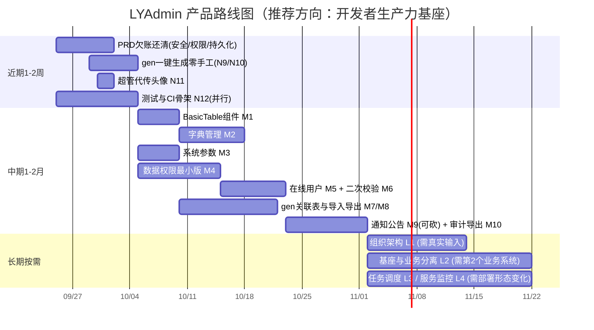

# LYAdmin 产品路线图建议（后续往哪走）

> 版本：v1.0 ｜ 撰写：许清楚（产品经理） ｜ 日期：2026-09-24
> 依据：`docs/PRD.md`（39 条需求）、`docs/handover/FEATURES-HANDOVER.md`（81 功能点 / E1~E12）、`docs/handover/HANDOVER.md`（风险清单 / 健康度实测）
> 文档性质：**只读盘点 + 建议**，未改动任何源码与既有文档。
> 阅读对象：决策人（老板）与接手开发。

---

## 0. 先说结论（30 秒版）

### 0.1 推荐方向

> **推荐：方向 B ——「开发者生产力基座」。以 `gen` 代码生成器为唯一北极星，把「新增一个业务模块的总耗时」作为产品的核心指标；同时只挑选方向 A 中能直接降低二次开发成本的模块（字典、系统参数、数据权限）作为配套。明确不做运行时低代码（在线表单设计器 / 页面拖拽）。**

### 0.2 北极星指标（唯一）

| 指标                                                                             | 现状（实测）                                                                                                                                            | 3 个月目标                                                       | 6 个月目标                                                                    |
| -------------------------------------------------------------------------------- | ------------------------------------------------------------------------------------------------------------------------------------------------------- | ---------------------------------------------------------------- | ----------------------------------------------------------------------------- |
| **新增一个业务模块，从"表已建好"到"超管能在侧边栏点开并用"所需时间与手工步骤数** | 约 60~90 分钟 / 手工 5 步（gen 生成 → 加菜单种子 → 加按钮权限码 → 补 `docs/catalog.ts` → 补 `OPERATION_RULES`），其中 2 步极易漏（见 `HANDOVER.md` §9） | **≤ 30 分钟 / 手工 0 步**（gen 一键生成后 4 项自动接线全部完成） | **≤ 15 分钟 / 手工 0 步**，且生成物开箱带字典下拉、关联字段显示、导入导出模板 |

> 选这个指标的缘由：LYAdmin 的定位是**基座**，"自己有几个功能"不是成功标准，"别人用它搭系统快不快"才是。当前 81 个功能点已实现 69 个，继续堆通用模块边际收益递减。

### 0.3 三个时间盒的投入分配

| 时间盒      | 总人日 | 方向 B（降本/gen）       | 方向 A（安全可追溯 + 通用能力） | 工程质量（并行，非产品功能） |
| ----------- | ------ | ------------------------ | ------------------------------- | ---------------------------- |
| 近期 1-2 周 | 10.6   | 4.0（N9/N10/N11）        | 3.6（N1~N8）                    | 3.0（N12）                   |
| 中期 1-2 月 | 25.0   | 7.5（M1/M7/M8）          | 17.5（M2~M6/M9/M10）            | —                            |
| 长期 3-6 月 | 按需   | 8.0（L7 基座与业务分离） | 按需（L1/L5，需业务方确认）     | —                            |

---

## 1. 方向的三个候选与取舍

### 1.1 方向 A：继续夯实「通用后台基座能力」

| 项                           | 内容                                                                                                                                                                                |
| ---------------------------- | ----------------------------------------------------------------------------------------------------------------------------------------------------------------------------------- |
| 目标用户                     | 企业内部多个业务后台的开发团队（一个团队同时维护 3~10 个内部管理系统）                                                                                                              |
| 典型场景                     | 新系统立项 → clone 基座 → 只写业务页面；审计员要查全量操作留痕                                                                                                                      |
| 要补的模块                   | 字典管理、系统参数配置、通知公告、任务调度、在线用户管理、服务监控、数据权限、审计导出、二次登录校验                                                                                |
| **为什么现在适合**           | 需求边界清晰、无市场风险、全是 CRUD + 种子的标准套路，本项目的 seed 机制（`menu.seed.ts` findOrCreate 递归写入，启动即生效）让"加模块"成本极低                                      |
| **为什么不适合作为唯一方向** | ① 这些是每个后台都有的"标配"，做完也不构成差异化；② 无真实业务方驱动，容易做成功能堆砌；③ 会和若依/RuoYi 这类成熟开源基座正面撞车，而对方的模块数是本项目的数倍——**拼功能数量必输** |

### 1.2 方向 B：做成「低代码平台」

| 项                                 | 内容                                                                                                                                                                                                                                                                                                                                                                                                                                                  |
| ---------------------------------- | ----------------------------------------------------------------------------------------------------------------------------------------------------------------------------------------------------------------------------------------------------------------------------------------------------------------------------------------------------------------------------------------------------------------------------------------------------- |
| 目标用户                           | 非专业开发、但需要快速交付内部工具的运营/运维人员                                                                                                                                                                                                                                                                                                                                                                                                     |
| 典型场景                           | 运营自己在页面上配字段、配列表、配查询条件，不改代码就得到一个 CRUD 页面                                                                                                                                                                                                                                                                                                                                                                              |
| **为什么现在部分适合（关键依据）** | **本项目已经自带低代码的雏形**：`api/src/services/gen.*`（`gen.templates` 模板引擎 + `gen.writer` 落盘器）+ 前端 `admin/src/views/tool/gen`，已实现「读 `information_schema` → 生成 7 个文件（模型/校验器/服务/控制器/路由 + 前端 api/页面 + README）→ 预览 / 下载 ZIP / **直接写入项目目录并自动接线** `models/index.ts` 与 `routes/index.ts`」。这条链路覆盖了低代码最难的部分（元数据读取 + 代码产出 + 自动接线），只差"在线配置 UI"和"运行时渲染" |
| **为什么现在完全做成不合适**       | ① 在线表单设计器 + 元数据表 + 动态渲染引擎 + 条件逻辑/联动校验，工作量是现有项目（3 天 / 75 提交 / 1.8 万行）的**数倍**；② 项目**零测试覆盖**，运行时动态渲染一旦出错，影响面是全站而非单个模块；③ 项目有"**零第三方依赖**"硬约束（`HANDOVER.md` §12.3），拖拽设计器自研成本极高，引库则破坏约束；④ 目前没有一条"非开发人员要自己配页面"的真实需求                                                                                                    |

### 1.3 方向 C：深耕「垂直业务场景」

| 项               | 内容                                                                                                                                                                               |
| ---------------- | ---------------------------------------------------------------------------------------------------------------------------------------------------------------------------------- |
| 目标用户         | 某个具体业务部门（如客服工单、进销存、会员运营）                                                                                                                                   |
| 典型场景         | 直接把 LYAdmin 变成一个能用的业务系统交付给部门                                                                                                                                    |
| **为什么不适合** | ① 业务代码与基座代码混在一个仓库，基座后续升级会被业务耦合拖死，**直接毁掉"基座"这个定位**；② 单人开发、无业务方输入，需求全靠猜；③ 做出来就只是"又一个业务系统"，基建投入无法复用 |

### 1.4 最终推荐：方向 B′（开发者生产力基座）

**取 B 的资产（gen）、取 A 的"降本 + 安全"子集，放弃 B 的运行时低代码、放弃 C。**

| 理由                                                        | 依据                                                                                                                                                                  |
| ----------------------------------------------------------- | --------------------------------------------------------------------------------------------------------------------------------------------------------------------- |
| ① gen 是被严重低估的差异化资产                              | 它是超出 PRD 的自研能力，落盘 7 文件 + 自动接线，`README.md` 第 1 节「功能特性」表**完全没写它**——说明连自己都没把它当卖点                                            |
| ② 成本结构最优                                              | gen 的"元数据读取 → 代码产出 → 接线"已经打通，往下只需补"生成后自动补权限/菜单/文档/留痕"（2 人日）就能把手工步骤从 5 步降到 0 步；而运行时低代码要从零建另一套技术栈 |
| ③ 与 PRD 定位自洽                                           | PRD §2「让业务方能够在同一套框架上快速接入新功能」——北极星指标就是这句话的量化版本                                                                                    |
| ④ 风险可控                                                  | 生成的是**静态代码**，有 `tsc --noEmit` / `vue-tsc` / ESLint 三重校验兜底（当前全零告警），出错影响面仅限新模块；运行时低代码没有这层保护                             |
| ⑤ 方向 A 的模块仍要挑着做，但用"是否为降本服务"作为准入门槛 | 字典管理 → 让 gen 能生成下拉、让列表能翻译码值（**做**）；服务监控 → 与降本无关（**不做**）                                                                           |

**准入门槛（新增通用模块必须先过这两问）**：

- Q1：它能否让"新增一个业务模块"更快？
- Q2：它能否让"审计更完整 / 权限更严密"？
- **两问都答"否" → 不做。** 只有一个答"是" → 降级为中期填充项；两个都"是" → 提优先级。

---

## 2. 功能路线图

> 成本口径：单人日 = 8 小时有效开发（含自测），按本项目既往产出速度（3 天 / 81 功能点）校准。
> 归属方向缩写：**D1** 安全与可追溯 ｜ **D2** 通用基座能力 ｜ **D3** 降本·gen ｜ **D4** 降本·前端组件/模板 ｜ **D5** 工程质量（非产品功能，但为所有功能前提）

### 2.1 近期（1-2 周，合计 10.6 人日）

> 主题：**把 PRD 欠账还清 + 让 gen 一次生成不留手工尾巴**。这批做完，PRD 39 条全部达交付标准。

| #       | 功能点                                                                                                          | 归属方向 | 价值（为什么现在做）                                                                                                                                              | 成本(人日) | 依赖         | 验收标准（可量化）                                                                                                                                                                                                                                                                                                                                                               |
| ------- | --------------------------------------------------------------------------------------------------------------- | -------- | ----------------------------------------------------------------------------------------------------------------------------------------------------------------- | ---------- | ------------ | -------------------------------------------------------------------------------------------------------------------------------------------------------------------------------------------------------------------------------------------------------------------------------------------------------------------------------------------------------------------------------- |
| **N1**  | `OPERATION_RULES` 补 2 条：清空 HTTP 日志 + 代码生成落盘                                                        | D1       | 补齐 G3「操作可追溯」的最后一块。谁清空了全量日志、谁往源码目录写了文件，当前**完全查不到**——这是审计上的黑洞，也是本项目唯一被三方独立审查一致判为 P0 的产品问题 | 0.2        | 无           | ① 调用 `DELETE /api/logs/http` 与 `POST /api/gen/create` 各产生 1 条 `sys_operation_log`，`module`/`action`/`params`/`result`/`duration` 五个字段非空；② 操作日志页按「日志管理」「代码生成」模块筛选可查到；③ 改动仅 `api/src/middlewares/operationLog.ts` 一个数组，不新增文件                                                                                                 |
| **N2**  | 前端按钮级权限补 3 处 + 判定改 fail-closed（REQ-007 收尾）                                                      | D1       | 消除"能点但必然 403 整页跳"的割裂体验；堵住"授权给只读角色后按钮露出来"的口子。后端权限码早就有了，是前端漏挂                                                     | 0.5        | 无           | ① 全站 `v-permission` 使用点 **16 → 19** 处（补：`system/user/index.vue:184` 状态开关 `system:user:edit`、`upload/index.vue` 上传区 `file:upload` 与删除 `file:remove`）；② `admin/src/utils/permission.ts:10-12` 与 `directives/permission.ts:11-13` 空码返回 **false**（与后端 fail-closed 对齐）；③ viewer 登录：用户页 DOM 中无 `el-switch`、上传页 DOM 中无上传区与删除按钮 |
| **N3**  | 路由级权限校验 + 403 改为路由内跳转（REQ-004 收尾）                                                             | D1       | 手敲无权限 URL 现在落 404（语义错误，误导排查）；接口 403 用 `window.location.href` 整页跳会丢掉已填表单和标签页                                                  | 1.0        | N2           | ① `admin/src/router/guard.ts` 校验 `to.meta.permission`，无权限 → `router.push('/403')`（**非整页刷新**）；② viewer 手敲 `/system/role` 命中 `/403` 而非 `/404`，切换前后 tagsView 中已开标签不丢失；③ `admin/src/api/request.ts:120-126/143-150` 的两处 `window.location.href` 全部替换为路由跳转；④ catch-all 仅对真正不存在的路径生效                                         |
| **N4**  | 暗黑模式持久化（REQ-021 收尾）                                                                                  | D2       | PRD 验收标准白纸黑字写了「刷新后保持」，属验收未过项；改动 1 行                                                                                                   | 0.1        | 无           | ① `admin/src/store/modules/app.ts` 的 `persist.pick` 追加 `dark`；② 切暗色后连续刷新 10 次，无一闪回亮色                                                                                                                                                                                                                                                                         |
| **N5**  | 用户启/禁用二次确认 + 禁止对自己下手（REQ-024 收尾）                                                            | D1       | 误点即冻结账号，且超管能把自己锁死，无撤销成本提示                                                                                                                | 0.3        | N2           | ① 点击状态开关弹出二次确认；② 对当前登录用户自己点击时按钮禁用（或提示「不能禁用当前登录账号」）；③ 连续误点 5 次不产生任何状态变更                                                                                                                                                                                                                                              |
| **N6**  | `admin` 权限收敛：`tool:gen:create`、`log:http:clear` 收归超管                                                  | D1       | 「向源码目录写 .ts/.vue」与「清空全量日志」是系统级能力，不该由"业务运营管理者"持有；这是当前最实质的越权风险                                                     | 0.2        | 无           | ① `api/src/seed/role.seed.ts` 中 admin 的 key 数 **27 → 25**；② admin 登录：`/tool/gen` 无「生成到项目」按钮、`/log/http` 无「清空所有日志」按钮；③ 重跑 `npm run seed` 结果一致（幂等），菜单树总数不变                                                                                                                                                                         |
| **N7**  | `GET /api/roles/all` 补权限码                                                                                   | D1       | 唯一一个无权限码的业务读接口，任何登录用户（含 viewer）可枚举全部角色含 `super_admin`                                                                             | 0.3        | 无           | ① `api/src/routes/role.routes.ts:30` 挂 `requirePermission('system:role:query')`（或新增 `system:role:all` 并写入 `menu.seed.ts` + `role.seed.ts`）；② viewer 调用返回 403；③ 持 `system:user:assignRole` 的角色仍能正常拉到角色下拉（回归用例）                                                                                                                                 |
| **N8**  | 登录页去掉默认账密预填与明文提示                                                                                | D1       | 与 `README.md`「首次部署后立即修改密码」的安全提示自相矛盾；公网部署等于公开凭据                                                                                  | 0.2        | 无           | ① `admin/src/views/login/index.vue` 表单初始值改为空；② 页面 grep 不到 `123456`；③ 仅 `import.meta.env.DEV` 下展示提示文案                                                                                                                                                                                                                                                       |
| **N9**  | ★ gen 生成后**自动补齐 4 项接线**：菜单种子节点、按钮权限码、`docs/catalog.ts` 条目、`OPERATION_RULES` 留痕规则 | **D3**   | **本路线图的核心。** 这 4 项正是 `HANDOVER.md` §9 点名的"最容易漏的两步"扩展版。补上后，新增业务模块的手工步骤从 5 步降到 0 步，直接命中北极星指标                | 2.0        | N1           | ① 对一张新表执行「生成到项目」后，**无需手工改动** `menu.seed.ts` / `role.seed.ts` / `docs/catalog.ts` / `operationLog.ts` 任一文件；② 重启后：模块菜单出现在超管侧边栏、4 个按钮权限码（`:query/:add/:edit/:remove`）在角色授权树可见、`/api-docs` 出现新接口且启动覆盖率校验 **0 告警**、该模块写操作落 `sys_operation_log`；③ 端到端计时（建表 → 可点击访问）≤ 30 分钟        |
| **N10** | gen 模板增强：按字段类型渲染合适的表单控件                                                                      | **D3**   | 现在生成的表单全是裸 `el-input`，业务方拿到后 100% 要手工改一遍——这是"生成完还要改"的最大来源                                                                     | 2.0        | N9           | ① 字段类型 → 控件映射至少覆盖 5 类：`tinyint(1)`→`el-switch`、`enum`/`tinyint` 带注释 → `el-select`、`datetime`/`date` → `el-date-picker`、长度 > 255 的 `varchar`/`text` → `el-input type=textarea`、`decimal`/`int` → `el-input-number`；② 生成后 `vue-tsc --noEmit` **0 error**、ESLint **0 warning**；③ 生成物中控件数量与数据库字段数 1:1 对应                              |
| **N11** | 超管代传用户头像（REQ-025 收尾，PRD 唯一未交付项）                                                              | D2       | 补齐 PRD 39 条的最后 1 条，让"PRD 完成度"从 32/39 提到 39/39                                                                                                      | 0.5        | 无           | ① `UserForm.vue` 含头像上传控件，复用已有上传能力（新增 `PUT /api/users/:id/avatar`，权限码复用 `system:user:edit`，viewer 无此码）；② 上传后列表头像列即时更新（不刷新页面）；③ 限图片、≤2MB，与 `POST /api/profile/avatar` 校验规则一致                                                                                                                                        |
| **N12** | 最小回归测试 + CI 骨架（auth / permission / gen 三条主线）                                                      | **D5**   | 非产品功能，但**是所有后续重构的前提**。当前零测试、无 CI，重构 = 裸奔                                                                                            | 3.0        | 无（可并行） | ① 3 个 `package.json` 均有 `test` 脚本且 `npm test` 通过；② auth（登录/无感刷新/强制下线）、permission（fail-closed / 超管通配 / viewer 红线）、gen（生成产物结构 / 自动接线）三条主线各 ≥ 3 个用例，合计 ≥ 12 个；③ CI 配置含 lint + `tsc --noEmit` + test 三个 job，任一失败阻断合并                                                                                           |

> **近期不做的事**（明确划界）：不动 `npm start` 生产启动链路（`HANDOVER.md` P0-1，属架构/工程线，由架构师排期）、不改 JWT 默认密钥（上线前 checklist 项）、不碰 `sequelize.sync()` 策略。

### 2.2 中期（1-2 月，合计 25.0 人日）

> 主题：**补齐"降本三件套"（组件库 / 字典 / gen 关联表）+ 把安全从"功能权限"推进到"数据权限"。**

| #       | 功能点                                              | 归属方向 | 价值（为什么现在做）                                                                                                                                         | 成本(人日) | 依赖    | 验收标准（可量化）                                                                                                                                                                                                                                                               |
| ------- | --------------------------------------------------- | -------- | ------------------------------------------------------------------------------------------------------------------------------------------------------------ | ---------- | ------- | -------------------------------------------------------------------------------------------------------------------------------------------------------------------------------------------------------------------------------------------------------------------------------- |
| **M1**  | 通用表格组件 `BasicTable`（REQ-039 收尾）           | **D4**   | 现在 9 个列表页各自手写 `el-table` 列，"新增业务模块仍需复制粘贴"——PRD 原话「减少重复代码」未达成。且 M7 的导入导出模板需要一个统一落点                      | 2.0        | N12     | ① 组件封装：分页、空态（顺带解决 E7）、loading、固定行操作列、列显隐配置；② 至少 5 个列表页完成改造（`system/user`、`system/role`、`log/login`、`log/operation`、`log/http`）；③ 改造页 `el-table-column` 手写行数下降 **≥ 40%**（改造前后 diff 可查）；④ 5 个页面功能回归全通过 |
| **M2**  | 字典管理（`sys_dict_type` + `sys_dict_data`）       | D2       | 唯一一个**同时命中 Q1 与 Q2** 的通用模块：向上承接 gen 枚举字段自动渲染下拉（N10 的升级），向下让列表页把码值翻译为中文；几乎所有业务后台都要"状态/类型"码表 | 3.0        | M1      | ① 字典类型/数据 CRUD 完整，含进程内缓存（命中不查库）；② gen 生成时对注释含 `字典:<type>` 的字段自动渲染字典下拉；③ 列表页字典列展示中文标签而非码值；④ `/api-docs` 覆盖率校验 0 告警；⑤ 权限码 `system:dict:*` 四码分离，viewer 无写码                                          |
| **M3**  | 系统参数配置（`sys_config`）                        | D2       | 让"不重启改配置"成为可能，是后续若干开关的唯一载体（上传大小上限、日志保留天数、`/api-docs` 是否开放）。当前这些全是硬编码                                   | 2.0        | 无      | ① 参数 CRUD + 按 key 读取 + 进程内缓存，改值即时生效（无需重启）；② 至少接入 **3 个真实参数**：文件上传大小上限、日志保留天数、`/api-docs` 公开开关（默认关闭）；③ 权限码 `system:config:*` 独立，viewer 无写码；④ 参数变更落操作日志                                            |
| **M4**  | 数据权限（最小版：角色数据范围 = 全部 / 仅本人）    | D1       | 从"能管功能权限"升级到"能管数据权限"，这是后台基座的另一半安全。**只做角色维度，不做部门树**——因为 9 张表里没有组织架构，且无真实组织结构输入                | 4.0        | N12     | ① 角色新增 `dataScope` 字段（`ALL` / `SELF`），随角色下发到前端；② 在 **SQL 层**生效（非前端过滤）：配 `SELF` 的 viewer 调 `GET /api/users` 只返回自己 1 条，超管返回全部；③ 三类日志**不纳入**数据权限（审计完整性优先于数据隔离）；④ 覆盖 ≥ 3 个业务查询接口                   |
| **M5**  | 在线用户管理 + 强制踢下线                           | D1       | 比"服务监控"更贴近管理场景：审计员需要知道"现在谁在线、从哪来"，超管需要在异常时立即收回会话                                                                 | 3.0        | N12     | ① `GET /api/monitor/online` 返回活跃会话（用户 / IP / UA / 登录时间 / 最后访问时间）；② 超管可「踢下线」→ 被踢用户下一个请求返回 401 并跳登录页，全程 ≤ 5 秒；③ 单机部署用进程内 Map 实现（不引 Redis，遵守零依赖约束）；④ 权限码 `monitor:online:*`，viewer 只读、无踢人码      |
| **M6**  | 二次登录校验（高危操作前验密码）                    | D1       | 「清空全量日志」「向源码目录写文件」这类操作，光有权限码不够——账号被盗用/误操作时缺一道闸                                                                    | 1.0        | N1      | ① 「清空 HTTP 日志」「生成到项目」「删除用户」三个高危操作弹密码确认框；② 新增 `POST /api/auth/verify-password`；③ 错误密码连续 3 次后锁定该操作 5 分钟；④ 校验失败**不写入登录日志**（避免污染登录审计）；⑤ 二次校验通过/失败均落操作日志                                       |
| **M7**  | gen 增强：关联表字段显示 + CSV 导入/导出模板        | **D3**   | 生成出来的列表页显示裸 `user_id` 是"生成完还要改"的第二大来源；导入导出是后台标配，手工写一次就得每模块写一次                                                | 4.0        | M1、N10 | ① 对存在外键的表生成时，列表与详情展示关联显示值（如 `user_id` → 用户名）而非裸 ID；② 生成物包含：CSV 导入接口 + 模板下载 + 导出接口（**用 CSV，不引 xlsx 库**，遵守零依赖约束）；③ 导入 100 条测试数据成功率 100%，失败行返回明确行号与原因；④ 导入/导出动作落操作日志          |
| **M8**  | gen 增强：落盘前差异预览 + 逐文件勾选 + 自动 `.bak` | **D3**   | 现在「生成到项目」会直接改写 `models/index.ts` 与 `routes/index.ts`，一旦覆盖同名文件没有回退路径——这是个高危但有低成本保险的功能                            | 1.5        | N9      | ① 落盘前展示 7 个文件的「新增 / 冲突」状态，可逐文件勾选；② 未勾选的文件不被写入；③ 覆盖已存在文件前自动写 `.bak` 备份；④ 覆盖后 `tsc --noEmit` 仍 0 error                                                                                                                       |
| **M9**  | 通知公告（`sys_notice` + 顶部铃铛）                 | D2       | ⚠️ **Q1/Q2 都不满足，属"填充项"，可砍。** 价值在于"像个正经后台"的完成度；实现简单（CRUD + 顶部下拉）                                                        | 2.5        | M1      | ① 公告 CRUD + 发布/下线/置顶；② 登录后顶部铃铛显示未读条数，点击跳详情；③ 权限码 `system:notice:*` 四码分离；④ **若中期排期紧张，本项第一个被砍**                                                                                                                                |
| **M10** | 统一审计导出中心                                    | D1       | 现在导出散在三个日志页，且**导出行为本身不留痕**——审计员导走了全量日志，操作日志里查不到                                                                     | 2.0        | M1      | ① 一个页面勾选三类日志按条件导出（ZIP 打包）；② 每次导出落 `sys_operation_log`（`module=审计导出`，含筛选条件）；③ 与现有单页导出共存不冲突；④ 导出 1 万条耗时 ≤ 10 秒                                                                                                           |

### 2.3 长期（3-6 月，按需触发）

> 主题：**让"基座"真正成为可独立演进的产品**。每项都写明触发条件，未触发前一律不动。

| #      | 功能点                                                     | 归属方向 | 触发条件（未满足则不做）                                                                        | 成本(人日) | 依赖        | 验收标准（可量化）                                                                                                                      |
| ------ | ---------------------------------------------------------- | -------- | ----------------------------------------------------------------------------------------------- | ---------- | ----------- | --------------------------------------------------------------------------------------------------------------------------------------- |
| **L1** | 组织架构（部门 / 岗位）+ 完整数据权限（自定义部门范围）    | D2       | 出现真实客户的组织结构输入，或 M4 上线后收到「仅本人/全部不够用」的反馈                         | 5.0        | M4          | ① 部门树 CRUD + 用户归属部门；② `dataScope` 扩展为 全部 / 自定义部门 / 仅本人 / 部门及以下；③ M4 的既有行为全部保持兼容（回归用例通过） |
| **L2** | 基座与业务代码分离（monorepo / npm 包化）                  | **D3**   | 出现**第 2 个**基于 LYAdmin 搭建的业务系统                                                      | 8.0        | M1、M7、N12 | ① 基座可独立版本化发布，业务仓库通过依赖引入；② 升级基座版本时业务代码零改动；③ 现有 81 功能点回归全通过                                |
| **L3** | 任务调度（定时任务 + 执行日志）                            | D2       | 出现"周期性自动执行"的真实需求（如日报邮件、定时同步）                                          | 5.0        | M3          | ① 任务 CRUD + cron 表达式 + 启停 + 执行日志记录；② 首个落地任务为「按 M3 的日志保留天数清理日志」                                       |
| **L4** | 服务监控（CPU / 内存 / 磁盘 / 连接池）                     | D2       | 部署形态从"单机本地"变为多实例或容器化                                                          | 3.0        | 无          | ① 监控面板展示 4 项指标 + 近 1 小时趋势；② 指标采集间隔 ≤ 30 秒，采集本身不写 HTTP 日志（避免自污染）                                   |
| **L5** | 多租户（schema 隔离 / `tenant_id` 字段）                   | D2       | 出现**第 1 个**要求数据隔离的外部客户                                                           | 12.0+      | L1          | ① 租户 CRUD + 数据隔离在 SQL 层强制生效；② 超管可跨租户审计；③ **未触发前一律不做**（见 §3.2）                                          |
| **L6** | 低代码运行时（在线表单设计器 / 页面拖拽 / 元数据驱动渲染） | D3       | **同时**满足：① 出现 ≥ 3 个"非开发人员要自己配页面"的真实需求；② 测试覆盖率 ≥ 30%（N12 已扩展） | 20.0+      | N12、L2     | ① 在线配置字段/列表/查询条件并即时渲染；② 配置版本可回滚；③ 与 gen 生成物可互转                                                         |

> **L3/L4 的低成本替代（现在就做，合计 0.5 人日）**：日志清理不一定要自研调度器——写一个 `npm run logs:prune` 脚本（按 M3 的保留天数删除），由操作系统 crontab / 任务计划程序每天调用。把它挂在 M3 下面一起交付。

---

## 3. 明确不做什么（Scope 红线）

> 这一节与路线图同等重要：**砍掉的能力要写清理由和"重启条件"**，避免下一个人把它重新捡回来。

### 3.1 不做清单

| #      | 不做的事                                                       | 理由（具体，非空泛）                                                                                                                                                                                                                                                                                                                        | 重启条件                                                            |
| ------ | -------------------------------------------------------------- | ------------------------------------------------------------------------------------------------------------------------------------------------------------------------------------------------------------------------------------------------------------------------------------------------------------------------------------------- | ------------------------------------------------------------------- |
| **X1** | **运行时低代码**：在线表单设计器、页面拖拽搭建、元数据驱动渲染 | ① 与 gen 的"生成静态代码"路线**重复投入**，两者解决同一个问题却要维护两套；② 需要元数据表 + 动态渲染引擎 + 条件逻辑 + 配置版本管理，成本 ≥ 20 人日，是现有项目（3 天）的数倍；③ 项目**零测试**，运行时动态渲染出错影响面是全站而非单模块，而 gen 产物有 `tsc`/`vue-tsc`/ESLint 三重静态校验兜底；④ 零第三方依赖约束下，拖拽交互自研成本极高 | 出现 ≥ 3 个非开发人员自助配页面的真实需求 **且** 测试覆盖率 ≥ 30%   |
| **X2** | **多租户**                                                     | ① 当前 **0 个**多租户客户，纯属想象需求；② 一旦引入，9 张表、gen 模板、权限模型、所有查询全部改造，是**不可逆**架构决策；③ 单人开发扛不住                                                                                                                                                                                                   | 出现第 1 个要求数据物理/逻辑隔离的外部客户                          |
| **X3** | **工作流 / 审批引擎**                                          | ① 审批是**业务域**不是基座域，做进基座会让基座背上特定业务假设；② BPMN 引擎自研成本极高（零依赖约束下更甚），引库则破坏约束；③ 会毁掉基座的中立性（同方向 C 的致命问题）                                                                                                                                                                    | 出现 ≥ 2 个业务系统都需要审批流，届时应作为**独立仓库**而非基座模块 |
| **X4** | **国际化（i18n）**                                             | ① PRD §1「客户已拍板决策」第 4 条明确不做，不推翻；② E8 的中英混排（IP、HTTP、ZIP、CSV、TS、User-Agent）是**技术术语**不是待翻译文案，强行汉化反而降低可读性；③ 真要修只需统一术语表（0.2 人日），不要顺势开 i18n                                                                                                                           | 出现明确的海外/多语言客户                                           |
| **X5** | **实时推送全家桶（WebSocket / SSE / 消息中间件）**             | ① 单机内部后台无刚需；② 若只是要"在线用户数"，M5 的进程内 Map 已足够；③ 引入后要处理连接管理、重连、消息幂等，成本与收益严重不匹配                                                                                                                                                                                                          | 出现"多人协同编辑"或"实时数据看板"的真实需求                        |
| **X6** | **移动端原生级适配（全站响应式表格重构）**                     | ① PRD §8 兼容性只要求 **Chrome / Edge 最新版**，E11 属可接受范围；② 后台管理的主战场是桌面；③ 全站表格响应式重构 ≥ 5 人日，收益极低                                                                                                                                                                                                         | 出现"必须用手机处理后台事务"的真实场景                              |
| **X7** | **自定义报表 / BI**                                            | ① ECharts 仪表盘已满足 PRD REQ-029/REQ-037；② BI 是一条独立产品线（数据集建模、可视化编排、权限下钻），不是后台基座的模块                                                                                                                                                                                                                   | 出现 ≥ 1 个明确的经营分析需求                                       |
| **X8** | **功能数量对标若依 / RuoYi**                                   | ① 对方模块数是本项目的数倍（定时任务、服务监控、多数据源、代码生成…），**拼数量必输**；② 本项目的差异化是 gen 的"生成完零手工"，不是模块清单长度；③ 见 §1.4 准入门槛两问                                                                                                                                                                    | 不适用——这条是长期纪律，不是待触发项                                |
| **X9** | **服务监控（当前阶段）**                                       | 单机本地部署场景下，服务器的 CPU/内存用系统自带工具看即可，做成页面是"好看不好用"                                                                                                                                                                                                                                                           | 部署形态变为多实例 / 容器化（即 L4）                                |

### 3.2 关于"通用能力缺口"的完整取舍表

> 决策人点名的 10 项候选，逐项给出判断与依据（准入门槛：Q1 能否让新增业务模块更快？Q2 能否让审计更完整/更安全？）

| 候选能力           | 结论              | 时间盒   | Q1 降本 | Q2 安全/审计 | 判断依据                                                                                           |
| ------------------ | ----------------- | -------- | :-----: | :----------: | -------------------------------------------------------------------------------------------------- |
| 字典管理           | ✅ 做             | 中期 M2  |   ✅    |      ✅      | 唯一双命中：向上供 gen 渲染下拉，向下供列表翻译码值                                                |
| 系统参数配置       | ✅ 做             | 中期 M3  |   ✅    |      ✅      | 承载上传上限/日志保留天数/`api-docs` 开关，是"不重启改配置"的唯一入口                              |
| 数据权限（角色级） | ✅ 做（最小版）   | 中期 M4  |   ❌    |      ✅      | Q2 强命中：功能权限之外的另一半安全。**但砍掉部门树**——9 张表无组织架构、无真实输入，做了就是猜    |
| 二次登录校验       | ✅ 做             | 中期 M6  |   ❌    |      ✅      | Q2 命中：给「清空日志」「写源码目录」加最后一道闸，成本仅 1 人日                                   |
| 在线用户管理       | ✅ 做             | 中期 M5  |   ❌    |      ✅      | Q2 命中：审计要知道"现在谁在线"，且能在异常时立即收回会话                                          |
| 审计导出中心       | ✅ 做（低优先级） | 中期 M10 |   ❌    |      ✅      | Q2 命中：当前导出行为本身不留痕，是审计链上的断点                                                  |
| 通知公告           | ⚠️ 做（可砍）     | 中期 M9  |   ❌    |      ❌      | 双不命中，仅"完成度"价值。排期紧张时第一个砍                                                       |
| 任务调度           | ⏸ 推迟            | 长期 L3  |   ❌    |      ❌      | 双不命中。真实需求是"日志清理"，用 crontab + `logs:prune` 脚本（0.5 人日）即可覆盖，不必自研调度器 |
| 服务监控           | ⏸ 推迟            | 长期 L4  |   ❌    |      ❌      | 双不命中 + 单机场景价值低                                                                          |
| 国际化             | ❌ 不做           | —        |   ❌    |      ❌      | PRD 已拍板不做；且 E8 是术语问题不是语言问题                                                       |
| 多租户             | ❌ 不做           | —        |   ❌    |      ❌      | 0 客户 + 不可逆架构决策（见 X2）                                                                   |
| 组织架构/部门      | ⏸ 推迟            | 长期 L1  |   ❌    |      ✅      | Q2 命中但**依赖真实组织结构输入**，无输入即猜需求；先做 M4 最小版试水                              |

---

## 4. 体验问题修复清单（E1~E12 优先级）

> 排序依据：**是否造成安全/审计后果 > 是否违反 PRD 验收标准 > 是否造成用户困惑 > 纯一致性**。

|        优先级        | 编号    | 问题                                                | 处置                    | 归入     |   成本(人日) | 理由与验收                                                                                                                                                     |
| :------------------: | ------- | --------------------------------------------------- | ----------------------- | -------- | -----------: | -------------------------------------------------------------------------------------------------------------------------------------------------------------- |
|       **必修**       | **E1**  | 登录页硬编码并预填默认账密 + 底部明文写出           | **近期必做**            | N8       |          0.2 | 与 README 安全提示自相矛盾；公网部署等于公开凭据。验收：页面 grep 不到 `123456`，表单初始值为空                                                                |
|       **必修**       | **E2**  | 403 用 `window.location.href` 整页跳转              | **近期必做**            | N3       |          0.5 | 丢失 SPA 状态/标签页/未填表单，是"能点但必失败"的伤害放大器。验收：`request.ts` 两处均改为路由跳转                                                             |
|       **必修**       | **E3**  | 路由级无权限 → 404 而非 403                         | **近期必做**            | N3       |          0.5 | 语义错误（"无权限"vs"不存在"），误导用户与排查；违反 REQ-004/US-10。验收：viewer 手敲 `/system/role` 落 `/403`                                                 |
|       **必修**       | **E4**  | 用户状态开关缺权限指令 + 缺二次确认                 | **近期必做**            | N2 + N5  |          0.4 | 误点即冻结账号；超管能把自己锁死；viewer 点了整页跳 403。验收：三处缺陷各有一条回归用例                                                                        |
|       **必修**       | **E5**  | 文件上传页整页 0 处 `v-permission`                  | **近期必做**            | N2       |          0.1 | 写入口裸奔，一旦授权给只读角色就露出来。验收：上传区与删除按钮均挂码                                                                                           |
|      **顺手做**      | **E6**  | 暗黑模式不持久化                                    | 近期（1 行）            | N4       |          0.1 | PRD REQ-021 验收标准明确要求「刷新后保持」，属验收未过，成本 1 行不做没有道理                                                                                  |
|      **顺手做**      | **E9**  | 菜单 sort 冲突（`tool=5` / `profile=5`）            | 近期（数据修正）        | N6 同期  |          0.1 | 菜单顺序依赖数据库返回顺序，不稳定；纯数据 bug，改 `menu.seed.ts` 一行                                                                                         |
|      **顺手做**      | **E10** | 秒传静默成功，提示"上传成功"却不新增记录            | 近期（改文案）          | 随 N8    |          0.2 | 用户困惑"我的文件呢"，属明确体验 bug。验收：命中秒传时提示「文件已存在，已跳过上传」并高亮该文件行                                                             |
|      **顺手做**      | **E12** | 500 页无自动触发入口                                | 近期（加错误边界）      | 随 N3    |          0.3 | 页面做了却基本进不去，等于白做；加 `app.config.errorHandler` → `/500` 即可                                                                                     |
|   **可忍（中期）**   | **E7**  | 表格空态不统一（8 张表用默认"暂无数据"）            | 中期随组件改造          | M1       | 0（含在 M1） | 不影响功能，纯一致性。**不要为它单独开一次改造**——随 `BasicTable` 一并解决，摊薄成本                                                                           |
| **可忍（仅做局部）** | **E11** | 移动端只适配了侧边栏，表格需横向滚动                | 只做 0.5 人日的局部优化 | 中期可选 |          0.5 | PRD 兼容性只要求桌面 Chrome/Edge，属可接受。仅做「窄屏下把行操作列收进「更多」下拉」，**不做全站响应式重构**（见 X6）                                          |
|   **可忍（不做）**   | **E8**  | 中英混排（IP / HTTP / ZIP / CSV / TS / User-Agent） | 只统一术语表，不开 i18n | 文档侧   |          0.2 | IP/HTTP/CSV/ZIP 是约定俗成的技术术语，汉化反而降可读性。处理：新增一份术语表（≥ 10 个词）统一写法与空格（如"IP 地址""状态码"），**严禁顺势启动 i18n**（见 X4） |

**优先级汇总**：

| 档位                         | 数量 | 编号               |               合计成本 |
| ---------------------------- | ---- | ------------------ | ---------------------: |
| 近期必修（含在 N1~N12 之中） | 5    | E1、E2、E3、E4、E5 | 1.7（已计入 N2/N3/N8） |
| 近期顺手做                   | 4    | E6、E9、E10、E12   |                    0.7 |
| 中期随改造                   | 1    | E7                 |           0（含在 M1） |
| 仅做局部                     | 1    | E11                |                    0.5 |
| 不做（仅文档）               | 1    | E8                 |          0.2（术语表） |

---

## 5. 路线图总览

---

## 6. 决策人待拍板

| #       | 待决策项                                                | 选项                                                 | PM 建议                                                                                                                                |
| ------- | ------------------------------------------------------- | ---------------------------------------------------- | -------------------------------------------------------------------------------------------------------------------------------------- |
| **D-1** | 方向选择                                                | A 夯实通用基座 / B 开发者生产力基座 / C 垂直业务     | **B**（见 §1.4）                                                                                                                       |
| **D-2** | 北极星指标                                              | 功能点数量 / 新增模块耗时 / 模块数量                 | **新增业务模块端到端耗时**（60~90 分钟 → ≤30 分钟 → ≤15 分钟）                                                                         |
| **D-3** | `admin` 是否回收 `tool:gen:create` 与 `log:http:clear`  | 回收 / 保留                                          | **回收到超管**（N6，0.2 人日，当前最实质的越权风险）                                                                                   |
| **D-4** | profile 三个写接口（改资料/改密/换头像）viewer 可否使用 | 维持现状并文档豁免 / 补 `profile:edit` 码剔除 viewer | **维持现状 + 文档豁免**（PRD US-26/27 明确"任何用户可维护自己账号"，与 viewer 红线不冲突，因为那三条管的是"自己的数据"不是"业务数据"） |
| **D-5** | 通知公告 M9 是否保留                                    | 做 / 砍                                              | **砍**（Q1/Q2 双不命中，2.5 人日可省）                                                                                                 |
| **D-6** | 近期是否投入 3 人日做测试与 CI（N12）                   | 做 / 推迟                                            | **做**。零测试是当前最大长期风险，且 L6（低代码）的重启条件之一就是覆盖率 ≥30%                                                         |

---

## 7. 附：本路线图与既有文档的关系

| 我回答了什么         | 对应依据                                                                             |
| -------------------- | ------------------------------------------------------------------------------------ |
| 现在有什么、还差什么 | `FEATURES-HANDOVER.md` §2（81 功能点）、§3（PRD 39 条对照）                          |
| 哪些是必须修的       | `FEATURES-HANDOVER.md` §6 P0-1~P0-3、`HANDOVER.md` §7 P0-1/P0-2                      |
| 哪些权限口子要堵     | `FEATURES-HANDOVER.md` §4.3（3 处口子 + admin 高危授权）、`HANDOVER.md` §7 P1-1~P1-5 |
| 为什么推 gen         | `FEATURES-HANDOVER.md` §3.4 第 1 项、`HANDOVER.md` §9 路线 A vs 路线 B（17 步）      |
| 成本怎么估的         | 按本项目既往速度校准：3 天 / 75 提交 / 后端 1.07 万行 + 前端 0.75 万行 / 81 功能点   |

> 本文件为建议稿，不修改任何源码与既有文档。如决策人拍板后需调整，请回到本文件更新并同步架构师。
