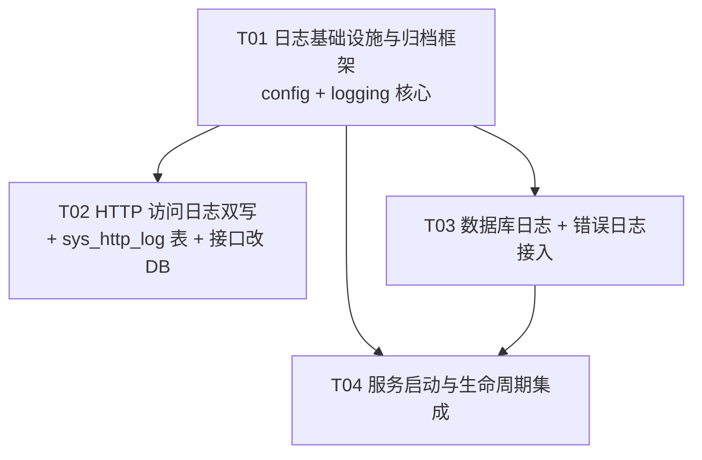

# 日志记录方案重构 · 系统设计说明书

> 作者：架构师 高见远（Gao）｜ 团队：software-lyadmin-logging ｜ 版本：v1.0
> 范围：仅后端 `api/`（Express + TypeScript + Sequelize + MySQL）。目标 **前端零改动**。
> 关联图：`docs/logging-class-diagram.mermaid`、`docs/logging-sequence-diagram.mermaid`

---

## 0. 需求 → 设计结论速查

| #   | 需求                                                | 设计结论                                                                                                  |
| --- | --------------------------------------------------- | --------------------------------------------------------------------------------------------------------- |
| 1   | 按天拆分日志，文件名 `2026-9-24.log`（月/日不补零） | 目录 `logs/<type>/`，文件名 `YYYY-M-D.log`（不补零）；内部另存规范键 `YYYY-MM-DD`（补零）用于排序/比较    |
| 2   | 启动时 + 每天定时，把昨日日志压缩为 `.tar.gz`       | `logs/archive/<type>/2026-9-24.tar.gz`；启动补跑 + 每日 00:05 自调度；幂等（已存在则跳过）                |
| 3   | 新增 db / error 日志                                | db 接 Sequelize `logging` 钩子；error 接 `errorHandler` + 进程级 `unhandledRejection`/`uncaughtException` |
| 4   | 「清空日志」只清 DB，不删物理文件                   | 访问日志**双写**：① 物理文件（留痕，永不被按钮删除）② `sys_http_log` 表；清空 = 只 `TRUNCATE` 表          |

**依赖选型结论：不新增任何 npm 依赖。** 归档用系统 `tar`（Git Bash / Win10+ System32 均有，`-czf` 通用）；定时用自研 `setTimeout` 自调度；日期用既有 `dayjs`。理由见 §1。

---

# Part A · 系统设计

## 1. 实现方案总览

### 1.1 核心难点

1. **按天切分且跨天自动换文件**（进程可能连续运行数天）——单例「日志管理器」按**每次写入时的当前本地日期**取流，天然跨天切换。
2. **Windows 下文件句柄泄漏**——写流按 `type + dateKey` 缓存；跨天时关闭旧流；归档前显式关闭对应日期的流，避免 `tar` 读不到/占用。
3. **归档的跨平台与幂等**——系统 `tar` 无依赖；「归档已存在则跳过」保证 nodemon 频繁重启/重复启动不重复归档。
4. **访问日志双写且清空语义分离**——文件与 DB 各司其职；清空只作用于 DB。
5. **DB 日志不得递归**——SQL 日志只写文件、不写 DB，故不会自触发。

### 1.2 选型

| 关注点         | 选型                                             | 理由                                                                                                                                                              |
| -------------- | ------------------------------------------------ | ----------------------------------------------------------------------------------------------------------------------------------------------------------------- |
| 归档压缩       | **系统 `tar`（`child_process.execFile`）**       | 零新依赖；Git Bash GNU tar 1.35 与 Win10+ bsdtar 均支持 `-czf`；`execFile` 传参数组避免 shell 注入与引号问题。抽象在 `archiver.ts` 内，日后可一行切换为 npm `tar` |
| 定时           | **自研 setTimeout 自调度**                       | 需求仅「每天一次」，无需引入 `node-cron`；自调度每次重算到 00:05 的延迟，规避 DST/时钟漂移                                                                        |
| 日期计算       | **既有 `dayjs`**                                 | 项目已有依赖，避免 `new Date` 手算的时区坑                                                                                                                        |
| 数据库日志     | **Sequelize `logging` 钩子 + `benchmark: true`** | 数据库配置已有该钩子（当前是 console.log），天然切入点；`benchmark` 提供耗时                                                                                      |
| 访问日志持久化 | **新增表 `sys_http_log`**                        | 解决「文件越来越大、每次全文件解析」的性能问题；支持 DB 分页/筛选                                                                                                 |

**为何不用 npm `tar` / `node-cron`：** 两者均可用，但引入即多 2 个依赖与其传递依赖；本项目依赖极简（仅 13 个运行时依赖），且系统 tar 在本项目目标环境（Windows 开发 + Linux 部署）均可用。保持「零新依赖」收益更大。

### 1.3 架构模式

沿用项目既有 **Controller → Service → Model** 分层 + 中间件。新增一个 `src/logging/` 领域目录承载「日志基础设施」，对上层暴露稳定的函数式 API；`utils/logger.ts` 保留为「HTTP 访问日志中间件 + getClientIp」的对外入口。

---

## 2. 文件清单

### 2.1 新增文件

| 相对路径                                | 职责                                                                                                                     |
| --------------------------------------- | ------------------------------------------------------------------------------------------------------------------------ |
| `api/src/logging/types.ts`              | 日志类型枚举与全部记录/DTO 类型（AccessLogRecord / DbLogRecord / ErrorLogRecord / HttpLogItem / HttpLogQuery / LogType） |
| `api/src/logging/logManager.ts`         | 单例日志管理器：日期键计算、目录/文件名、按天写入流缓存与跨天切换、关流                                                  |
| `api/src/logging/archiver.ts`           | 归档器：扫描昨日及更早的 `.log`，用系统 `tar` 压成 `.tar.gz`，幂等                                                       |
| `api/src/logging/scheduler.ts`          | 调度器：启动补跑归档 + 每日 00:05 自调度 + 停止                                                                          |
| `api/src/logging/errorReporter.ts`      | 错误上报：把业务异常/进程级异常写入 error 日志（含请求上下文）                                                           |
| `api/src/logging/httpLogStore.ts`       | HTTP 访问日志存储：DB 写入 / 分页查询 / 清空（唯一持有 `HttpLog` 模型的日志模块，避免循环依赖）                          |
| `api/src/logging/index.ts`              | 领域出口 barrel，统一导出上述模块                                                                                        |
| `api/src/logging/processHandlers.ts`    | 进程级异常处理：注册 `unhandledRejection` / `uncaughtException`                                                          |
| `api/src/models/HttpLog.ts`             | 新模型 `sys_http_log`（HTTP 访问日志表）                                                                                 |
| `docs/logging-sequence-diagram.mermaid` | 本方案时序图（已生成）                                                                                                   |
| `docs/logging-class-diagram.mermaid`    | 本方案类图（已生成）                                                                                                     |

### 2.2 修改文件

| 相对路径                              | 改动点                                                                                                                                                                             |
| ------------------------------------- | ---------------------------------------------------------------------------------------------------------------------------------------------------------------------------------- |
| `api/src/config/index.ts`             | 新增 `config.log` 配置块（归档目录、归档时刻、慢 SQL 阈值、是否保留源文件等）                                                                                                      |
| `api/src/config/database.ts`          | `logging` 钩子改为写入 db 日志管理器；开启 `benchmark: true` 以拿到耗时                                                                                                            |
| `api/src/utils/logger.ts`             | 保留 `getClientIp` / `httpAccessLogger`；`finish` 时改为**双写**（文件 + DB）；移除 `ACCESS_LOG_FILE` / `clearAccessLog` / `readHttpLogs` / `HttpLogRecord`（迁移到 logging 模块） |
| `api/src/services/log.service.ts`     | `listHttpLogs` 改查 DB、`clearHttpLogs` 改清 DB；`HttpLogItem` 类型改从 `logging/types` 引入并再导出                                                                               |
| `api/src/middlewares/errorHandler.ts` | 5xx / 未捕获异常写入 error 日志（保留 `console.error`）                                                                                                                            |
| `api/src/server.ts`                   | 启动时 `startLogScheduler()`；注册进程级异常处理；`SIGINT/SIGTERM` 优雅退出（关流 + 停调度）                                                                                       |
| `api/src/models/index.ts`             | 注册 `HttpLog` 到 `models` 数组（`sequelize.sync()` 自动建表）                                                                                                                     |
| `api/.env.example` / `api/.env`       | 追加可选环境变量（见 §6）                                                                                                                                                          |

> **不改动**：`log.routes.ts`、`log.controller.ts`、`app.ts`（访问日志中间件调用签名不变）、前端全部文件。

---

## 3. 数据结构与接口

### 3.1 类图

见 `docs/logging-class-diagram.mermaid`。核心关系：`LogScheduler → Archiver → LogManager`；`LogService → HttpLogStore → HttpLog`；`ErrorReporter → LogManager`。

### 3.2 数据库表 `sys_http_log`（DDL 级）

```sql
CREATE TABLE `sys_http_log` (
  `id`          BIGINT UNSIGNED   NOT NULL AUTO_INCREMENT COMMENT '主键',
  `time`        DATETIME(3)       NOT NULL                COMMENT '请求完成时间（本地时区 +08:00）',
  `method`      VARCHAR(10)       NOT NULL                COMMENT 'HTTP 方法',
  `url`         VARCHAR(1024)     NOT NULL                COMMENT '请求 URL（含 query）',
  `status_code` SMALLINT UNSIGNED NOT NULL                COMMENT 'HTTP 状态码',
  `duration`    INT UNSIGNED      NOT NULL DEFAULT 0      COMMENT '耗时 ms',
  `ip`          VARCHAR(64)       NULL                    COMMENT '客户端 IP',
  `user_agent`  VARCHAR(500)      NULL                    COMMENT 'User-Agent',
  `query`       JSON              NULL                    COMMENT '查询参数（已脱敏）',
  `req_body`    TEXT              NULL                    COMMENT '请求体（已脱敏、截断 2KB）',
  `res_body`    TEXT              NULL                    COMMENT '响应内容（截断 2KB；二进制为占位）',
  PRIMARY KEY (`id`),
  KEY `idx_time` (`time`),
  KEY `idx_method` (`method`),
  KEY `idx_status_code` (`status_code`),
  KEY `idx_method_time` (`method`, `time`)
) ENGINE=InnoDB DEFAULT CHARSET=utf8mb4 COLLATE=utf8mb4_general_ci COMMENT='HTTP 访问日志表';
```

**建模要点（沿用项目既有约定）**

- 用 `sequelize-typescript` 装饰器；`@Table({ tableName:'sys_http_log', underscored:true, timestamps:false, comment:'HTTP 访问日志表' })`。
- `timestamps: false`（与 `LoginLog` 一致）：记录时间用业务字段 `time`，不再重复 `created_at`。
- `id`：`@PrimaryKey @AutoIncrement @Column({ type: DataType.BIGINT.UNSIGNED })`。
- `time`：`DataType.DATE(3)`（毫秒精度）；全局 Sequelize 已设 `timezone:'+08:00'`。
- `statusCode` → 列 `status_code`（underscored 自动映射）；`userAgent` → `user_agent`。
- `query`：`DataType.JSON`（MySQL JSON 列，读回自动反序列化为对象，前端拿到即对象）。
- `reqBody`/`resBody`：`DataType.TEXT`。
- 索引：`@Table` 内 `indexes` 声明 `idx_time`、`idx_method`、`idx_status_code`、`idx_method_time`（时间倒序分页 + method/status/时间范围筛选）。
- **建表方式**：沿用 `syncDatabase()` 的 `sequelize.sync({ alter:false })` —— 只需把 `HttpLog` 加入 `models/index.ts` 的 `models` 数组，下次启动自动建表，无需手写迁移。

### 3.3 关键 TypeScript 类型（`api/src/logging/types.ts`）

```ts
export type LogType = 'access' | 'db' | 'error';

/** 访问日志记录（写入物理文件的 JSON Lines 结构，字段名沿用现状） */
export interface AccessLogRecord {
  time: string; // ISO 8601 UTC，如 2026-09-24T01:23:45.678Z
  method: string;
  url: string;
  status: number;
  responseTime: number; // ms
  ip: string;
  userAgent: string;
  query?: Record<string, unknown>;
  reqBody?: string;
  resBody?: string;
}

/** 数据库日志记录 */
export interface DbLogRecord {
  time: string;
  sql: string;
  durationMs: number;
  slow: boolean;
}

/** 错误日志记录 */
export interface ErrorLogRecord {
  time: string;
  level: 'error' | 'warn';
  message: string;
  stack?: string;
  method?: string;
  url?: string;
  ip?: string;
  userId?: number | null;
  statusCode?: number;
}

/** 对外 API 契约（与前端 HttpLog 对齐，字段不变） */
export interface HttpLogItem {
  id: number;
  time: string; // ISO 字符串
  method: string;
  url: string;
  statusCode: number;
  duration: number;
  ip: string;
  userAgent: string;
  query?: Record<string, unknown> | null;
  reqBody?: string | null;
  resBody?: string | null;
}

export interface HttpLogQuery {
  page: number;
  pageSize: number;
  method?: string;
  statusCode?: number;
  startTime?: string;
  endTime?: string;
}

export interface ArchiveResult {
  type: LogType;
  dateKey: string; // 规范键 YYYY-MM-DD
  status: 'archived' | 'skipped' | 'failed';
  archivePath?: string;
  message?: string;
}
```

### 3.4 日志管理器 API（`api/src/logging/logManager.ts`）

```ts
/** 目录：logs/<type>/（绝对路径），不存在则递归创建 */
export function getLogDir(type: LogType): string;

/** 文件名（用户要求：月/日不补零）→ "2026-9-24.log" */
export function dailyLogFileName(date: Date): string;

/** 当日日志文件绝对路径 → logs/<type>/2026-9-24.log */
export function dailyLogPath(type: LogType, date: Date): string;

/** 归档文件绝对路径 → logs/archive/<type>/2026-9-24.tar.gz */
export function archiveLogPath(type: LogType, date: Date): string;

/**
 * 写入一条日志（JSON Lines）。内部按“写入时的本地日期”取/建流，
 * 跨天自动切换新文件并关闭旧流。任何异常仅 console.error，不抛出。
 */
export function writeLog(type: LogType, record: AccessLogRecord | DbLogRecord | ErrorLogRecord): void;

/** 关闭某类型某天的写入流（归档前调用，幂等；未打开则 no-op） */
export function closeStream(type: LogType, date: Date): Promise<void>;

/** 关闭全部写入流（优雅退出用） */
export function closeAllStreams(): Promise<void>;
```

**内部实现要点**

- 私有 `const streams = new Map<string, fs.WriteStream>()`，key = `${type}|${dateKey(padded)}`。
- 私有 `const currentKeys: Record<LogType, string>` 记录各类型当前活跃的 dateKey。
- `writeLog`：先 `const date = new Date()` 取**本地日期** → `dateKey`；若 `currentKeys[type] !== dateKey`，`await` 关闭旧流（`end` 回调）并更新指针；再 `getStream` 取/建新流并 `write(JSON.stringify(record) + '\n')`。
- `getStream`：`fs.mkdirSync(dir, {recursive:true})`；`fs.createWriteStream(path, {flags:'a'})`；绑定 `stream.on('error', ...)` → `console.error` 并 `streams.delete(key)`（下次写入自动重建）。
- 规范键函数 `dateKey(date) => dayjs(date).format('YYYY-MM-DD')`（补零，仅内部使用）。

### 3.5 归档器 API（`api/src/logging/archiver.ts`）

```ts
/** 归档所有“日期 < 今天”的日志文件（启动补跑 + 每日定时共用） */
export async function archivePastLogs(): Promise<ArchiveResult[]>;

/** 归档指定日期的日志（供测试/手动触发） */
export async function archiveForDate(date: Date): Promise<ArchiveResult[]>;
```

**实现要点**

- 对每种 `LogType`：`fs.readdirSync(logs/<type>/)`，用 `/^(\d{4})-(\d{1,2})-(\d{1,2})\.log$/` 匹配；解析出 `dateKey`；仅处理 `dateKey < todayKey` 的文件（今天正在写的不动）。
- 目标 `archiveLogPath(type, date)`；**若已存在则 `skipped`**（幂等，nodemon 重启不重复归档）。
- 归档前 `await closeStream(type, date)` 释放句柄。
- 用 `promisify(execFile)`：`execFile(TAR_BIN, ['-czf', dest, '-C', srcDir, fileName], { windowsHide:true })`；`TAR_BIN = process.env.TAR_BIN ?? 'tar'`。
- 成功后按 `config.log.keepSourceAfterArchive` 决定是否 `fs.unlinkSync(src)`（默认删除，见 §5 待明确）。
- 失败：记 `status:'failed'` + `console.error`，**不抛**（不阻断启动）。

### 3.6 调度器 API（`api/src/logging/scheduler.ts`）

```ts
export function startLogScheduler(): void; // 启动补跑 + 每日自调度
export function stopLogScheduler(): void; // 清定时器
```

**实现要点**

- `startLogScheduler()`：① 立即 `void archivePastLogs().catch(console.error)`（启动补跑）；② `scheduleNext()`。
- `scheduleNext()`：`dayjs()` 计算到「次日 `config.log.archiveHour:archiveMinute`（默认 00:05）」的毫秒数 → `timer = setTimeout(() => { void archivePastLogs()...; scheduleNext(); }, ms)`。
- `stopLogScheduler()`：`clearTimeout(timer)`。

### 3.7 错误上报 API（`api/src/logging/errorReporter.ts`）

```ts
export interface ErrorContext {
  method?: string;
  url?: string;
  ip?: string;
  userId?: number | null;
  statusCode?: number;
}
/** 业务异常上报（errorHandler 调用） */
export function reportError(err: unknown, ctx?: ErrorContext): void;
/** 进程级异常上报（unhandledRejection / uncaughtException） */
export function reportProcessError(kind: 'unhandledRejection' | 'uncaughtException', err: unknown): void;
```

### 3.8 存储层 API（`api/src/logging/httpLogStore.ts`）

```ts
export async function appendHttpLog(record: AccessLogRecord): Promise<void>; // DB 写入，吞异常
export async function queryHttpLogs(query: HttpLogQuery): Promise<PageResult<HttpLogItem>>;
export async function clearHttpLogsDb(): Promise<void>; // TRUNCATE sys_http_log
```

### 3.9 改造后的 `httpAccessLogger`（`api/src/utils/logger.ts`）

签名不变：`export function httpAccessLogger(): RequestHandler`。`res.on('finish')` 内改为：

```ts
const record: AccessLogRecord = {/* 现有字段组装逻辑完全保留 */};
writeLog('access', record); // ① 物理文件（JSON Lines，按天）
void appendHttpLog(record); // ② DB（fire-and-forget，不影响响应）
```

> `/api/logs/*` 跳过响应体的既有逻辑保留。移除 `readHttpLogs` / `clearAccessLog` / `ACCESS_LOG_FILE`（改由 DB + 归档模块承担）。

### 3.10 改造后的服务层（`api/src/services/log.service.ts`）

```ts
export async function listHttpLogs(query: Record<string, unknown>): Promise<PageResult<HttpLogItem>> {
  return queryHttpLogs({
    page,
    pageSize, // 来自 parsePagination
    method: typeof query.method === 'string' ? query.method : undefined,
    statusCode: query.statusCode !== undefined && query.statusCode !== '' ? Number(query.statusCode) : undefined,
    startTime: typeof query.startTime === 'string' ? query.startTime : undefined,
    endTime: typeof query.endTime === 'string' ? query.endTime : undefined,
  });
}

export async function clearHttpLogs(): Promise<void> {
  await clearHttpLogsDb(); // 仅清 DB，物理文件不动
}
```

`queryHttpLogs` 内部：`where.method = method.toUpperCase()`；`where.statusCode = statusCode`；时间范围复用现有 `buildDateRange` 思路（`Op.gte`/`Op.lte`）；`order: [['time','DESC'],['id','DESC']]`；`findAndCountAll` + `buildPageResult`；`row.time` 用 `toISOString()` 输出。

---

## 4. 调用流程

见 `docs/logging-sequence-diagram.mermaid`（含 ① 请求双写 ② 启动/定时归档 ③ 查询 ④ 清空 四张时序图）。

关键边界（工程师必须实现）：

- **跨天切换**：`writeLog` 每次按当前日期取流 → 午夜后首条写入即自动开新文件并关旧流，无需定时器。
- **归档边界**：每日 00:05 触发；此时「昨日」文件因已跨天而停止写入，且归档前再 `closeStream` 兜底（进程若整夜无请求，昨日流可能仍开着）。
- **幂等**：目标 `.tar.gz` 已存在即跳过；启动补跑覆盖「停机跨天/多天」场景（扫描所有 `< 今天` 的文件）。
- **写失败隔离**：文件写、DB 写、归档全部 try/catch，失败仅 `console.error`。

---

## 5. Anything UNCLEAR（待明确，不阻塞开工）

1. **归档后是否删除源 `.log`**：需求「压缩为 .tar.gz 归档」通常含「压缩后删除原件以省空间」。**默认：压缩成功后删除源文件**（`LOG_ARCHIVE_KEEP_SOURCE=false`）；若希望保留原件，置 `true`。→ 请主理人确认。
2. **旧文件 `api/logs/access.log`（约 60KB）如何处置**：新 UI 读 DB，DB 初始为空，旧文件内容不会出现在页面。**默认：原样保留、不动、不迁移**（不违反「不删物理文件」精神）。如需延续历史可见性，可加一次性导入脚本（把 JSON Lines 灌入 `sys_http_log`）——**建议列为后续可选，不在本次范围**。
3. **归档是否覆盖已有同名归档**：默认「已存在即跳过」（幂等优先）。若某天源文件在归档后又被追加（正常不会，因跨天已换文件），不会重新归档。→ 确认可接受。
4. **db 日志是否记录所有 SQL**：默认 `DB_LOGGING=true` 时记录全部 SQL 并标注慢查询；`sys_http_log` 的 INSERT 自身也会被记录一条（无递归，仅噪音）。如需过滤，可加忽略名单——默认不做。

---

# Part B · 任务分解

## 6. 依赖包列表

**新增依赖：无。** 全部复用现有依赖与系统能力：

| 能力        | 使用                                   | 来源                                               |
| ----------- | -------------------------------------- | -------------------------------------------------- |
| 日期计算    | `dayjs@^1.11.23`                       | 既有运行时依赖                                     |
| 压缩归档    | 系统 `tar`（`child_process.execFile`） | Node 内置 + 系统命令（Git Bash / Win10+ System32） |
| 定时        | `setTimeout` 自调度                    | Node 内置                                          |
| DB 日志钩子 | Sequelize `logging` + `benchmark`      | 既有 `sequelize@^6.37.8`                           |
| 文件 IO     | `fs`                                   | Node 内置                                          |

**新增环境变量（`api/.env.example` / `.env`，均有默认值、可选）**

```
# 归档时刻（本地时间，默认次日 00:05 归档昨日）
LOG_ARCHIVE_HOUR=0
LOG_ARCHIVE_MINUTE=5
# 归档成功后是否保留源 .log（默认 false=删除）
LOG_ARCHIVE_KEEP_SOURCE=false
# 慢 SQL 阈值（ms）
LOG_SLOW_SQL_MS=200
# 自定义 tar 可执行文件（默认 PATH 中的 tar）
# TAR_BIN=tar
```

> `DB_LOGGING` 语义更新：`true` → SQL 写入 `logs/db/`（原为 console 打印）。

## 7. 任务列表（≤5，按依赖排序）

### T01 · 日志基础设施与归档框架 【P0】

- **源文件**：`api/src/config/index.ts`（新增 `config.log`）、`api/src/logging/types.ts`、`api/src/logging/logManager.ts`、`api/src/logging/archiver.ts`、`api/src/logging/scheduler.ts`
- **依赖**：无
- **内容**：实现 §3.3–3.6 全部类型与函数；`config.log` 含 `archiveDir / archiveHour / archiveMinute / keepSourceAfterArchive / slowSqlMs`。此任务为后续一切的地基。

### T02 · HTTP 访问日志双写 + 数据表 + 接口改走 DB 【P0】

- **源文件**：`api/src/models/HttpLog.ts`、`api/src/models/index.ts`、`api/src/logging/httpLogStore.ts`、`api/src/utils/logger.ts`、`api/src/services/log.service.ts`
- **依赖**：T01
- **内容**：建 `sys_http_log` 模型并注册（自动建表）；`appendHttpLog/queryHttpLogs/clearHttpLogsDb`；`httpAccessLogger` 双写；`listHttpLogs`→DB、`clearHttpLogs`→只清 DB。**前端零改动**。

### T03 · 数据库日志 + 错误日志接入 【P0】

- **源文件**：`api/src/config/database.ts`、`api/src/middlewares/errorHandler.ts`、`api/src/logging/errorReporter.ts`
- **依赖**：T01
- **内容**：Sequelize `logging` 钩子写 `logs/db/`（含 `benchmark` 耗时与慢 SQL 标记）；`errorHandler` 对 5xx/未捕获异常写 `logs/error/`（保留 `console.error`）。

### T04 · 服务启动与生命周期集成 【P0】

- **源文件**：`api/src/server.ts`、`api/src/logging/index.ts`、`api/src/logging/processHandlers.ts`
- **依赖**：T01、T03
- **内容**：`bootstrap` 中 `startLogScheduler()`；注册 `unhandledRejection`/`uncaughtException`→error 日志（`uncaughtException` 记录后 `process.exit(1)`）；`SIGINT/SIGTERM` → `closeAllStreams()` + `stopLogScheduler()` 后退出；barrel 统一导出。

> 并行度：T02、T03 均只依赖 T01，可并行；T04 收口。T02 是需求 1/2/4 的主线，T03 是需求 3 的主线。

## 8. Shared Knowledge（跨文件约定）

- **日期键（内部规范）**：`YYYY-MM-DD`（补零），用于排序、比较、Map key。**禁止**对文件名做字符串排序/比较（`2026-9-24` vs `2026-10-2` 会错序）。
- **文件名（对外展示）**：`YYYY-M-D.log`（**月/日不补零**，严格按用户要求）。归档名 `YYYY-M-D.tar.gz`。
- **时区**：日切与「昨天」均按**服务器本地时区（Asia/Shanghai, +08:00）**；记录内 `time` 字段为 **ISO 8601 UTC**（与现状一致）。
- **日志行格式**：JSON Lines（一行一个 JSON 对象），UTF-8。
- **统一响应体**：`{ code, data, message }`（既有约定，HTTP 日志接口保持不变）。
- **日志写失败绝不影响业务**：文件写 / DB 写 / 归档全部 try/catch，仅 `console.error`。
- **不新增 npm 依赖**；归档二进制可用 `TAR_BIN` 覆盖。
- **前端零改动**：`GET/DELETE /api/logs/http` 路径、权限码（`log:http:list`）、分页与筛选参数、返回字段（`time/method/url/statusCode/duration/ip/query/reqBody/resBody`）全部保持不变。
- **DB 日志无递归**：SQL 日志只写文件，不写 DB。
- **表命名**：`sys_` 前缀；列 `snake_case`（`underscored:true` 自动映射）；主键 `BIGINT UNSIGNED` 自增。

## 9. 任务依赖图


